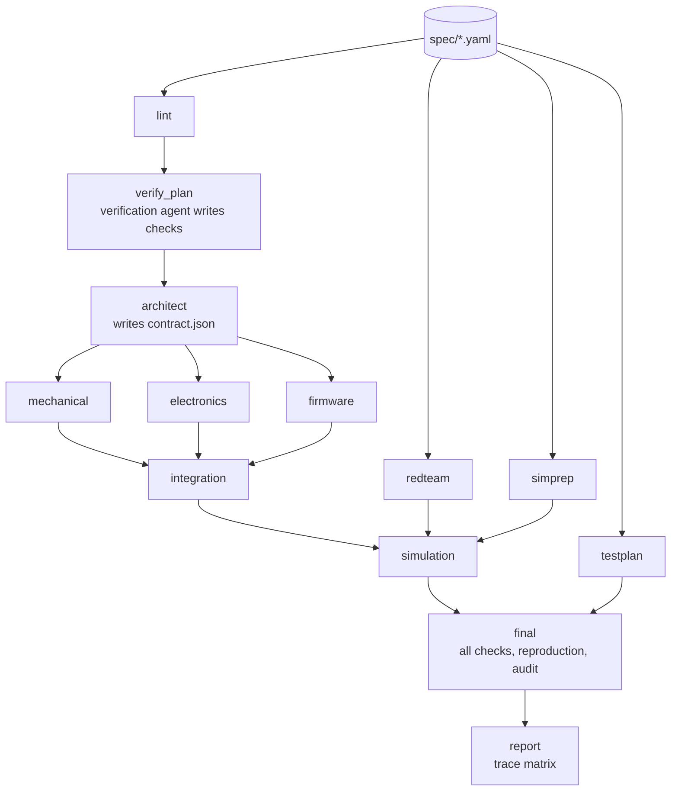

# Engenia: Project Plan, Roles and Environment

Night build, Friday 13 November 2026. Three people, seven agent seats.

This file is the single reference for the whole project. Each person has two files of their own: `<NAME>-PLAN.md` (what to complete) and `<NAME>-PROMPTS.md` (the prompts to paste). The deep design is in `engenia-technical-implementation-plan.md`.

---

## 1. What we are building

Engenia takes a written product request and produces a verified design: requirements, CAD, electronics, firmware, simulation results and a trace report. When a requirement changes, only the affected parts rebuild.

Five rules that must not be broken tonight:

1. One spec per project is the only source of truth.
2. Agents write code. Scripts decide pass or fail.
3. Design agents run in parallel and coordinate only through the contract board.
4. Verification happens before design, after each stage, at integration and at the end.
5. A rebuild from committed code gives identical files.

---

## 2. Pipeline in one picture



Stage names above are the exact names used in code.

---

## 3. People, seats and ownership

| Person | Seat ID | Agent | Lane |
|---|---|---|---|
| P3 Timothy (integrator) | T1 | Claude A | Core |
| P3 Timothy | T2 | Claude B | Harness, agents, gate |
| P3 Timothy | T3 | Codex | Mechanical and integration |
| P3 Timothy | T4 | OpenCode | Independent agents and example specs |
| P1 | A1 | Codex | Electronics and firmware |
| P1 | A2 | OpenCode | Checks and evidence |
| P2 | B1 | OpenCode | Infrastructure, then simulation |

### Folder ownership

A seat may only create or edit files inside its own folders. This is what makes parallel work safe.

| Folder | Owner seat |
|---|---|
| `engenia/core/` | T1 |
| `engenia/contracts/` (schemas) | T1, changes only with Timothy's approval |
| `engenia/harness/`, `engenia/agents/intake/`, `engenia/agents/architect/`, `engenia/agents/verification/`, `engenia/gate/` | T2 |
| `engenia/agents/mechanical/`, `packs/buoy/templates/`, `engenia/stages/integration/` | T3 |
| `engenia/agents/redteam/`, `engenia/agents/testplan/`, `projects/*/spec/` | T4 |
| `engenia/agents/electronics/`, `engenia/agents/firmware/`, `packs/buoy/parts/` | A1 |
| `verifiers/`, `evals/faults/`, `engenia/evidence/` | A2 |
| `containers/`, `infra/`, `.github/`, `engenia/sim/`, `packs/buoy/sim/` | B1 |
| `tests/<lane>/` | Same seat as the lane |

### What each person is responsible for

**P3 Timothy**

- Runs step 0 and freezes the contracts.
- Supervises T1 to T4.
- Is the only person who merges pull requests and the only person who approves schema changes.
- Calls each merge window and decides cuts.

**P1**

- Supervises A1 and A2.
- Delivers a working electronics and firmware stage, and every check script the gate calls.
- Owns the fault suite: planted defects must all be caught.

**P2**

- Supervises B1.
- Creates the cloud machine, containers and CI before anything else.
- Runs every exit test by hand at each merge window and reports pass or fail.
- Delivers the simulation stage in sprints 2 and 3.

---

## 4. Technology decisions (fixed, do not change tonight)

| Area | Choice |
|---|---|
| Language | Python 3.12 |
| Package manager | `uv` |
| Data models | Pydantic v2 |
| CLI | Typer, command name `engenia` |
| Tests and lint | `pytest`, `ruff` |
| CAD | `build123d`, export STEP and STL |
| Electronics | SKiDL to a KiCad netlist, plus a `facts.toml` for parts |
| Firmware | PlatformIO, `native` environment for compile and unit tests |
| Wave simulation | Capytaine |
| Structure simulation | gmsh mesh, CalculiX solver |
| Flow simulation | OpenFOAM template (slot tonight) |
| Containers | Docker, images referenced by digest |
| Run state | SQLite file in sprint 1 and 2, resumable runs in sprint 3 |
| Model access | OpenAI-compatible HTTP client, configured by environment variables |

### Environment variables

Put these in `.env` in the main repository folder. Never commit `.env`.

```
ENGENIA_LLM_BASE_URL=        # OpenAI-compatible endpoint
ENGENIA_LLM_API_KEY=
ENGENIA_DESIGN_MODEL=        # model used by design agents
ENGENIA_VERIFY_MODEL=        # must be a different model family
ENGENIA_MAX_ATTEMPTS=3
ENGENIA_STORE=.engenia/store    # content-addressed outputs
ENGENIA_RUNNER=local         # local | docker
```

---

## 5. Repository layout

```
engenia/
  contracts/        models.py  (frozen schemas)
  core/             spec.py lint.py graph.py hashing.py cache.py
                    scheduler.py contract_board.py runstate.py cli.py
  harness/          llm.py loop.py tools.py limits.py
  agents/
    intake/ architect/ verification/ mechanical/
    electronics/ firmware/ redteam/ testplan/
  stages/           base.py  registry.py  integration/
  gate/             gate.py audit.py
  evidence/         matrix.py ledger.py
  sim/              simprep.py simulation.py sanity.py
verifiers/          one file per check
packs/buoy/         templates/ parts/ sim/ pack.yaml
containers/         cad/ eda/ firmware/ sim/
infra/              vm_bootstrap.sh runner_setup.md
evals/faults/       planted defects
projects/
  harbour-listener/
    spec/           R-001.yaml ...
    checks/         checks.yaml (approved, hashed)
    contract/       contract.json  change_requests/
    src/<stage>/    agent-written code, committed
    build/<stage>/  outputs, interface.json, verdict.json (not committed)
tests/<lane>/
.superset/          config.json setup.sh teardown.sh
.github/workflows/  ci.yml
AGENTS.md           rules every coding agent reads first
PROJECT.md  engenia-technical-implementation-plan.md
TIMOTHY-PLAN.md TIMOTHY-PROMPTS.md PERSON1-PLAN.md PERSON1-PROMPTS.md
PERSON2-PLAN.md PERSON2-PROMPTS.md
```

---

## 6. Frozen contracts

These are written in step 0 in `engenia/contracts/models.py`. After the step 0 merge they change only through Timothy.

### Requirement (`projects/<p>/spec/R-xxx.yaml`)

| Field | Type | Rule |
|---|---|---|
| `id` | string | `R-` plus three digits, matches file name |
| `statement` | string | One obligation, contains "shall" |
| `value` | number or null | Required unless method is `inspection` |
| `unit` | string or null | Required when `value` is set |
| `verify.method` | enum | `inspection`, `analysis`, `simulation`, `test` |
| `verify.check` | string | Name of a file in `verifiers/` |
| `verify.limit` | object | Any of `min`, `max`, `equals` |
| `affects` | list of stage names | At least one |
| `status` | enum | `draft`, `approved` |
| `origin` | enum | Optional: `user` (default), `derived` |
| `reason` | string or null | Optional derivation reason; defaults to `null` |

### Contract (`projects/<p>/contract/contract.json`)

```json
{
  "version": 1,
  "budgets": {
    "mechanical":  {"mass_g": 300, "outer_envelope_mm": [160, 160, 220]},
    "electronics": {"mass_g": 60, "bay_mm": [70, 40, 22], "energy_mwh_per_day": 180},
    "firmware":    {"flash_kb": 512, "ram_kb": 64}
  },
  "interfaces": {
    "pin_map": {"HYDROPHONE_ADC": "GPIO34", "LORA_CS": "GPIO5"},
    "mounts":  {"board_holes_mm": [[3, 3], [67, 3], [3, 37], [67, 37]]}
  },
  "totals": {"mass_g_max": 400}
}
```

### Change request (`projects/<p>/contract/change_requests/CR-xxx.json`)

```json
{"id": "CR-001", "from_stage": "electronics", "path": "budgets.electronics.bay_mm",
 "requested": [70, 40, 26], "reason": "battery height 24 mm", "status": "open"}
```

Status values: `open`, `accepted`, `rejected`.

### Interface (`build/<stage>/interface.json`)

```json
{"stage": "mechanical", "key": "sha256:...", "facts": {"dry_mass_g": 318.4}}
```

### Verdict (`build/<stage>/verdict.json`, a list)

```json
{"check": "buoyancy_margin", "requirement": "R-005", "measured": 0.27,
 "limit": {"min": 0.20}, "result": "pass", "evidence_level": "calculated",
 "artifact": "sha256:...", "message": null}
```

`result` is `pass`, `fail` or `error`. `evidence_level` is `calculated`, `simulated` or `measured`.

`message` is an optional human-readable reason, used for `fail` and `error` results. `requirement` is optional: `null` means an internal consistency check not tied to one requirement, such as an integration check or the gate canary.

`margin_pct` is an optional number, defaulting to `null`: distance to the limit as a
percentage of the limit. It is `null` for errors, checks that did not run, or when
the percentage is undefined.

### Stage contract (`engenia/stages/base.py`)

Every stage implements this. Step 0 ships a stub for each stage.

```python
class Stage(Protocol):
    name: str                 # exact stage name from section 2
    needs: list[str]          # upstream stage names
    reads_contract: bool
    checks: list[str]         # verifier names run after build

    def generate(self, ctx: StageContext) -> None: ...   # agent writes src/<stage>/
    def build(self, ctx: StageContext) -> None: ...      # deterministic, no model calls
    def interface(self, ctx: StageContext) -> dict: ...  # facts for later stages
```

### Verifier contract (`verifiers/<name>.py`)

```python
def run(ctx: CheckContext) -> Verdict: ...
```

A verifier reads files only. It never calls a model and never writes outside `build/`.

### Check plan (`projects/<p>/checks/checks.yaml`)

```yaml
- id: C-005
  requirement: R-005
  check: buoyancy_margin
  params: {water_density_kg_m3: 1005}
  limit: {min: 0.20}
```

### CLI commands (exact)

| Command | Does |
|---|---|
| `engenia lint <project>` | Validates and lints the spec |
| `engenia plan <project>` | Shows which stages will run and why |
| `engenia run <project>` | Runs the pipeline with parallel scheduling and cache |
| `engenia gate <project>` | Runs all checks, reproduction and coverage |
| `engenia matrix <project>` | Writes the trace matrix |
| `engenia status <project>` | Shows run state and open change requests |

---

## 7. Environment setup

Do these in order. Total time about 40 minutes if done in parallel by the three of you.

### 7.1 Accounts and access (all three, 5 minutes)

1. Timothy creates a private GitHub repository named `engenia`.
2. Timothy adds P1 and P2 as collaborators with write access.
3. Timothy turns on branch protection for `main`: pull request required, CI check required, no direct pushes.
4. Each person logs in to their agent command-line tools once in a normal terminal, so Superset finds them logged in:
   - Claude Code: run `claude` and sign in.
   - Codex: run `codex` and sign in.
   - OpenCode: run `opencode` and connect a provider.
5. Each person installs GitHub CLI and runs `gh auth login`.

### 7.2 Local tools on each Mac (10 minutes)

```bash
# Homebrew packages
brew install git gh uv

# Clone
git clone git@github.com:<owner>/engenia.git
cd engenia

# Python environment (after step 0 has added pyproject.toml)
uv sync
```

Docker is **not** needed on the laptops. Heavy builds run in CI on the cloud machine.

### 7.3 Superset on each Mac (10 minutes)

1. Install the Superset desktop app from `superset.sh` and sign in with your own Superset account.
2. Open the cloned `engenia` folder as a project.
3. Check that the three files below exist in the repository. Step 0 creates them. Superset runs the setup commands each time a workspace is created.

`.superset/config.json`

```json
{
  "setup": ["./.superset/setup.sh"],
  "teardown": ["./.superset/teardown.sh"]
}
```

`.superset/setup.sh`

```bash
#!/usr/bin/env bash
set -euo pipefail

echo "Workspace: ${SUPERSET_WORKSPACE_NAME:-unknown}"

# Share secrets from the main checkout. Never commit .env.
if [ -f "$SUPERSET_ROOT_PATH/.env" ]; then
  cp "$SUPERSET_ROOT_PATH/.env" .env
else
  echo "WARNING: no .env in $SUPERSET_ROOT_PATH"
fi

# Python environment for this worktree
uv sync

# Fast self-check so a broken workspace is obvious
uv run engenia --help >/dev/null && echo "engenia CLI ok"
uv run pytest -q tests/smoke || echo "WARNING: smoke tests failing"

echo "Workspace ready"
```

`.superset/teardown.sh`

```bash
#!/usr/bin/env bash
rm -rf .venv .engenia/store
```

Make both scripts executable once: `chmod +x .superset/setup.sh .superset/teardown.sh`.

4. Put your `.env` file in the main `engenia` folder (see section 4).

### 7.4 One workspace per task

For every task in your own prompts file:

1. Press Cmd+N for a new workspace.
2. Name the workspace exactly as the task's branch name, for example `t1-s1-core`.
3. Wait for "Workspace ready".
4. Open a terminal in that workspace and start the agent for that seat (`claude`, `codex` or `opencode`).
5. Paste the task prompt from `PROMPTS.md`.

Each workspace is its own git worktree and branch, so seats never overwrite each other.

If your Superset version offers remote hosts and the cloud machine is ready, you may create workspaces on it. Do not spend more than 20 minutes on this. Local workspaces are fine, because the agents only call cloud models and CI does the heavy builds.

### 7.5 Cloud machine (P2, 20 minutes, starts at 17:45)

1. Create one Linux machine: Ubuntu 24.04, 8 or more cores, 32 GB memory, 100 GB disk.
2. Run `infra/vm_bootstrap.sh` on it (written by seat B1 in sprint 1). It installs Docker, `uv`, `git` and the GitHub Actions runner.
3. Register the machine as a self-hosted runner for the `engenia` repository with the label `engenia-build`.
4. Add repository secrets: `ENGENIA_LLM_BASE_URL`, `ENGENIA_LLM_API_KEY`, `ENGENIA_DESIGN_MODEL`, `ENGENIA_VERIFY_MODEL`.
5. Set a spending alert and an automatic shutdown time on the cloud account.

### 7.6 `AGENTS.md` (created in step 0)

Every coding agent reads this file first. It contains the five rules from section 1, the folder ownership table, the frozen contracts and the finish steps from section 8. Step 0 also copies it to `CLAUDE.md` so Claude Code loads it automatically.

---

## 8. Git workflow

### Branch names

`<seat>-<sprint>-<short-name>`, lower case. Examples: `t1-s1-core`, `a1-s2-firmware`, `b1-s1-infra`.

### Finish steps for every task

The agent does steps 1 to 5. The person does step 6.

1. `uv run ruff check .` passes.
2. `uv run pytest tests/<lane> -q` passes.
3. `git status` shows changes only inside the seat's folders.
4. Commit with message `<seat>: <what changed>`.
5. `git push -u origin <branch>` then `gh pr create --fill --base main`.
6. Post the pull request link in the team chat and send it for review.

### Pull request description (use `--fill`, then edit)

```
Seat:
Task ID:
What it adds:
How to test: (exact commands)
Acceptance criteria met: (tick list from the task prompt)
Anything not done:
```

### Merge rule

Timothy merges a pull request only when all four are true:

- CI is green.
- The review (section 9) says "approve".
- Files changed are inside the seat's folders.
- The acceptance criteria in the prompt are all ticked.

Use squash merge. After every merge, each open workspace runs `git fetch origin && git rebase origin/main`.

---

## 9. Review by Claude

After a task is pushed, the pull request is sent to Claude in the planning chat for review.

**How to request a review**

1. Give Claude access to the repository once: tell it the repository name (`<owner>/engenia`).
2. For each pull request, send: `Review PR #<number>, task <task ID>`.

Claude cannot watch GitHub by itself. It reviews when asked.

**What Claude checks, in this order**

| # | Check | Fails if |
|---|---|---|
| 1 | Scope | Any file outside the seat's folders is changed |
| 2 | Contracts | A schema, stage name, CLI command or file path differs from section 6 |
| 3 | Rule 2 | Any pass or fail decision is made by a model call |
| 4 | Determinism | `build()` or a verifier calls a model, the network, the clock or random numbers without a fixed seed |
| 5 | Acceptance | Any criterion from the task prompt is not met by a test |
| 6 | Tests | Tests are missing, skipped, or only test the happy path |
| 7 | Secrets | Keys or `.env` content appear in the diff |
| 8 | Honesty | The description claims something the code does not do |

**What Claude returns**

- `approve`, or
- `changes needed` with a numbered list. Each item names the file, the line, the problem and the fix.

A pull request with `changes needed` goes back to the same seat with the list pasted in as the next prompt.

---

## 10. Timeline

| Time | Block | Exit test (run by P2) |
|---|---|---|
| 17:45 to 18:30 | Step 0, contract freeze | `uv run engenia run harbour-listener` passes with stub stages in CI |
| 18:30 to 21:00 | Sprint 1 | Each lane's own tests pass |
| 21:00 to 21:30 | Merge 1 | A real hull is generated, measured, and rebuilt with identical hashes |
| 21:30 to 23:30 | Sprint 2 | Each lane's own tests pass |
| 23:30 to 00:30 | Merge 2 | Three design agents run in parallel; one forced failure does not stop the others; an accepted change request reruns only affected stages |
| 00:30 to 03:00 | Sprint 3 | Each lane's own tests pass |
| 03:00 to 03:30 | Merge 3 | A run killed mid-way resumes and finishes |
| 03:30 to 06:00 | Proof | Same spec three times gives identical hashes; fault suite 100%; second project passes |

### Task list by seat and sprint

| Seat | Sprint 1 | Sprint 2 | Sprint 3 |
|---|---|---|---|
| T1 | `T1-S1` spec, lint, graph, hashing, cache | `T1-S2` parallel scheduler, contract board | `T1-S3` resumable runs, `engenia plan` and `status` |
| T2 | `T2-S1` harness, intake agent | `T2-S2` architect and verification agents, gate | `T2-S3` final audit, model-family guard |
| T3 | `T3-S1` mechanical stage | `T3-S2` integration stage | `T3-S3` second pack variant |
| T4 | `T4-S1` example spec, red-team agent | `T4-S2` test-plan agent | `T4-S3` second project spec |
| A1 | `A1-S1` electronics stage | `A1-S2` firmware stage | `A1-S3` firmware emulator slot, parts library growth |
| A2 | `A2-S1` level 1 verifiers | `A2-S2` fault suite, trace matrix | `A2-S3` assumption ledger, benchmark runner |
| B1 | `B1-S1` VM, containers, CI | `B1-S2` simprep and wave simulation | `B1-S3` structure simulation, flow template |

---

## 11. Rules for the night

1. **Only Timothy changes `engenia/contracts/`.** Anyone needing a change asks him. He makes it on `main` and tells everyone to rebase.
2. **Stay in your folders.** If a task needs something from another lane, call its interface or ask.
3. **Stubs before depth.** A thin stage that keeps its contract is better than a deep one that breaks it.
4. **Every pull request passes CI.** No exceptions late at night.
5. **30-minute stop rule.** A lane blocked for 30 minutes is taken over by hand or cut to a stub.
6. **No silent cuts.** Anything not done is written in the pull request and in section 13.
7. **Sleep.** One person sleeps 90 minutes after merge 2, another after merge 3.

---

## 12. Definition of done for the night

- [ ] `engenia lint`, `plan`, `run`, `gate`, `matrix`, `status` all work on `harbour-listener`.
- [ ] Mechanical, electronics and firmware run in parallel from one contract.
- [ ] A forced failure in one design stage leaves the other two finished and cached.
- [ ] An accepted change request reruns only the affected stages.
- [ ] Changing `R-003` from 7 to 30 days reruns electronics and mechanical, not firmware.
- [ ] Verification agent writes `checks.yaml` from the spec only, using `ENGENIA_VERIFY_MODEL`.
- [ ] Gate runs requirement checks, reproduction, coverage and a canary.
- [ ] Fault suite: every planted defect is rejected.
- [ ] Trace matrix lists every requirement with measured value and evidence level.
- [ ] At least one simulated verdict from the wave model.
- [ ] Same spec run three times gives identical output hashes.
- [ ] A second project runs through the same core.

---

## 13. Known slots after tonight

Fill this in honestly at 06:00.

| Item | State | Owner |
|---|---|---|
| Flow simulation result | Template only | P2 |
| Firmware emulator | Slot | P1 |
| Durable orchestration on a workflow engine | Resumable SQLite only | Timothy |
| Artefact signing | Not started | Timothy |
| On-premises model option | Config value only | Timothy |
| Physical calibration | Needs a printed part | All |
