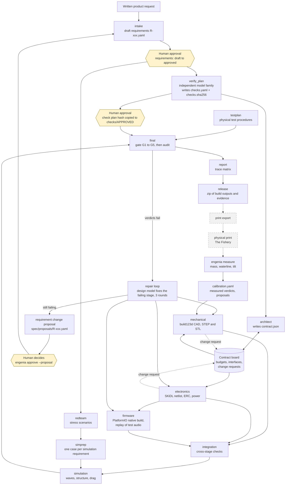
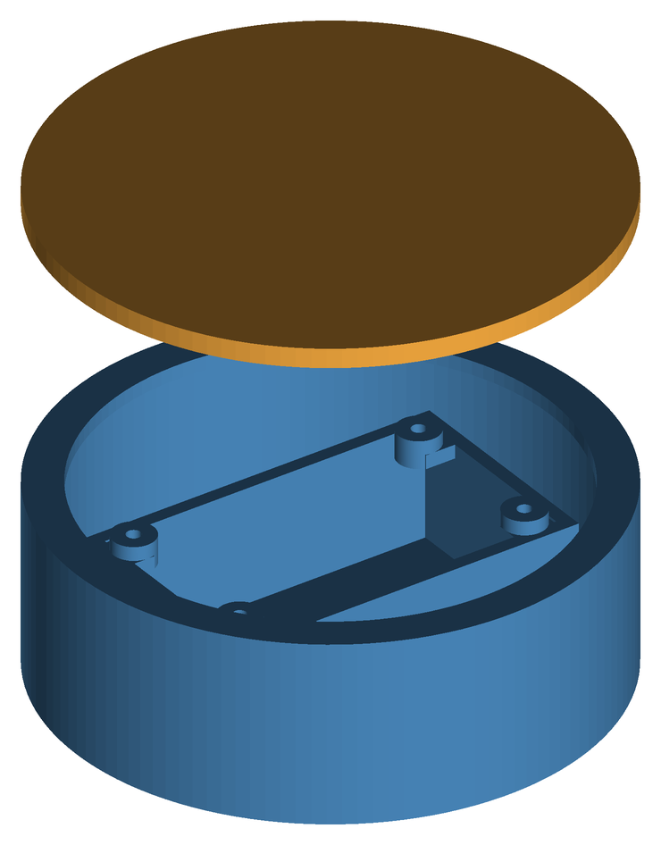
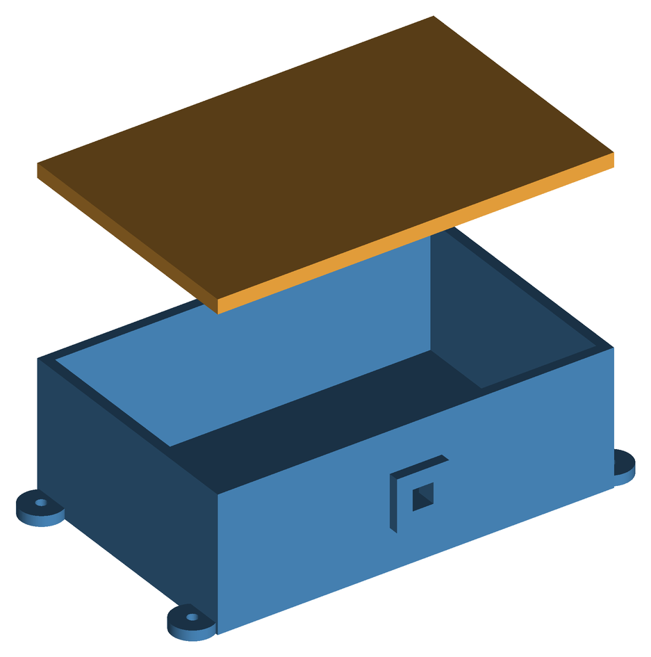

# Engenia

Engenia is software-driven hardware engineering. A written product request becomes a verified, printable hardware design (requirements, CAD, electronics, firmware and simulation results) through AI agents that propose designs, while scripts, not models, decide pass or fail. Every requirement is traced to a check, a measured value, a limit and an evidence level, and a rebuild from committed code gives identical files.

Status: a working prototype built in one night build (Friday 13 November 2026). Two example projects run end to end on `main`. Section 15 says what is simulated, what is not measured, and what is missing; section 16 lists work that is not on `main`.

Contents: [1 What it is](#1-what-engenia-is) · [2 The problem](#2-the-problem) · [3 How it works](#3-how-it-works) · [4 The agents](#4-the-agents) · [5 Verification](#5-verification-in-three-layers) · [6 Rules](#6-the-rules-that-make-it-trustworthy) · [7 Examples](#7-example-projects) · [8 Quick start](#8-quick-start) · [9 CLI](#9-cli-reference) · [10 Dashboard](#10-dashboard) · [11 Configuration](#11-configuration) · [12 Layout](#12-repository-layout) · [13 Development](#13-development) · [14 Prototyping](#14-physical-prototyping) · [15 Limitations](#15-limitations-and-honest-status) · [16 Roadmap](#16-in-progress-roadmap-team-and-license)

Longer documents: [`PROJECT.md`](PROJECT.md) (plan, roles, fixed decisions), [`engenia-technical-implementation-plan.md`](engenia-technical-implementation-plan.md) (deep design), [`AGENTS.md`](AGENTS.md) (rules and frozen contracts for coding agents).

---

## 1. What Engenia is

Engenia takes a plain-language product request, turns it into numbered requirements that a person approves, and then builds a design that meets them: a parametric CAD model, an electronics netlist, native-compiled firmware, and simulations of floating, wave response, hull stress and drag. Language models propose requirements, check plans, budgets and design parameters. They never decide whether something passes. Small verifier scripts read the build outputs, compare a measured number with a limit, and write a verdict. A separate gate re-runs the checks, rebuilds every stage in a scratch copy and compares the hashes. When a requirement changes, only the stages it affects rebuild, and the output is a trace matrix from each requirement to the evidence behind it.

## 2. The problem

Engenia was built for the Saab × MTC "Prompt-to-Product" challenge. The task is to take a maritime system from a written request through requirements, CAD, electronics, and test and verification, and to produce a part that can be made by additive manufacturing at The Fishery.

A language model can write CAD code, a circuit or firmware that looks right. Whether it is right is a separate question, and a model that checks its own output tends to agree with itself. A design process that is going to end in a physical object therefore needs verification that does not depend on the model that produced the design:

- the pass or fail decision has to come from code a person can read, not from model text;
- the checks have to be fixed by the requirements before the design exists, so the design cannot shape its own test;
- the evidence has to say how it was obtained (calculated, simulated or measured), so a calculation is never presented as a test;
- the result has to be reproducible, so a reviewer can rebuild it and get the same files.

Engenia is organised around those four points.

## 3. How it works



Yellow nodes are human decisions. Dashed grey nodes are not automated on `main`: print export and the physical print are described in [section 14](#14-physical-prototyping). `testplan` writes the test procedures for that print, and `engenia measure` reads their ids.

How the diagram maps to the code:

- **Order is set by each stage's `needs`** (`engenia/stages/registry.py`, `engenia/core/graph.py`). `verify_plan`, `redteam` and `testplan` need nothing; `architect` needs `verify_plan`; `mechanical` and `electronics` need `architect`; `firmware` needs `architect` and `electronics`; `integration` needs the three design stages; `simprep` needs `redteam`; `simulation` needs `integration`, `redteam` and `simprep`; `final` needs `simulation` and `testplan`; `report` needs `final`. Independent stages run in parallel (`-j`, default 4). A failed stage blocks only the stages that need it.
- **The check-plan approval is enforced by the gate**, not by the scheduler. The design stages do not wait for it. `engenia new` asks for it before it runs the gate.
- **Firmware-in-the-loop** happens inside the firmware stage: the build compiles the detector with PlatformIO, runs its unit tests, and replays synthetic audio through the compiled native executable. The `detection_rate` and `false_alarm_rate` verifiers read those results.
- **The simulation stage** runs three solvers: waves (Capytaine), structure (gmsh mesh and scikit-fem) and drag (a calculated estimate; see [section 15](#15-limitations-and-honest-status)).
- **Change requests**: a stage that cannot live within its budget writes `contract/change_requests/CR-xxx.json`. The engine accepts it only if the contract stays valid and within its totals, bumps the contract version (which rebuilds every stage that reads the contract), and records the reason in `contract/decisions.json`.
- **Requirement proposals** are written by a script, never applied by it: the new bound is the measured value plus or minus 5 percent. A person accepts one with `engenia approve <project> --proposal R-xxx`.

## 4. The agents

Eight agent folders sit under `engenia/agents/`. Four more pipeline stages are scripts with no model involved. Whether a model is used depends on configuration ([section 11](#11-configuration)): with no model configured, every agent that can call one uses its deterministic builder instead.

| Agent / stage | Role | Reads | Writes | Model or script | Code |
|---|---|---|---|---|---|
| `intake` | Turns the request into draft requirements; runs lint and retries with the lint output, at most 3 fix rounds | request text | `spec/R-xxx.yaml`, always `status: draft` | Design model; else a deterministic template from the pack | `engenia/agents/intake/` |
| `verify_plan` | Writes the check plan from the requirements and the names and docstrings of the verifiers; never sees `src/` or `build/`; cannot write `checks/APPROVED` | requirements, verifier docs | `checks/checks.yaml`, `checks/checks.sha256` | Verification model (a different family); else a deterministic plan. Script validates the plan | `engenia/agents/verification/` |
| `architect` | Splits the budgets (mass, bay, energy, flash, RAM) and fixes pins and mounts | requirements, pack | `contract/contract.json` | Design model, checked by a script that sums the budgets; else the pack's default contract | `engenia/agents/architect/` |
| `mechanical` | Sizes the hull or enclosure around the bay and mounts; builds CAD | contract, requirements, pack templates, `calibration.yaml` | `build/mechanical/` (STEP, STL, facts) | Design model may propose parameters, a script validates; else deterministic sizing. The CAD build is always a script | `engenia/agents/mechanical/`, `packs/*/templates/` |
| `electronics` | Selects parts, builds the netlist, runs the electrical rule check, computes power and battery life | contract, requirements, parts facts | `build/electronics/` (netlist, BOM, ERC, facts) | Design model may propose a selection; else deterministic. SKiDL build is a script | `engenia/agents/electronics/`, `packs/*/parts/` |
| `firmware` | Proposes detector settings, builds with PlatformIO, runs unit tests, replays audio | contract, electronics facts | `build/firmware/` (detections, metrics) | Design model may propose settings; else deterministic. Build and replay are scripts | `engenia/agents/firmware/` |
| `redteam` | Scenario files that stress the design (waves, cold, flooding, storm; for the enclosure: heat, cold, washdown, vibration) | project scenario files | `build/redteam/scenarios/*.yaml` | Script: four fixed scenarios, or the project's own `scenarios/*.yaml`. No model | `engenia/agents/redteam/` |
| `testplan` | Writes a physical test plan: for each approved requirement that can be checked on the printed prototype (mass, buoyancy and waterline, tilt, fit, battery endurance) the procedure, instrument, expected value and pass limit. Requirements with no bench test (stress, detection rate, ERC, power budget, wall thickness) are listed as not covered, with the reason | the approved requirements (`spec/`) | `build/testplan/physical-tests.md` and `physical-tests.json` (test `T-005` checks `R-005`) | Deterministic: fixed procedure templates chosen by `verify.check`; the numbers and limits come from the requirement. No model | `engenia/agents/testplan/` |
| `integration` | Cross-stage checks: board fits bay, mounts match, total mass, pins match, contract version | the three design interfaces, contract | facts, `mismatches.json` | Script | `engenia/stages/integration/` |
| `simprep` | One simulation case per simulation requirement | requirements, scenario names | `build/simprep/cases.yaml` | Script | `engenia/sim/simprep.py` |
| `simulation` | Runs the waves, structure and drag solvers | cases, interfaces | `build/simulation/results.json` | Solvers (scripts) | `engenia/sim/` |
| `final` and `report` | Runs the gate, writes an audit, writes the trace matrix | everything | `build/final/`, `build/report/` | Gate and report are scripts. The audit adds an optional advisory note from the verification model that never changes a verdict | `engenia/gate/`, `engenia/evidence/report.py` |

Counts on `main`:

- 12 pipeline stages: `verify_plan`, `architect`, `mechanical`, `electronics`, `firmware`, `redteam`, `testplan`, `simprep`, `integration`, `simulation`, `final`, `report`.
- 8 agent folders. 6 of them can call a model: `intake`, `verify_plan`, `architect`, `mechanical`, `electronics`, `firmware`. 2 are deterministic (`redteam`, `testplan`).
- 5 stages are scripts: `integration`, `simprep`, `simulation`, `final`, `report`. `final` has one optional model call, the advisory audit note.
- 2 more model call sites that are not agents: the repair loop (`engenia/harness/repair.py`, design model) and the audit note (verification model).
- Deciding code: 18 verifier scripts in `verifiers/` (15 design checks and 3 `measured_*` checks) and the gate in `engenia/gate/`. No model is ever called there.

## 5. Verification in three layers

**Before the design (the plan is fixed first).**

- Requirements are checked by `engenia lint` (rules L1 to L6 plus schema checks: the id matches the file name, exactly one "shall", no vague words, a value and unit unless the method is `inspection`, a verify block, at least one affected stage).
- A person approves the requirements. Intake can only write drafts.
- `verify_plan` writes the check plan from the requirements alone and records its sha256. A person approves it by copying the hash into `checks/APPROVED`. If `checks.yaml` changes afterwards, the hash no longer matches and the gate fails.

**During the build (each stage is checked as it is made).**

- Each design stage declares its checks (for example mechanical: `mass_budget`, `buoyancy_margin`, `print_bed_fit`, `wall_thickness_min`) and the harness runs them after the build.
- Stages read budgets from the contract board and cannot edit it.
- `integration` compares the stages' published facts with each other and with the contract and writes `build/mismatches.json`.
- Every stage is keyed by the hash of its inputs, so an output is only reused when nothing it depends on has changed.

**After the build (the gate, `engenia gate`).** The gate exits 0 only if the approval check and G1 to G5 all hold. No model is called.

| Step | What it checks | What failure it catches |
|---|---|---|
| approval | `checks/APPROVED` equals the hash of the current `checks.yaml`, and the plan still validates against the requirements and verifiers | A check plan that was edited, or never reviewed, after approval |
| G1 | Every item in the check plan runs by the verifier it names, and every verdict passes | A design that violates a requirement |
| G2 | Every verdict's result is recomputed from its measured value and limit, including every `build/<stage>/verdict.json` on disk | A hand-edited "pass" |
| G3 | Every stage is rebuilt from `src/` in a scratch copy and the output hashes are compared with `build/` | A result that cannot be reproduced, or outputs edited after the build |
| G4 | Every approved requirement has a pass or fail verdict | A requirement nobody checks |
| G5 | Each verifier in use is run once on a fixture it must fail, and must say fail | A verifier that always passes |

A requirement whose verifier does not exist is reported as `unverified`. It is never counted as a pass. `final` also fails on any verdict with result `error`.

**Human approvals** are: the drafted requirements, the check plan (by hash), and each requirement change proposal. Nothing in the engine does any of these on its own. `engenia new --yes` approves the first two for you, so use it only for experiments.

**Evidence levels** are written on every verdict:

| Level | Meaning | Example on `main` |
|---|---|---|
| `calculated` | A formula or deterministic script on the design facts | mass, buoyancy margin, battery life, firmware replay on synthetic audio |
| `simulated` | A solver run that passed its own sanity checks | wave tilt (Capytaine), stress safety factor (scikit-fem) |
| `measured` | A number recorded from the physical prototype with `engenia measure` | `measured_mass`, `measured_waterline`, `measured_tilt` |

Both example projects currently have 0 measured verdicts.

The planted-defect suite (`evals/faults/`, ten faults F01 to F10) checks the checks: `uv run python evals/faults/run_faults.py` prints `10/10 faults caught`.

## 6. The rules that make it trustworthy

| Rule | What it prevents |
|---|---|
| One spec per project is the only source of truth (`projects/<p>/spec/R-xxx.yaml`) | Code, checks and documents drifting apart; every check and every row of the trace matrix points back to one requirement |
| Scripts decide pass or fail; agents write code | A model declaring its own work correct; the stop condition of every loop reads `Verdict.result`, never model text |
| The verification model is from a different family than the design model (guard in `engenia/harness/llm.py`) | One model family checking its own work and sharing its blind spots |
| Human approval is bound to a hash (`checks/APPROVED`) | A check plan quietly changed after review, and a model writing its own sign-off |
| Reproducible builds: fixed STEP timestamp, fixed STL deflection, normalised logs, pinned dependencies (`uv.lock`) | "It worked on my machine"; G3 rebuilds everything and compares hashes |
| Canaries (G5 and the fault suite) | A verifier that passes everything, which would make a green gate meaningless |
| Contract board: budgets live in `contract.json`; stages read it, and only the engine edits it, one change request at a time | Three parallel agents each assuming the mass, bay or pin map they would like |
| Content-addressed cache (`ENGENIA_STORE`): stage key = hash of requirements, upstream interfaces, contract, source, stage code, declared inputs | Stale outputs after a change, and rebuilding stages the change does not affect |

## 7. Example projects

The first two projects, 7.1 and 7.2, live in `projects/`. The numbers below come from running the commands on `main` at commit `4758b43` on an Apple-silicon Mac (Python 3.12.5), in deterministic mode: no model was configured, so every `proposer` fact in the interfaces reads `deterministic`. A run with models configured can pick different design parameters. The check plans are the same, so the limits do not change.

```bash
uv run engenia run harbour-listener      # 12 stages ran, 44 s; a second run restored 11 of 12 from the cache
uv run engenia gate harbour-listener
uv run engenia matrix harbour-listener
```

### 7.1 harbour-listener (buoy)

**The request:** a small floating buoy that listens with a hydrophone for a 200 Hz tone and reports over LoRa; battery powered, printed in PETG on a 220 × 220 × 250 mm bed.

**Requirements** (`projects/harbour-listener/spec/`):

| Id | Obligation | Check | Method |
|---|---|---|---|
| R-001 | Total mass at most 400 g | `mass_budget` | analysis |
| R-002 | Hull fits the 220 × 220 × 250 mm print bed | `print_bed_fit` | analysis |
| R-003 | At least 7 days on one battery charge | `battery_capacity` | analysis |
| R-004 | Minimum wall thickness at least 3 mm | `wall_thickness_min` | analysis |
| R-005 | Buoyancy margin at least 0.20 | `buoyancy_margin` | analysis |
| R-006 | Metacentric height at least 5 mm | `metacentric_height` | analysis |
| R-007 | Average power at most 25 mW | `power_budget` | analysis |
| R-008 | Zero electrical rule errors | `erc_clean` | analysis |
| R-009 | Detects a 200 Hz tone in the test audio, rate at least 0.9 | `detection_rate` | analysis |
| R-010 | At most 2 false alarms per hour on the quiet recording | `false_alarm_rate` | analysis |
| R-011 | Tilt within 30° in 0.5 m significant wave height | `wave_tilt` | simulation |
| R-012 | Stress safety factor at least 2 at 3 m depth | `stress_safety_factor` | simulation |

**Result of `engenia gate harbour-listener`:** approval, G1, G2, G3, G4 and G5 pass; `gate harbour-listener: pass`. The first gate run passed; in later repeated runs, made before the macOS path fix, G3 failed on some of them; see [section 15](#15-limitations-and-honest-status).

**Trace matrix** (`engenia matrix harbour-listener`): 12 pass, 0 fail, 0 error, 0 unverified. 10 verdicts are `calculated`, 2 are `simulated`, 0 are `measured`.

| Requirement | Measured | Limit | Result | Evidence |
|---|---|---|---|---|
| R-001 total mass | 191.87 g | max 400 | pass | calculated |
| R-002 print bed fit | 1 (fits) | equals 1 | pass | calculated |
| R-003 battery life | 7.46 days | min 7 | pass | calculated |
| R-004 wall thickness | 3.0 mm | min 3 | pass | calculated |
| R-005 buoyancy margin | 1.31 | min 0.20 | pass | calculated |
| R-006 metacentric height | 17.6 mm | min 5 | pass | calculated |
| R-007 average power | 2.98 mW | max 25 | pass | calculated |
| R-008 ERC errors | 0 | max 0 | pass | calculated |
| R-009 detection rate | 1.0 | min 0.9 | pass | calculated |
| R-010 false alarms per hour | 0 | max 2 | pass | calculated |
| R-011 wave tilt (0.5 m scenario) | 3.43° | max 30 | pass | simulated |
| R-012 stress safety factor | 9.02 | min 2 | pass | simulated |

**Design facts:** 114 mm outer diameter, 43.2 mm high; dry mass of the printed parts 170.97 g, electronics 20.9 g (battery included), total 191.87 g; displaced volume 440.9 cm³; battery 0.666 Wh (0.533 Wh usable after the 0.8 derating); maximum von Mises stress 2.33 MPa against an allowable of 21 MPa (35 MPa yield-based, times a 0.60 printed knock-down factor), which gives the safety factor 9.02. Firmware: 2 of 2 unit tests pass, 2.03 KB estimated flash.

**Wave tilt per scenario** (linear theory, one regular wave per scenario; R-011 is judged on the scenario whose wave height matches the requirement, here `baltic_winter`):

| Scenario | Wave height | Period | Water density | Draft | Max tilt |
|---|---|---|---|---|---|
| calm_harbour | 0.1 m | 3.0 s | 1005 kg/m³ | 18.7 mm | 1.43° |
| baltic_winter | 0.5 m | 4.5 s | 1003 kg/m³ | 18.7 mm | 3.43° |
| flooded_bay (10 % flooded, 30.6 g of water) | 0.4 m | 3.5 s | 1000 kg/m³ | 21.8 mm | 4.55° |
| storm | 2.0 m | 8.0 s | 1005 kg/m³ | 18.7 mm | 6.27° |

**Drag per scenario** (calculated, not simulated; `F = ½ ρ Cd A v²` with Cd 1.2, from `packs/buoy/sim/flow/params.yaml`):

| Scenario | calm_harbour | baltic_winter | flooded_bay | storm |
|---|---|---|---|---|
| Drag | 0.0129 N | 0.0514 N | 0.0596 N | 0.463 N |

No requirement limits drag; it is reported in the simulation facts.



*Hull (blue) and lid (orange), lid raised 60 mm for the picture. Rendered from the STL files in `build/mechanical/` by `docs/images/render_stl.py`; this script is not part of the pipeline.*

### 7.2 deck-sensor (enclosure)

**The request:** a deck-mounted sensor box measuring temperature, humidity and vibration on a weather deck, battery powered with a LoRa uplink, in a 3D-printed PETG enclosure. It uses the `enclosure` pack (`projects/deck-sensor/project.yaml`) with no change to `engenia/` core, and generates the block-RMS `threshold` detector instead of the buoy's tone detector. Details: [`projects/deck-sensor/README.md`](projects/deck-sensor/README.md).

**Requirements** (`projects/deck-sensor/spec/`):

| Id | Obligation | Check |
|---|---|---|
| R-001 | Total mass at most 400 g | `mass_budget` |
| R-002 | Enclosure fits the 220 × 220 × 250 mm print bed | `print_bed_fit` |
| R-003 | At least 14 days on one battery charge | `battery_capacity` |
| R-004 | Minimum wall thickness at least 3 mm | `wall_thickness_min` |
| R-005 | Average power at most 25 mW | `power_budget` |
| R-006 | Zero electrical rule errors | `erc_clean` |
| R-007 | Electronics assembly fits the battery bay | `bay_fit` |
| R-008 | Detects the reference vibration tone in the replayed test audio, rate at least 0.9 | `detection_rate` |

**Result of `engenia gate deck-sensor`:** approval, G1, G2, G4 and G5 pass on every run. G3 passed in 3 of 5 consecutive gate runs on this Mac and failed in 2 (`electronics: build.log differs from rebuild`), before the macOS path fix (see [section 15](#15-limitations-and-honest-status)). The table below is the same on every run.

**Trace matrix:** 8 pass, 0 fail, 0 error, 0 unverified; all 8 verdicts are `calculated`.

| Requirement | Measured | Limit | Result |
|---|---|---|---|
| R-001 total mass | 164.16 g | max 400 | pass |
| R-002 print bed fit | 1 (fits) | equals 1 | pass |
| R-003 battery life | 40.9 days | min 14 | pass |
| R-004 wall thickness | 3.0 mm | min 3 | pass |
| R-005 average power | 2.71 mW | max 25 | pass |
| R-006 ERC errors | 0 | max 0 | pass |
| R-007 bay fit | 1 (fits) | equals 1 | pass |
| R-008 detection rate | 1.0 | min 0.9 | pass |

**Design facts:** enclosure 132 × 77.1 × 43.2 mm; dry mass of the printed parts 128.01 g, electronics 36.15 g, total 164.16 g; battery 3.33 Wh. There are no wave, drag or stress results because no requirement uses `method: simulation` and the four deck scenarios (heat soak, cold snap, washdown, transport vibration) carry no water conditions; the flow solver skips them and records why.



*Enclosure body (blue) and lid (orange), lid raised 50 mm for the picture.*

### 7.3 Product packs and their example projects

Five product packs exist in `packs/`. A project picks one with `pack: <name>` in `projects/<p>/project.yaml`, and every pack ships an example project that passes `engenia run` and `engenia gate` with no model (the deterministic fallback). The three newest packs build from a pack-owned Python module (`module:` in `pack.yaml`) that sizes every dimension from the contract and the requirements and logs a decision for each choice.

| Pack | Product | Example project | In one line |
|---|---|---|---|
| `buoy` | Floating hydrophone buoy | `harbour-listener` | Hull, lid, mast housing; tone detector; waves, structure and flow solvers |
| `enclosure` | Deck-mounted sensor box | `deck-sensor` | Gasketed rectangular box; block-RMS threshold detector |
| `pressure_housing` | Watertight cylindrical sensor pod | `sensor-pod` | Tube and two plug end caps on O-rings from a standard table, optional cable-gland boss; stress safety factor at depth from the structure solver, with max-depth and cold-water scenarios |
| `bracket` | Mast clamp or L-bracket | `antenna-bracket` | Clamp diameter, mounting holes and fillets; the new `bending_stress` check (cantilever root stress against the printed PETG allowable); no electronics, so those stages are skipped |
| `thruster_duct` | Kort-nozzle-like duct around a small thruster propeller | `thruster-duct` | Mounting flange with bolt holes; the new `prop_clearance` check (tip clearance inside a band); the flange is checked with `bending_stress` |

`engenia new` writes `project.yaml` for `pressure_housing`, `bracket` and `thruster_duct`; `enclosure` projects add it by hand. A pack's `skip_stages: [electronics, firmware]` makes those stages publish `not_applicable` and drops the checks that need them. Details: `packs/<pack>/README.md` and `projects/<project>/README.md`.

## 8. Quick start

### Codespaces

1. On GitHub choose **Code → Codespaces → Create codespace on main**, and pick the **4-core** machine.
2. Wait for the first build. It installs Python 3.12, uv, the CAD system libraries, `uv sync`, and the PlatformIO `native` platform, so the firmware stage downloads nothing later.
3. Run the pipeline and the checks:

   ```bash
   uv run engenia run harbour-listener
   uv run engenia gate harbour-listener
   ```

4. Start the dashboard. Bind to `0.0.0.0` so Codespaces can forward port 8080:

   ```bash
   uv run python -m engenia.dashboard --project harbour-listener --host 0.0.0.0 --port 8080
   ```

   Open the forwarded port 8080 from the **Ports** tab.

   The dashboard is a React app in `dashboard-ui/`. Its built files are committed in `engenia/dashboard/static/`, so no Node is needed to run it. To change the UI, edit `dashboard-ui/` and rebuild: `cd dashboard-ui && npm install && npm run build` (use `npm run dev` for live reload against a running dashboard on port 8080, and `npm test` for its tests).

**libxcursor note.** The devcontainer image installs `libgl1`, `libglu1-mesa`, `libxrender1` and `libxext6`. The CI workflow installs three more libraries before it builds CAD and meshes: `libxcursor1`, `libxft2` and `libxinerama1`. If a CAD or meshing step fails to load a shared library on a plain Linux image, install the same set that CI uses:

```bash
sudo apt-get update && sudo apt-get install -y libglu1-mesa libgl1 libxrender1 libxext6 libxcursor1 libxft2 libxinerama1
```

### Local (macOS or Linux)

Requirements: Python 3.12, [uv](https://docs.astral.sh/uv/) 0.11.x, and a C compiler for the PlatformIO `native` firmware build (Xcode command line tools on macOS, `build-essential` on Linux). On Linux, also install the libraries above.

```bash
git clone https://github.com/TimothyVictor1/Engenia.git
cd Engenia
uv sync                                  # Python dependencies, from uv.lock
uv run engenia doctor                    # checks model config, local tools (pio, gmsh, capytaine)
uv run engenia run harbour-listener
uv run engenia gate harbour-listener
```

The first firmware build downloads the PlatformIO `native` platform, the SCons tool and the Unity test library. The Codespaces setup (`.devcontainer/setup.sh`) installs them in advance. No API key is needed for any of this: without one the agents run their deterministic builders.

## 9. CLI reference

All commands are `uv run engenia <command>`. Run `engenia <command> --help` for the same text.

| Command | Flags | Does | Example |
|---|---|---|---|
| `lint <project>` | | Validates and lints the spec. Exits 1 on any error. | `engenia lint harbour-listener` |
| `intake <request>` | `-p/--project` (required), `--pack` (default `buoy`) | Turns a plain-language request into draft `spec/R-xxx.yaml` files that pass lint. Uses the design model if configured, else the pack template. Files are always drafts. | `engenia intake "A buoy that hears a 200 Hz tone" -p my-buoy` |
| `new <request>` | `-p/--project` (required), `--pack` (`buoy`, `enclosure`, `pressure_housing`, `bracket` or `thruster_duct`), `-y/--yes`, `-j/--workers` | Creates a project and goes from request to release: intake, approve requirements, run, approve check plan, gate with repair loop, release. Asks at each approval unless `--yes`. Never applies a change proposal. | `engenia new "A deck sensor box" -p my-box --pack enclosure` |
| `run <project>` | `-j/--workers` (default 4), `--resume`, `--repair` | Runs every stage in dependency order, independent stages in parallel, rerunning only what changed. `--resume` continues the last unfinished run. `--repair` runs the gate, asks the design model to repair failing stages (3 rounds), then writes requirement change proposals. | `engenia run harbour-listener -j 2 --repair` |
| `approve <project>` | `--proposal <R-xxx>`, `-y/--yes` | Shows what changed, then copies `checks/checks.sha256` to `checks/APPROVED`. With `--proposal`, accepts `spec/proposals/R-xxx.yaml` into `spec/` as approved. | `engenia approve my-buoy` |
| `gate <project>` | | Runs the approval check, G1 to G5 and the coverage lists. Exit 0 only on pass. Writes `build/gate/report.json`. | `engenia gate harbour-listener` |
| `matrix <project>` | | Writes `build/report/trace_matrix.md` and `.json` and prints the matrix. | `engenia matrix harbour-listener` |
| `release <project>` | | Runs the gate fresh and, only if it passes, writes `release/<project>-<hash>.zip` (build outputs, spec, check plan, contract, `MANIFEST.json`). Equal contents give equal bytes. | `engenia release harbour-listener` |
| `measure <project>` | `--mass-g` (required), `--waterline-mm` (required), `--tilt-deg`, `--date YYYY-MM-DD` | Records the printed prototype's measurements, compares them with the predictions, writes `calibration.yaml`, runs the `measured` verifiers. | `engenia measure harbour-listener --mass-g 205 --waterline-mm 21` |
| `doctor` | | Checks model configuration, the model-family guard, one tool-calling request per model, and local tools. Exits 1 on failure. | `engenia doctor` |
| `status <project>` | | Shows the latest run of the project from `.engenia/run.db`: per stage its status, attempts and duration; then the result of the last `engenia gate` (from `build/gate/report.json`, or `not run`) and the open change requests. Read only. | `engenia status harbour-listener` |

There is no `export-print` command on `main`; see [section 14](#14-physical-prototyping). The dashboard has its own entry point (`python -m engenia.dashboard`, [section 10](#10-dashboard)), and the gate also runs as `python -m engenia.gate`.

## 10. Dashboard

A read-only web app for one project, served by FastAPI. It reads the files under `projects/<project>/` and the event log; it does not run or change anything.

```bash
uv run python -m engenia.dashboard --project harbour-listener            # http://127.0.0.1:8080
uv run python -m engenia.dashboard --project harbour-listener --host 0.0.0.0 --port 8080
```

Flags: `--project` (required unless `--all`), `--all`, `--port` (default 8080), `--host` (default 127.0.0.1). With `--all` (`uv run python -m engenia.dashboard --all`) one server shows every project with requirements at `/p/<name>/`, `--project` picks the one opened first, and a **project switcher** in the header moves between them (harbour-listener, deck-sensor, sensor-pod, antenna-bracket, thruster-duct). `GET /api/projects` lists them. The React source is in `dashboard-ui/`; the built files are committed in `engenia/dashboard/static/`. A **Sample data** toggle (or `?sample=1`) shows bundled sample data when no project has been built.

| View | Shows |
|---|---|
| Pipeline | The stage graph with each stage's state |
| Requirements | Each requirement with its limit, check, and latest verdict |
| Design | The 3D model of the hull and lid from the mechanical stage (three.js), with the facts the stages reported |
| Contract | The budgets and interfaces in `contract.json`, next to the facts each stage reported against them |
| Scenarios | The red-team scenarios and which requirements each one targets |
| Live studio | What the agents are doing now, or a replay of a finished run: messages, tool calls, code, design decisions, verdicts, repairs |

**Live events.** During `engenia run`, the engine writes one JSON line per event to `.engenia/events/<run_id>.jsonl` (kinds: `message`, `tool_call`, `tool_result`, `code`, `decision`, `preview`, `verdict`, `repair`). The dashboard streams them over server-sent events (`/api/events`) and can replay a past run (`/api/events/history`). Secrets are scrubbed before an event is written, and a failure to write an event never changes a run. A deterministic run still logs stage start and finish messages and the mechanical preview; tool calls, code, decisions and repairs appear only when a model drives a stage.

## 11. Configuration

Settings are read from the **process environment**. A `.env` file at the repository root is not loaded by the pipeline; `engenia doctor` reads it only to warn you that a value exists there but is not exported. To use it: `set -a; source .env; set +a`. Never commit `.env` (it is in `.gitignore`).

| Variable | Meaning |
|---|---|
| `ENGENIA_LLM_BASE_URL` | OpenAI-compatible endpoint, for example `https://api.tokenfactory.nebius.com/v1/` |
| `ENGENIA_LLM_API_KEY` | Bearer token for that endpoint. Never printed; errors are scrubbed against it |
| `ENGENIA_DESIGN_MODEL` | Model used by the design agents (intake, architect, mechanical, electronics, firmware, repair) |
| `ENGENIA_VERIFY_MODEL` | Model used by `verify_plan` and the audit note. Must be a different family |
| `ENGENIA_ALLOW_SAME_FAMILY` | Set to `1` to override the family guard. The override is written to `build/final/audit.md` |
| `ENGENIA_MAX_ATTEMPTS` | Attempts per stage in the generate, build, verify loop. Default 3, minimum 1 |
| `ENGENIA_STORE` | Where the content-addressed cache lives. Default `<repo>/.engenia/store`; a relative path is taken from the repo root |
| `ENGENIA_ROOT` | Repository root, if not found from the current directory (nearest parent holding `projects/`) |

Other per-attempt limits in `engenia/harness/limits.py`: 40 tool calls and 600 seconds of wall time per attempt.

**Model setup on Nebius Token Factory.** Create an API key, then set the endpoint and two models from different families. The family is the part of the model ID before the first `/`.

```bash
export ENGENIA_LLM_BASE_URL=https://api.tokenfactory.nebius.com/v1/
export ENGENIA_LLM_API_KEY=...                         # your key
export ENGENIA_DESIGN_MODEL=zai-org/GLM-5.3            # family: zai-org
export ENGENIA_VERIFY_MODEL=deepseek-ai/DeepSeek-V4-Pro-0813   # family: deepseek-ai
uv run engenia doctor                                  # confirms both models answer a tool-calling request
```

Any other OpenAI-compatible endpoint works; the client (`engenia/harness/llm.py`) sends chat-completion requests with tools and retries with backoff.

**Model-family guard.** If the two model IDs are equal or share a family, the harness raises `ModelFamilyError` before any call and the refusal is not swallowed by the deterministic fallback. `ENGENIA_ALLOW_SAME_FAMILY=1` overrides it and records the override in the audit.

**Deterministic fallback mode.** If no endpoint and key are set in the process, if the endpoint fails, or if the attempts run out, each agent uses its deterministic builder: `intake` uses the pack template, `verify_plan` writes the standard plan, `architect` uses the pack's `default_contract.json`, and `mechanical`, `electronics` and `firmware` use their sizing, selection and detector defaults. `engenia doctor` reports this as a warning, and the interfaces say `"proposer": "deterministic"` (or `"source": "default"` for the contract). It is a full run: the same verifiers and the same gate apply. It is also how the CI runs. What it does not show is a model proposing a design.

## 12. Repository layout

```
engenia/                  Python package (the `engenia` command)
  core/                   CLI, engine, scheduler, stage keys, cache, run state, approvals, release, repair loop, events
  contracts/              Frozen Pydantic models: requirement, contract, interface, verdict, stage context
  harness/                Model client, agent loop, tools, design loop, proposer, repair, limits
  agents/                 One folder per agent: intake, verification, architect, mechanical, electronics, firmware, redteam, testplan
  stages/                 Stage protocol, registry, integration stage
  sim/                    simprep, simulation, and the waves, structure and flow solvers
  gate/                   The gate (G1 to G5), canary fixtures, the final stage
  evidence/               Trace matrix, `engenia measure`, `engenia doctor`
  dashboard/              FastAPI app and the committed build of the UI
verifiers/                18 check scripts: each reads files and returns one verdict
packs/                    Product packs: buoy, enclosure, pressure_housing, bracket, thruster_duct (templates, parts facts, default contract, intake template, scenarios, sim settings)
projects/                 Example projects: harbour-listener, deck-sensor, sensor-pod, antenna-bracket, thruster-duct (spec, checks, scenarios)
evals/faults/             The planted-defect suite F01 to F10
dashboard-ui/             React source of the dashboard
docs/images/              Renders used in this README and the script that made them
tests/                    One folder per lane: smoke, core, harness, agents, mechanical, electronics, firmware, verifiers, integration, sim, gate, evidence, faults, redteam, dashboard
.devcontainer/            Codespaces image and setup
.github/workflows/        CI
PROJECT.md                Plan, roles, fixed decisions
engenia-technical-implementation-plan.md   Deep design
AGENTS.md                 Rules and frozen contracts for coding agents
```

A project folder holds `spec/` (requirements), `checks/` (`checks.yaml`, `checks.sha256`, `APPROVED`), `contract/`, `scenarios/` (optional), `src/<stage>/` (generated source) and `build/<stage>/` (outputs, `interface.json`, `verdict.json`). `src/` and `build/` are generated by `engenia run`; `build/` is git-ignored.

## 13. Development

**Tests.** `uv run pytest -q` collects 998 tests; 52 are marked `@pytest.mark.slow` (they build CAD, mesh, or run the full pipeline). `uv run pytest -q -m "not slow"` is the fast set. Lint: `uv run ruff check .`. The dashboard has its own tests: `cd dashboard-ui && npm test`; these are not run by CI.

**CI** (`.github/workflows/ci.yml`, on pull requests and pushes to `main`, every action pinned by commit SHA):

| Job | Runs |
|---|---|
| `fast` | system libraries, `uv sync`, `ruff check .`, `pytest -m "not slow"` |
| `slow` | system libraries, `uv sync`, `pytest -m slow`, then `engenia run harbour-listener` (on failure it prints `build/gate/report.json`) |

**Seats, branches and pull requests** (full rules in [`AGENTS.md`](AGENTS.md)):

- Work is split by folder into seats (T1 to T4, A1, A2, B1). A seat may only edit its own folders, and nobody edits `engenia/contracts/` without the owner's approval.
- Branch names are `<seat>-<sprint>-<short-name>`, lower case, for example `t1-s1-core`.
- Finish steps for every task: `ruff` passes, the lane's tests pass, `git status` shows changes only inside the seat's folders, commit as `<seat>: <what changed>`, push, and open a pull request with `gh pr create --fill --base main`.
- The integrator merges a pull request only when CI is green, the review approves, the changed files are inside the seat's folders, and the acceptance criteria are ticked. Squash merge. After every merge each workspace runs `git fetch origin && git rebase origin/main`.

**How the team built it.** Three people ran seven parallel AI coding-agent seats, each in its own workspace and folder, from written plans and prompts (`PROJECT.md`, `PERSON1-PLAN.md`, `PERSON2-PLAN.md`, `TIMOTHY-PLAN.md` and the matching `*-PROMPTS.md`). The contracts in `engenia/contracts/` were frozen first, so the seats could work in parallel without agreeing on interfaces afterwards. The pull requests in the history show the sequence.

## 14. Physical prototyping

The loop from a verified design to a measured one:

1. **Release.** `engenia release <project>` runs the gate and, on a pass, writes `release/<project>-<hash>.zip`. The STEP and STL files of the mechanical stage are in it under `build/mechanical/`.
2. **Export for printing.** *Not on `main`.* There is no `export-print` command. Until it exists, take `hull.stl` and `lid.stl` (or `body.stl` and `lid.stl`) from the release zip or from `build/mechanical/`, and slice them yourself. The mass model assumes solid PETG at density 1.27 g/cm³ with infill factor 1.0; a slicer's real infill and wall settings will give a different mass.
3. **Print** at The Fishery.
   The `testplan` stage has already written `build/testplan/physical-tests.md` (for the bench) and `physical-tests.json`: one test per requirement that can be checked on the print, named `T-<number>` after its requirement (`T-005` checks `R-005`), with the instrument, procedure, expected value and pass limit. Requirements with no bench test are listed there as not covered.
4. **Measure** the printed prototype: mass in grams, waterline height above the hull base in millimetres, and optionally tilt at rest in degrees.

   ```bash
   uv run engenia measure harbour-listener --mass-g 205 --waterline-mm 21 --tilt-deg 1.5
   ```

   (The numbers are an illustration, not a measurement.) The command saves `projects/<p>/measurements.yaml`, compares the numbers with the design's predictions, and runs the `measured_*` verifiers for every approved requirement whose method is `test`. Those verdicts carry the evidence level `measured`. A failed verdict becomes a draft requirement change proposal. If `build/testplan/physical-tests.json` exists, the command also reads its test ids and prints, for each planned test whose number you just supplied (mass, waterline, tilt), `T-001 (R-001) mass: pass` or `fail` against that test's limit. These lines are informational; the verdicts decide the exit code.
5. **Calibration.** The command writes `projects/<p>/calibration.yaml` with `mass_factor` (measured mass divided by predicted mass) and `waterline_offset_mm` (measured minus predicted waterline).
6. **Re-run.** `engenia run <project>` again. The mechanical stage reads `calibration.yaml` and multiplies the material density by `mass_factor`, so the stages that depend on mass rebuild and the cache key changes. Today `waterline_offset_mm` is recorded but nothing reads it.

## 15. Limitations and honest status

**Simulated versus measured.** Every verdict in both example projects is `calculated` or `simulated`. No physical prototype has been measured, so no verdict is `measured`. The `measured_*` verifiers and `engenia measure` are implemented and tested on fixtures, not on a real print.

**Level-1 models.** These results are first-order engineering estimates, not validation:

- *Buoyancy, stability, battery life, power:* closed-form formulas. Battery life applies a 0.8 derating. Power comes from mode power and duty-cycle assumptions in the parts facts.
- *Wave tilt:* linear potential flow (Capytaine), one regular wave per scenario, no viscosity, wind or mooring, radiation damping only, upright closed cylinder. Slamming, green water and drag are not modelled. The reported tilt scales linearly with wave height.
- *Structure:* a static external-pressure case at the stated depth on a tetrahedral mesh (gmsh, 5 mm), solved with scikit-fem. Material values (E = 2100 MPa, ν = 0.38, allowable 35 MPa, printed knock-down factor 0.60) are assumptions written in `packs/buoy/pack.yaml`. Printed PETG is anisotropic; this is not.
- *Drag:* an analytic estimate with an assumed Cd of 1.2. The scenarios on `main` carry no current speed, so the `storm` value comes from the documented assumed speeds. OpenFOAM is not used; the code detects it but has no case to run.
- *Firmware:* a Goertzel-style detector compiled natively and replayed against synthetic audio (fixed seed, Gaussian noise plus 200 Hz bursts). A detection rate of 1.0 on that audio is not field performance. Flash use is a source-size estimate, not an MCU measurement.
- *Mechanical:* `wall_min_mm` is the template's nominal structural minimum, not a measurement of the mesh. Seals, O-rings and lid fasteners are not modelled. Mass uses uniform effective density.
- *Electronics:* the circuit is checked with SKiDL's electrical rule check against a small parts library; no PCB layout or footprints are produced (SKiDL warns that footprint libraries are missing).

**What deterministic mode does.** Without a model, the design agents use fixed sizing and selection, so a deterministic run shows that the pipeline, the verifiers and the gate work, not that a model can design. The numbers in [section 7](#7-example-projects) are from that mode.

**Known gaps on `main`.**

- **G3 on macOS (fixed, not re-measured).** The gate rebuilds in a temporary directory under `/var/...`, which macOS exposes as `/private/var/...`. `normalize_log` in `engenia/agents/electronics/stage.py` replaced the shorter `/var/...` form first, which is a substring of the `/private/var/...` form, so a stray `/private` was left in front of the `<src>` label and the rebuilt `build.log` differed. It now replaces the longest path form first, and `tests/electronics/test_stage.py` covers a symlinked temp directory. The gate runs quoted in [section 7](#7-example-projects), where G3 failed on some runs, were made before this fix; the 5-run check on a Mac has not been repeated.
- The `testplan` expected values are the requirement limits, not the design's predicted values (the stage has no upstream stage). Procedures are fixed templates, not tailored by a model. No physical test has been run against them.
- No `export-print` command.
- A container runner is not on `main`; there is no `containers/` directory, so stages run in the local environment. Reproducibility across machines is tested within one kernel and platform version only (see `engenia/agents/mechanical/README.md`).
- Requirement-to-check mapping for `verify_plan` is validated by script, but whether a check is a good test of the requirement's wording is a human judgement at the approval step. The audit note is advisory.
- The structure solver reads the depth from the statement of the requirement whose check is `stress_safety_factor` (R-012 when none is marked), so that requirement must state it in the form "at N m depth".
- The wave and structure caches key on the stage classes, not on solver parameters; after editing solver settings, clear `build/simulation/` to force a rerun.
- The dashboard UI tests are not part of CI.
- Five packs exist (buoy, enclosure, pressure_housing, bracket, thruster_duct). The three newer ones are checked by analytic models: the pod's collapse margin is sized in its proposer and the FE check is linear stress only, `bending_stress` is a closed-form beam formula on the cantilever root, and `prop_clearance` is geometric. Their red-team load factors and the swelling shift are assumptions. See each pack's README.

## 16. In progress, roadmap, team and license

**In progress (not on `main`; nothing here should be read as done).**

- Print export (`export-print`) for slicer-ready files, and the printed prototype itself.
- A container runner (images by digest).
- A flow simulation with OpenFOAM, and CalculiX for the structure case, as set out in the technical plan; `main` uses an analytic drag estimate and scikit-fem.
- First `measured` verdicts from a printed prototype.

**Team.** Engenia was built by three people, with Timothy Victor as integrator, and seven AI coding-agent seats (see [section 13](#13-development)). The history of who changed what is in the git log.

**License.** There is no license file in the repository yet, so no license is granted beyond what GitHub's terms give viewers of a public repository. A license will be added by the owner.
