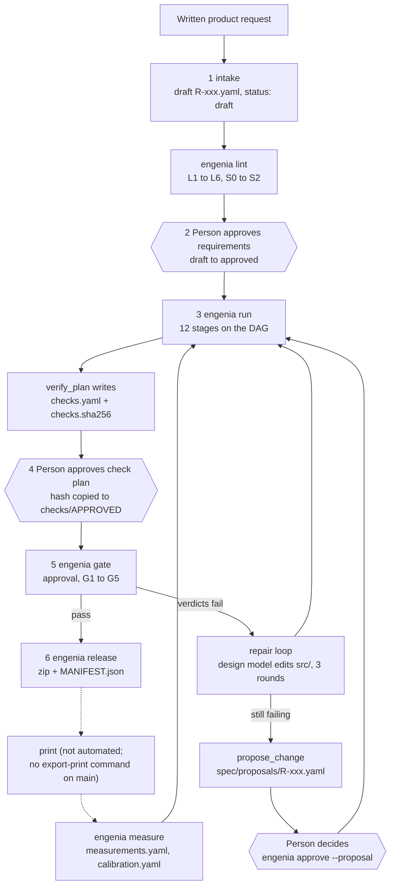
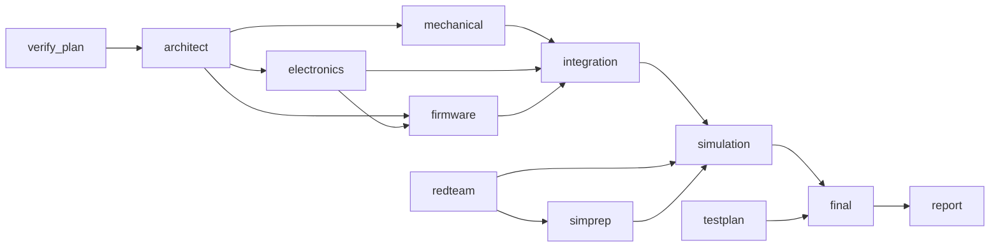
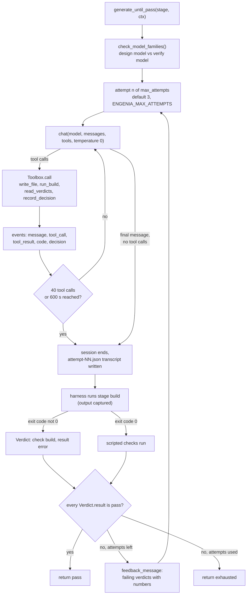
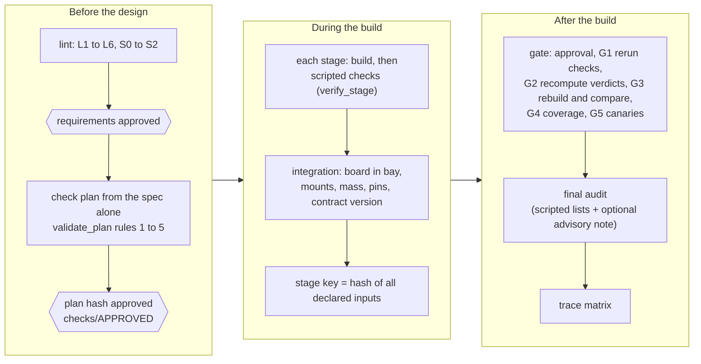
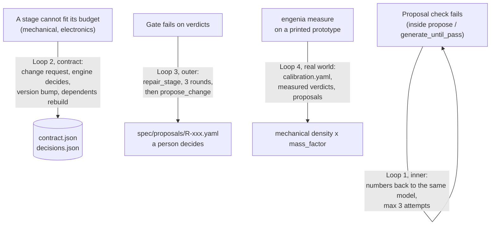
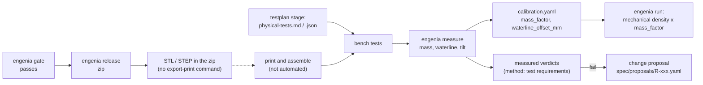

# Engenia: Technical Report

For engineers at Saab and MTC who need to judge what Engenia does, how it does it, and how far its results can be trusted.

| | |
|---|---|
| Code baseline | `main` at commit `c4c9bd7` (merge of PR #50), 14 November 2026. Engine code is unchanged since `316db90` (PR #53); PR #50 changed only the dashboard UI, its built bundle, screenshots and committed generated project files |
| Source of truth | The code on `main`. `README.md`, `PROJECT.md`, `engenia-technical-implementation-plan.md` and `docs/mission-api.md` were used as maps and checked against the code. Where they disagree with the code, this report follows the code and Appendix E lists the differences |
| Citations | Every mechanism is cited as `path` or `path::function`, relative to the repository root |
| Numbers | **[run]** produced by running the stated command on `c4c9bd7` (or on `316db90` where stated; the engine code is the same), in deterministic mode (no model configured), on one Apple-silicon Mac (macOS, Darwin 23.6, Python 3.12.5, uv 0.11.2). **[derived]** computed here from constants in the code, not run. **[PR]** taken from a pull-request description; the run behind it is not in the repository. **[doc]** taken from a project document, not re-checked |
| Status of the system | A working prototype built in one night (13–14 November 2026). It is not a product and it is not qualified for any safety or certification use |

How to read it: section 1 is a one-page summary. Sections 2 and 3 describe the architecture and data model. Sections 4 to 11 go through the mechanisms one by one. Section 12 describes how it was built, section 13 gives results, section 14 explains the design decisions, and section 15 covers extensions, limitations and risks. The appendices hold the CLI reference, the environment variables, a repository map, a glossary and a list of documentation drift found while writing.

## Contents

1. [Executive summary](#1-executive-summary)
2. [System architecture](#2-system-architecture)
3. [Data model](#3-data-model)
4. [Stages in depth](#4-stages-in-depth)
5. [Agents](#5-agents)
6. [Verification](#6-verification)
7. [Reproducibility and caching](#7-reproducibility-and-caching)
8. [Simulations](#8-simulations)
9. [Parallel scheduler, contract board, run state and resume](#9-parallel-scheduler-contract-board-run-state-and-resume)
10. [The physical loop](#10-the-physical-loop)
11. [Dashboard and live events](#11-dashboard-and-live-events)
12. [Engineering process](#12-engineering-process)
13. [Results](#13-results)
14. [Why this design](#14-why-this-design)
15. [Potential, limitations and risks](#15-potential-limitations-and-risks)
- [Appendix A: CLI reference](#appendix-a-cli-reference)
- [Appendix B: environment variables](#appendix-b-environment-variables)
- [Appendix C: repository map](#appendix-c-repository-map)
- [Appendix D: glossary](#appendix-d-glossary)
- [Appendix E: documentation drift found while writing this report](#appendix-e-documentation-drift-found-while-writing-this-report)
- [Appendix F: output files per stage](#appendix-f-output-files-per-stage)

---

## 1. Executive summary

**Problem.** A language model can write CAD code, a netlist or firmware that looks right. Whether it is right is a separate question, and a model that checks its own output tends to agree with it. A design that ends as a printed, floating, battery-powered object therefore needs verification that is independent of whatever produced the design. Four properties follow:

1. the pass or fail decision comes from code a person can read, not from model text;
2. the checks are fixed by the requirements before the design exists, so a design cannot shape its own test;
3. every result says how it was obtained (calculated, simulated or measured), so a calculation is never presented as a test;
4. the result is reproducible: a reviewer can rebuild it and get the same files.

Engenia was built for the Saab × MTC "Prompt-to-Product" challenge (`README.md` section 2): take a maritime system from a written request through requirements, CAD, electronics, firmware and test, and end with a part that can be 3D-printed.

**Approach.** Engenia is a fixed pipeline of 12 stages (`engenia/contracts/models.py::STAGE_NAMES`) over one project folder.

- *One spec.* Each requirement is one YAML file, `projects/<p>/spec/R-xxx.yaml`, linted by six rules (`engenia/core/lint.py`) and approved by a person. Intake can only write drafts.
- *Checks first.* A verification model of a different family from the design models writes the check plan from the requirements alone (`engenia/agents/verification/stage.py`); a script validates it; a person approves its hash (`checks/APPROVED`). The plan can be written without any model.
- *Models propose, scripts decide.* Design agents propose requirements, a contract of budgets, hull parameters, a part selection and detector settings. Sixteen verifier scripts (`verifiers/`) read build outputs, compare a number with a limit and write a `Verdict`. No stop condition anywhere reads model text (`engenia/harness/checks.py::all_pass`).
- *A contract board instead of agent chat.* Mechanical, electronics and firmware run in parallel against budgets and interfaces in `contract.json`. A stage that cannot fit files a change request; the engine accepts it only if the contract stays valid and within totals (`engenia/core/board.py`).
- *A gate that does not trust the build.* `engenia gate` re-runs every check, recomputes every verdict from its own numbers, rebuilds every stage in a scratch copy and compares hashes, checks coverage, and runs each verifier on a fixture it must fail (`engenia/gate/gate.py`).
- *Rebuild only what changed.* Every stage is keyed by a hash of its declared inputs and cached in a content-addressed store (`engenia/core/hashing.py`, `engenia/core/cache.py`).
- *A path to the real world.* A release zip, a physical test plan, and `engenia measure`, which records measurements of a printed prototype, writes calibration factors and runs `measured`-level verifiers.

**What is proven today.** All numbers are **[run]** on `c4c9bd7` in deterministic mode unless marked.

| Claim | Evidence |
|---|---|
| Two example projects run through the same core: `harbour-listener` (a buoy, 12 requirements, `buoy` pack) and `deck-sensor` (an enclosure, 8 requirements, `enclosure` pack) | Section 13.1 |
| `harbour-listener`: 12 of 12 requirements pass; 8 verdicts are `calculated`, 4 are `simulated`, 0 are `measured`. Gate steps approval, G1 to G5 all pass | Section 13.1 |
| `deck-sensor`: 8 of 8 pass; 7 `calculated`, 1 `simulated` | Section 13.1 |
| The check layer catches planted defects: 10 of 10 faults (F01 to F10) | Section 13.3 |
| The gate and repair machinery catch a defect injected into a full pipeline run: `demo-fault` F01 caught in G1, G2 and G3; F10 (hand-edited verdict) caught in G2 | Section 13.4 |
| Rebuilds are reproducible on this machine: G3 (full rebuild and hash comparison) passed in 20 of 20 gate runs (5 per project at each of two commits) | Section 13.2 |
| An unchanged project is served from the cache: a second run restores 11 of 12 stages (the twelfth, `firmware`, is rebuilt every time; Section 7.7 explains why and also shows what an edit rebuilds) | Sections 7.7, 13.2 |
| 1,161 tests collected; the 1,108 fast tests pass in about 80 seconds and the 53 slow tests pass in about 4.5 minutes | Section 13.5 |

**What is not proven.**

- *No measured result exists.* No printed prototype has been measured. Every verdict is `calculated` or `simulated`. The `measured_*` verifiers and `engenia measure` are tested on fixtures only.
- *Deterministic mode does not show a model designing.* The numbers above come from fixed sizing, fixed part selection and fixed detector settings. They show that the pipeline, the verifiers and the gate work. They do not show that a language model can produce a passing design.
- *Live-model evidence is thin.* No event log or transcript of a live-model run is in the repository. The only record is three pull-request descriptions (#51, #52, #53), which report defects that appear when a real model drives the pipeline (Section 13.6). No cost, token or latency figure exists, and the code has no token accounting.
- *The physics is first-order.* Buoyancy, stability, battery life and power are closed-form; wave tilt is linear potential flow; hull stress is a static pressure case; drag is an assumed-coefficient formula; firmware is tested on synthetic audio (Section 8).
- *Model-written source is executed on the host.* Generated `src/` files run in a subprocess with the user's privileges; there is no container runner on `main` (Section 15.6).
- *Two packs only* (`buoy`, `enclosure`), one reproducibility platform, and a dashboard whose Mission Control view and API documentation disagree with the backend in places (Section 11.5).

---

## 2. System architecture

### 2.1 Layers

| Layer | Responsibility | Where |
|---|---|---|
| Spec | Requirements as files; schema; lint; the single source of truth | `engenia/contracts/models.py::Requirement`, `engenia/core/spec.py`, `engenia/core/lint.py`, `projects/<p>/spec/` |
| Contract board | Budgets and interfaces shared by the parallel design stages; change requests and their decision | `engenia/core/board.py`, `projects/<p>/contract/` |
| Stages | Twelve units with one contract: `generate`, `build`, `interface` | `engenia/stages/base.py`, `engenia/stages/registry.py`, `engenia/agents/*/stage.py`, `engenia/sim/`, `engenia/stages/integration/`, `engenia/gate/final.py`, `engenia/evidence/report.py` |
| Orchestration | Stage graph, keys, cache, scheduler, run state, resume, repair loop | `engenia/core/graph.py`, `hashing.py`, `cache.py`, `scheduler.py`, `engine.py`, `runstate.py`, `repair_loop.py` |
| Harness | Model client, agent loop, four tools, limits, family guard, parameter proposer, repair | `engenia/harness/` |
| Verification | Check plan, per-stage checks, 16 verifier scripts, canaries, the gate, the fault suite | `engenia/agents/verification/`, `engenia/harness/checks.py`, `engenia/core/verification.py`, `verifiers/`, `engenia/gate/`, `evals/faults/` |
| Evidence | Trace matrix, measurement and calibration, environment doctor, release zip | `engenia/evidence/`, `engenia/core/release.py` |
| Dashboard | Read-only HTTP API, event stream, React UI | `engenia/dashboard/`, `dashboard-ui/` |
| Packs | Everything specific to one product type: templates, parts catalogue, default contract, intake rules, solver settings | `packs/buoy/`, `packs/enclosure/` |

The package is 15,626 lines of Python under `engenia/` (4,815 in `core/`, 4,366 in `agents/`), 1,159 in `verifiers/`, 14,242 lines of test code and 3,553 lines of dashboard TypeScript **[run: line counts of tracked files]**.

### 2.2 End-to-end flow

`engenia new` (`engenia/core/new_project.py::new_project`) walks the whole flow with a person at each approval. The same steps exist as separate commands.



Yellow-box steps in the README diagram (human decisions) are drawn here as hexagons. The dashed path is not automated: there is no `export-print` command on `main` (Section 10.2).

### 2.3 The stage DAG

Edges are the `needs` lists of the registered stages (`engenia/stages/registry.py`, each stage class). Registration order is the order in which ties are broken (`engenia/core/graph.py::topo_order`).



`verify_plan`, `redteam` and `testplan` need nothing and can start together. `simulation` runs alone on the main thread (Section 9.1). In the cold run of `harbour-listener`, at most three stages and three agents had a phase open at the same time **[run: `engenia/core/summary.py::run_summary`]**; the dependency structure explains why: after the three roots there is a narrow waist at `architect`, then `mechanical` and `electronics` in parallel, then `firmware`, which waits for `electronics`.

### 2.4 The agent loop

The loop in `engenia/harness/loop.py::run_agent` is one attempt; `engenia/harness/design_loop.py::generate_until_pass` wraps it with build and verification and repeats.



The decision node reads only `Verdict.result` (`engenia/harness/checks.py::all_pass`). Section 5 lists which stages use this loop directly and which wrap it.

### 2.5 The three verification layers



### 2.6 The four feedback loops

The technical plan names four loops. This diagram shows what each one is on `main`.



Differences from the plan (`engenia-technical-implementation-plan.md`, "Four feedback loops"):

- *Inner loop.* The engine does not retry a stage whose scripted checks fail: `engenia/core/engine.py::_run_keyed` raises, the stage fails, its dependents are blocked. Retry with numbers happens inside the parameter proposal (checked by proposal validators, not by the real verifiers) and in the repair loop (loop 3).
- *Outer loop.* `engenia/core/repair_loop.py::run_with_repair` repairs stages with failed verdicts, re-runs and re-gates, at most `MAX_ROUNDS = 3`; if the gate still fails it writes requirement-change proposals. A proposal is never applied by the engine. Since PR #53 the same function is used by `engenia new` at step 4 to repair stages that fail their own scripted checks before the plan is approved (`engenia/core/new_project.py`, `stages_only=True`).
- *Real-world loop.* Only the mass calibration is consumed: `waterline_offset_mm` is recorded and printed, and no code reads it (Section 10.5).

---

## 3. Data model

All schemas are Pydantic models in `engenia/contracts/models.py`. Every model sets `extra="forbid"`, so an unknown field is a validation error, not a silent drop. The file is frozen: `AGENTS.md` says it changes only with the integrator's approval, on `main`.

### 3.1 Requirement, VerifySpec, Limit

One requirement is one file, `projects/<p>/spec/R-xxx.yaml` (loader: `engenia/core/spec.py::load_spec`).

```yaml
id: R-011
statement: The buoy shall keep its tilt within 30 degrees in 0.5 m significant wave height.
value: 30
unit: deg
verify:
  method: simulation
  check: wave_tilt
  limit: {max: 30}
affects: [simulation]
status: approved
```

| Field | Type and rule | Why it exists |
|---|---|---|
| `id` | `^R-\d{3}$`; must equal the file stem (S1); unique (S2) | Stable key for the trace matrix, for change proposals (`spec/proposals/R-xxx.yaml`), and for test ids (`T-005` verifies `R-005`) |
| `statement` | must contain "shall" (`Requirement._check_rules`); lint L1 requires exactly one | One obligation per file, so one verdict answers one question |
| `value` | number or null; required unless `verify.method` is `inspection` (rule in the model and lint L3) | Forces a number; also read by `endurance_target` (`engenia/agents/electronics/selection.py`) and rewritten by `propose_change` when it equals the old limit |
| `unit` | required when `value` is set | Read by `endurance_target` (day, days, d, h, hour) and by the architect (`mW`) |
| `verify.method` | `inspection`, `analysis`, `simulation`, `test` | Selects behaviour elsewhere: `simprep` makes a solver case for `simulation`; `engenia measure` checks requirements with `test`; the audit flags `simulation` or `test` requirements verified only at `calculated` level (`engenia/agents/verification/audit.py::audit_data`) |
| `verify.check` | name of a file in `verifiers/` | Binds the requirement to the script that decides it; lint L6 checks the file exists (a warning, see Section 6.1) |
| `verify.limit` | `Limit(min, max, equals)`, all optional floats; lint L4 needs at least one unless `inspection` | The pass criterion. The check plan must repeat it exactly (`validate_plan` rule 5), and the verdict carries a copy |
| `affects` | list of stage names, at least one; lint L5 rejects unknown names | Decides which requirement files a stage hashes into its key, so it decides what rebuilds when a requirement changes (Section 7.1) |
| `status` | `draft` or `approved` | Only approved requirements are planned, simulated, gated and hashed by spec-wide stages |

### 3.2 Contract

`projects/<p>/contract/contract.json` (model: `Contract`). Example: `packs/buoy/default_contract.json`.

| Field | Meaning | Written by | Read by |
|---|---|---|---|
| `version` | integer; goes up by one whenever the board accepts a change that alters the contract | `board.process_change_requests` | every stage that reads the contract (it is part of their key) and `mismatches.py` (stages record the version they built for) |
| `budgets.mechanical.mass_g`, `outer_envelope_mm` | mass the hull and lid may weigh; the box the assembled hull must fit | architect | mechanical (sizing and change requests), `mass_budget` verifier, integration |
| `budgets.electronics.mass_g`, `bay_mm`, `energy_mwh_per_day` | mass of parts and support hardware; the clear bay the board and battery must fit; the daily energy budget | architect | electronics, mechanical (the bay sets the hull size), proposer validators |
| `budgets.firmware.flash_kb`, `ram_kb` | firmware size budget | architect | `mismatches.py` compares them with facts a stage publishes; no verifier enforces them |
| `interfaces.pin_map` | signal name to MCU pin | architect | firmware (`include/pins.h`), electronics ERC, integration `int_pins_match` |
| `interfaces.mounts.board_holes_mm` | four board mounting holes, relative to the bay's lower-left corner | architect | mechanical (standoffs), electronics, integration `int_mounts_match` |
| `totals.mass_g_max` | total mass limit | architect | integration `int_mass_total`, board feasibility check |

Next to it the engine writes `decisions.json` (the reason for every change-request decision) and, since PR #53, the architect writes `budget_sources.json` (which requirement set each budget). They are not inside `contract.json` because the frozen model forbids extra fields (`engenia/agents/architect/stage.py::SOURCES_FILE`).

### 3.3 ChangeRequest

`projects/<p>/contract/change_requests/CR-xxx.json`:

```json
{"id": "CR-001", "from_stage": "electronics", "path": "budgets.electronics.bay_mm",
 "requested": [70, 40, 26], "reason": "battery height 24 mm", "status": "open"}
```

`path` is a dotted path into the contract and must start with `budgets` (`board.evaluate`); `requested` is any JSON value; `status` is `open`, `accepted` or `rejected`. The model has no field for the decision reason; `decisions.json` holds it. Files are created with exclusive-create (`open("x")`), so two parallel stages cannot take the same id (`board.submit_change_request`).

### 3.4 Interface

`build/<stage>/interface.json`: `{stage, key, facts}`. `facts` is a free dictionary of what later stages and verifiers need, for example `dry_mass_g`, `bbox_mm`, `avg_power_mw`, `detection_rate`. `key` is the hash of the build outputs, excluding `interface.json`, `verdict.json` and `transcripts/` (`engine.py::_NOT_OUTPUTS`). It exists so that two runs producing the same outputs and the same facts write byte-identical interface files: a downstream stage's key includes its upstream interfaces, so an unchanged interface leaves every downstream key unchanged and stops propagation.

### 3.5 Verdict and CheckPlanItem

`Verdict` (`build/<stage>/verdict.json` is a list of them):

| Field | Meaning |
|---|---|
| `check` | verifier name, or an `int_*` integration check, or a harness check such as `build` |
| `requirement` | `R-xxx`, or null for an internal check (integration, `final`'s counters, gate canary) |
| `measured` | the number compared with the limit; null for `error` |
| `limit` | the `Limit` actually applied. For `mass_budget` at the mechanical stage this is the stage budget, not the requirement limit (`verifiers/mass_budget.py`) |
| `result` | `pass`, `fail`, `error`. `error` means the check could not be evaluated; it never counts as a pass |
| `evidence_level` | `calculated`, `simulated`, `measured` |
| `artifact` | optional `sha256:` of the thing measured; only integration sets it on `main` |
| `message` | reason for `fail` or `error` |

`CheckPlanItem` (`projects/<p>/checks/checks.yaml` is a list): `id` (`C-nnn`), `requirement`, `check`, `params`, `limit`. `params` carries inputs a verifier needs that are not facts, for example `bed_mm` for `print_bed_fit`.

### 3.6 Contexts

`StageContext` and `CheckContext` carry only `project`, `stage` and `root`; every path is derived (`_ProjectPaths`: `spec_dir`, `checks_path`, `contract_path`, `src_dir`, `build_dir`, `stage_build_dir(stage)`, `stage_interface_path(stage)`). All seats therefore resolve paths the same way, and a scratch copy of a project (the gate's G3, `demo-fault`) works by changing `root`.

### 3.7 Events

The live design log is one JSON line per event in `.engenia/events/<run_id>.jsonl` (`engenia/core/events.py`). It is a side channel: written outside `projects/` and `build/`, never read back into a stage, and `emit` never raises, so a logging failure cannot change a run or a cache key. Secrets are scrubbed from every event (environment values whose variable name matches API_KEY, TOKEN, SECRET or PASSWORD; `sk-…` and `Bearer …` patterns; keys named like secrets), and any string over 20,000 characters is cut.

Envelope: `ts`, `run_id`, `project`, `stage`, `attempt`, `kind`, `data`, `agent` (`{name, role, model, family, kind}` where `kind` is `llm`, `deterministic` or `script`), `phase` (`plan`, `propose`, `generate`, `build`, `check`, `repair`, `publish`, `cache`).

| `kind` | Emitted by | `data` as emitted |
|---|---|---|
| `message` | engine (stage started, done, failed); `harness/loop.py` (one per model turn) | `{text}`, `{text, level: "error"}`, or `{role: "assistant", text, tool_calls: n}` |
| `tool_call` | `loop.py` | `{id, name, arguments}`; for `write_file`, arguments are reduced to `{path, bytes}` |
| `tool_result` | `loop.py` | `{id, content}` (first 4,000 characters) |
| `code` | `Toolbox.write_file`, mechanical `_write_src` | `{file, content, diff}` |
| `decision` | `record_decision` tool; deterministic fallbacks emit equivalent decisions | `{title, choice, reason, alternatives: [{option, why_not}], requirements: [R-xxx], numbers: {}}` |
| `preview` | mechanical build | `{stl: "/api/previews/<run>/<file>", file}` |
| `verdict` | `harness/checks.py::write_verdicts` | a `Verdict` as a dictionary |
| `repair` | `harness/repair.py`, `repair_loop.py` | `{phase: "start", failed}`, `{phase: "end", outcome}`, `{phase: "round", round, outcome, failed: [check]}` |
| `phase_start`, `phase_end` | `events.phase` (engine, repair loop, intake) | `{phase}`; `{phase, duration_ms, ok, result: "ok"/"fail", error?}` |
| `cache` | engine | `{key: "sha256:" + first 16 hex, hit}` |
| `gate_step` | gate | `{gate: "G1".."G5", action: "start"/"end", result?, items?}` |
| `approval` | gate; `approval.py` | gate: `{status: "needed"/"given", hash, problems}`; approve: `{what: "plan"/"proposal", status: "given", hash, requirement?}` |
| `change_request` | board | `{status: "filed"/"accepted"/"rejected", id, path, requested?, reason, contract_version?}` |
| `proposal` | repair loop | `{requirement, file}` |
| `fault` | no emitter on `main`; the kind is declared in `events.KINDS` | |

`docs/mission-api.md` describes different shapes for `gate_step`, `approval` and `change_request` and a `fault` event; Appendix E lists the differences.

### 3.8 Other persisted data

| File | Content | Defined in |
|---|---|---|
| `.engenia/run.db` | SQLite: `run(id, project, started, finished, status)`, `stage_run(run_id, stage, key, status, attempts, started, finished, message)`; statuses `pending`, `running`, `done`, `cached`, `failed`, `blocked` | `engenia/core/runstate.py` |
| `.engenia/store/` | `blobs/<aa>/<sha256>` and `entries/<key>.json` | `engenia/core/cache.py` |
| `projects/<p>/src/.generated-from/<stage>` | the input key the stage's `src/` was written for | `engine.py::_record_generation` |
| `projects/<p>/build/gate/report.json` | per gate step `{passed, problems}`, every G1 verdict with its stage and item id, the unverified list; no timestamps | `gate.py::_run_gate` |
| `projects/<p>/build/mismatches.json` | where stage facts disagree with each other or with the contract | `engenia/core/mismatches.py` |
| `projects/<p>/measurements.yaml`, `calibration.yaml` | what `engenia measure` recorded and derived | `engenia/evidence/measure.py` |
| `release/<project>-<12 hex>.zip` | build outputs, spec, check plan, contract, `MANIFEST.json` | `engenia/core/release.py` |

---

## 4. Stages in depth

Every stage implements the protocol in `engenia/stages/base.py`: `name`, `needs`, `reads_contract`, `checks`, and three methods. `generate(ctx)` is the only step that may call a model and writes `src/<stage>/`. `build(ctx)` is deterministic and writes `build/<stage>/`. `interface(ctx)` returns the facts later stages need. The engine runs them in that order and adds the scripted checks (`engenia/core/engine.py::_run_keyed`, `engenia/core/verification.py::verify_stage`).

Cache inputs are the same seven parts for every stage (Section 7.1): requirements, upstream interfaces, contract, `src/`, stage class source, container digest, declared inputs. The table summarises what differs per stage.

| Stage | `needs` | Reads contract | Requirement files hashed | Container family | Extra declared trees (on top of the common set, Section 7.1) |
|---|---|---|---|---|---|
| `verify_plan` | none | no | every approved | none | `engenia/agents/verification`; the published `checks/checks.yaml` is part of `src` |
| `architect` | `verify_plan` | no | every approved | none | `engenia/agents/architect`, `engenia/agents/verification`; the published `contract.json` is part of `src` |
| `mechanical` | `architect` | yes | those whose `affects` has `mechanical` | `cad` | `engenia/agents/mechanical` |
| `electronics` | `architect` | yes | `affects` has `electronics` | `eda` | `engenia/agents/electronics` |
| `firmware` | `architect`, `electronics` | yes | `affects` has `firmware` | `firmware` | `engenia/agents/firmware` |
| `redteam` | none | no | every approved | none | `engenia/agents/redteam`, `{project}/scenarios` |
| `testplan` | none | no | every approved, plus the whole `{project}/spec` tree | none | `engenia/agents/testplan` |
| `simprep` | `redteam` | no | every approved | `sim` | `engenia/sim` |
| `integration` | `mechanical`, `electronics`, `firmware` | yes | `affects` has `integration` (none do in the examples) | none | `engenia/stages/integration` |
| `simulation` | `integration`, `redteam`, `simprep` | no | `affects` has `simulation` | `sim` | `engenia/sim` |
| `final` | `simulation`, `testplan` | no | every approved | none | the whole `engenia` package |
| `report` | `final` | no | every approved | none | the whole `engenia` package |

Sources: `engenia/core/hashing.py::SPEC_WIDE_STAGES`, `CONTAINER_FAMILIES`; `engenia/core/inputs.py::STAGE_TREES`; `needs` and `reads_contract` in each stage class. No `containers/` directory exists on `main`, so the container part of every key is "family, no digest".

In `harbour-listener` the requirements affect these stages: R-001 and R-003 mechanical and electronics; R-002, R-004, R-005, R-006 mechanical; R-007 and R-008 electronics; R-009 and R-010 firmware; R-011 and R-012 simulation. `integration` therefore hashes no requirement files; its key moves only when an upstream interface or the contract moves.

### 4.1 verify_plan

- **Code.** `engenia/agents/verification/stage.py::VerifyPlanStage`.
- **Inputs.** Approved requirement files; the names and docstrings of the verifiers (read with `ast`, nothing is imported, `verifier_docs`); the print-bed size from `packs/buoy/pack.yaml` (`_pack` always reads the buoy pack, even for an enclosure project; both packs declare the same bed).
- **Outputs.** The plan is written to `projects/<p>/checks/checks.yaml`, outside `build/`. `build/verify_plan/` holds a copy and `checks.sha256`; `checks/checks.sha256` is written too. `src/verify_plan/` holds a copy and `meta.json` (`source`: `model` or `deterministic`).
- **Agent and model.** The verification model (`ENGENIA_VERIFY_MODEL`, a different family from every design model). One `run_agent` session per attempt, up to `max_attempts`. The sandbox is the `checks/` folder and a write guard allows only the file `checks.yaml`, so the model cannot write `checks/APPROVED`. `read_verdicts` has no verdict file to read (`verdicts_path=None`), so no design output reaches the model.
- **Deterministic fallback.** `deterministic_plan`: one item per approved requirement, in id order (`C-001`, `C-002`, …), `check` and `limit` copied from the requirement, `params.bed_mm` from the pack for `print_bed_fit`. Used when no model is set, the endpoint fails, or the plan does not validate in `max_attempts` tries.
- **Script validation.** `validate_plan` (five rules, Section 6.1) is the only judge. `build()` raises if the plan is invalid, then writes `sha256` of the file to `checks.sha256`.
- **Checks and evidence.** None; this stage produces the plan the others are judged by.
- **Interface facts.** `source`, `checks_sha256`, `items`, `unverified` (requirements whose verifier script does not exist).

### 4.2 architect

- **Code.** `engenia/agents/architect/stage.py::ArchitectStage`.
- **Inputs.** Approved requirements; the project's pack (`packs/<pack>/pack.yaml`, `default_contract.json`).
- **Outputs.** `projects/<p>/contract/contract.json` and `budget_sources.json`; `src/architect/{contract.json, meta.json}`; `build/architect/contract.json`.
- **Agent and model.** Design model (`ENGENIA_MODEL_ARCHITECT`, else `ENGENIA_DESIGN_MODEL`). Sandbox: the `contract/` folder; write guard: only `contract.json`. `run_build` is wired to `check_contract`, which prints the measured sums back to the model.
- **Script validation.** `check_contract`: validates against `Contract`, checks that mechanical plus electronics mass is within `totals.mass_g_max`, that every budget number is positive, that the bay fits the envelope (dimensions sorted, so a rotated bay is allowed), that board holes lie inside the bay, and that no two signals share a pin.
- **Deterministic fallback.** Copy the pack's `default_contract.json`.
- **Budgets from requirements (PR #53).** After either path, `derive_budgets` overrides the budgets a requirement governs: the strictest `mass_budget` maximum becomes `totals.mass_g_max`; 90 percent of it (`MASS_RESERVE = 0.10`) is split between mechanical and electronics in the ratio of the pack default; the strictest `power_budget` maximum in mW becomes `energy_mwh_per_day = mW × 24 × 0.9` (`POWER_MARGIN = 0.10`). If the derived contract fails `check_contract`, the proposed one is kept and no provenance is claimed. Envelope, bay, flash, RAM, pin map and board holes are never derived from requirements: they come from the pack default or from the model.
- **Result [run].** For `harbour-listener`: `totals.mass_g_max` 400 (R-001), mechanical 300.0 g and electronics 60.0 g (R-001), `energy_mwh_per_day` 540.0 (R-007: 25 mW × 24 × 0.9), everything else from the pack default; mass sum 360, headroom 40 g.
- **Checks and evidence.** None.
- **Interface facts.** `source`, `budget_sources`, `contract_sha256`, `mass_g_sum`, `mass_g_max`, `mass_g_headroom`.

### 4.3 mechanical

- **Code.** `engenia/agents/mechanical/stage.py::MechanicalStage`, `builder.py`, templates `packs/buoy/templates/hull.py`, `mast_housing.py`, `packs/enclosure/templates/deck_enclosure.py`.
- **Inputs.** Contract (or pack default), the pack (`materials.PETG.density_g_cm3` 1.27, `printing.infill_factor` 1.0, templates and their check lists), approved `wall_thickness_min` limits, `projects/<p>/calibration.yaml` if present (its `mass_factor` multiplies the density).
- **Outputs.** `src/mechanical/{params.yaml, model.py, proposer.json}`; `build/mechanical/{hull.step, hull.stl, lid.step, lid.stl}` (`body.*` for the enclosure) and the interface.
- **Agent and model.** The design model proposes the eleven hull parameters as JSON (`outer_diameter_mm`, `height_mm`, `wall_thickness_mm`, `battery_bay_mm`, `board_holes_mm`, `lid_thickness_mm`, `o_ring_groove_width_mm`, `o_ring_groove_depth_mm`, `standoff_height_mm`, `screw_hole_diameter_mm`, `infill_factor`) in a scratch folder via `engenia/harness/proposer.py::propose_mechanical_params`. It does not write CAD code. Validators: the template's own constructor (`HullParams` rejects unbuildable geometry), diameter within the envelope, assembled height within the envelope, bay slack at least zero, wall at least the strongest minimum, and, since PR #53, a closed-form printed-mass estimate (`estimate_hull_mass_g`, with a 5 percent boss allowance) at most the mechanical mass budget. Failing numbers go back to the model, up to `max_attempts`.
- **Deterministic fallback.** `propose_params`: wall = the largest `wall_thickness_min` limit or 3.0 mm; diameter = `ceil(2 × (extent + 2 × wall + groove + 3.0))`, where `extent` is the larger of the bay half-diagonal plus wall and the farthest mounting hole plus its boss radius, and `groove = 2.0`; height = `wall + bay_z + standoff (6.0) + 8.0`; lid thickness = `wall + 1.2`. If the result exceeds the envelope it raises `EnvelopeBudgetError` and files a change request on `budgets.mechanical.outer_envelope_mm`. **[derived]** For the default contract (bay 72 × 42 × 22, wall 3) this gives diameter 114 mm and height 39 mm, matching the build.
- **Build.** A fresh Python subprocess (`python -m engenia.agents.mechanical.builder`) runs `src/mechanical/model.py` with `runpy`, exports STEP and STL with fixed settings (Section 7.5), and computes the facts. A CAD kernel crash therefore cannot take the engine down, and kernel state cannot leak between builds. If the printed mass exceeds the mechanical budget the stage files a change request on `budgets.mechanical.mass_g` (the next whole gram).
- **Checks.** At this stage `mass_budget` (against the *stage* budget), `print_bed_fit` and `wall_thickness_min`. `buoyancy_margin` and `metacentric_height` need the electronics mass, so they run at integration (`JOINT_CHECKS` in `engenia/core/verification.py`). The hull template lists `mass_budget, buoyancy_margin, print_bed_fit, wall_thickness_min`; the mast housing and enclosure templates omit `buoyancy_margin`.
- **Evidence level.** `calculated`. `wall_min_mm` is the template's nominal wall, not a measurement of the mesh. Mass is the CAD solid volume times density times infill factor (an effective fraction, not a slicer prediction).
- **Interface facts [run, harbour-listener].** `dry_mass_g` 170.972, `bbox_mm` [114, 114, 43.2], `displaced_volume_cm3` 440.944 (the closed outer cylinder), `internal_volume_cm3` 306.320, `centre_of_mass_mm` [0.0102, 0.0005, 22.787], `wall_min_mm` 3.0, `battery_bay_mm` [72, 42, 22], `contract_version` 2, `proposer` `deterministic`.

### 4.4 electronics

- **Code.** `engenia/agents/electronics/stage.py::ElectronicsStage`, `selection.py`, `facts.py`, `circuit_buoy.py`, `circuit_template.py`; catalogues `packs/<pack>/parts/facts.toml`.
- **Inputs.** Contract; the parts catalogue; the endurance requirement (`endurance_target`: the largest of `value`, `limit.min` and `limit.equals` over every approved `battery_capacity` requirement, converted to days).
- **The catalogue.** Each part has mass, size, supply range, active and sleep current, and, for batteries, capacity and nominal voltage. A `source` string must name a datasheet and a page, and every numeric field needs its own entry in `sources` (`facts.py::PartFact.validate_facts`); a part with missing provenance is rejected at load. The buoy catalogue has ESP32-WROVER-B, RFM95W-868S2, MAX4466EUK, S7V8F3 and three EEMB cells (LP402030, LP503450, LP505464). `packs/buoy/parts/README.md` states the assumptions: duty cycle sample 0.003, transmit 0.0005, sleep 0.9965; regulator efficiency 0.85; usable battery fraction 0.8; support allowance 12 g and 0.2 mA; board envelope 70 × 40 × 8 mm. Some numbers are engineering allowances, not vendor figures (for example 0.1 g for the MAX4466), and the README says so.
- **Agent and model.** The design model chooses one part id per function as JSON. Validators (`proposer.py::_selection_from_parts`, `electronics_validator`): exactly the pack's functions; each part has the right function; the battery's voltage range lies inside the regulator input range; every other part accepts the regulator's output voltage; endurance at least the target; assembly fits the bay; mass within the electronics budget; average power within the energy budget divided by 24 (the last two since PR #53).
- **Deterministic fallback.** `selection.py::propose_selection`: the lowest-id part for every function except the battery; among compatible batteries the smallest cell (by volume, then capacity, mass, id) that meets the endurance target and fits the bay; if none fits, the least bay growth among capable cells; if none is capable, the longest endurance, leaving the shortfall visible. If the assembly does not fit, `_request_bay` files a change request on `budgets.electronics.bay_mm`.
- **Power model.** `power_facts`: per duty mode, current = support current + each function's active or sleep current; power = regulated voltage × current ÷ regulator efficiency + battery voltage × regulator quiescent current; average power = sum over modes weighted by duty; endurance (days) = usable Wh × 1000 ÷ average mW ÷ 24.
- **Build.** The generated `circuit.py` (a copy of `circuit_buoy.py` or `circuit_template.py`) runs in a subprocess with a scrubbed environment (`PYTHONHASHSEED=0`, `LC_ALL=C.UTF-8`, `TZ=UTC`, variables starting `KICAD` or `SKIDL` removed), 120 s timeout. It builds a SKiDL netlist from local symbols (no KiCad library needed), runs SKiDL's electrical rule check, and writes `circuit.net`, `erc.json`, `erc.txt`; the stage writes `bom.csv`, `build_facts.json` and a normalised `build.log` (Section 7.5). `erc_errors` is the ERC error count **plus** the warning count.
- **Checks.** `power_budget`, `battery_capacity`, `erc_clean`, `mass_budget` (against the electronics budget) at this stage; `bay_fit` at integration.
- **Evidence level.** `calculated`. No PCB layout or footprints are produced; ERC checks connectivity and pin drive classes, not analogue gain, RF matching or battery safety (`packs/buoy/parts/README.md`).
- **Interface facts [run, harbour-listener].** Parts `ESP32-WROVER-B`, `RFM95W-868S2`, `MAX4466EUK`, `S7V8F3`, `LP402030`; `mass_g` 20.9 (parts plus 12 g support); `battery_wh` 0.666, `usable_battery_wh` 0.5328; `avg_power_mw` 2.9777; `endurance_days` 7.4555; `assembly_mm` [70, 40, 14.3]; `erc_errors` 0; `pins_used` equal to the contract pin map.

### 4.5 firmware

- **Code.** `engenia/agents/firmware/stage.py::FirmwareStage`; templates under `engenia/agents/firmware/templates/` (`common`, `tone`, `threshold`).
- **Inputs.** Contract pin map; electronics duty cycle; the pack's detector family (`pack.yaml` `firmware.detector`: `tone` for the buoy, `threshold` for the enclosure).
- **Agent and model.** The design model proposes detector settings as JSON: `frequency_hz`, `threshold`, `hold_s` for `tone`; `threshold`, `hold_s` for `threshold`. It does not write C. Validators are range checks only (`proposer.py::FIRMWARE_RANGES`): frequency 20 to 900 Hz, threshold above 0 and below 1, hold 0.01 to 5 s.
- **Deterministic fallback.** `tone`: 200 Hz, threshold 0.15, hold 0.15 s. `threshold`: threshold 0.25, hold 0.15 s.
- **Source generation.** `propose_firmware` copies the template, writes `include/pins.h` (one `#define` per contract signal), `src/duty.h`, and `config.json`, then runs `tools/make_data.py` to generate the replay audio.
- **Build (firmware in the loop).** `pio run -e native` compiles the detector with PlatformIO's native environment; `pio test -e native` runs the Unity unit tests and every one must pass; the native executable is rebuilt, then four recordings (tone at −6, 0 and +6 dB SNR, and a 600 s noise-only recording) are fed to that compiled executable through `tools/replay.py`. Detection rate is the share of ground-truth bursts containing at least one event, taken at the 0 dB case; `false_alarms_per_hour` is the number of events in the quiet recording times six; `flash_kb` is the total size of the C sources, not an MCU measurement. If `pio` is not installed the build does not raise: it publishes `not_run` with a reason and the verifiers return `error`.
- **Checks.** `detection_rate`, `false_alarm_rate`.
- **Evidence level.** `simulated` since PR #49 (`metrics.json` carries `"evidence": "simulated"` and `verifiers/_common.py::evidence_verdict` reads it). The data are synthetic: fixed PCG64 seed 20261113, Gaussian noise of RMS 0.2, 200 Hz bursts of amplitude √2 × 0.2 for the 0 dB case, 2 kHz mono PCM16.
- **Interface facts [run, harbour-listener].** `detection_rate` 1.0; `detection_rate_by_snr_db` {−6: 0.7, 0: 1.0, 6: 1.0}; `false_alarms_per_hour` 0; `flash_kb` 2.03; `tests_passed` 2 of 2. No requirement limits the −6 dB result; it is reported only.

### 4.6 redteam

- **Code.** `engenia/agents/redteam/stage.py::RedteamStage`.
- **Behaviour.** Deterministic; no model call on `main` (the module docstring says the harness "may replace `propose_scenarios()` later"). `generate` uses the project's own `scenarios/*.yaml` if present, else the four fixed scenarios: `calm_harbour` (0.1 m, 3.0 s, 1005 kg/m³), `baltic_winter` (0.5 m, 4.5 s, 1003), `storm` (2.0 m, 8.0 s, 1005), `flooded_bay` (0.4 m, 3.5 s, 1000, 10 percent flooded). Since PR #52 a scenario names the checks it stresses (`target_checks`), and `resolve_targets` turns them into the project's own requirement ids; a scenario whose checks no requirement uses is skipped and the reason is written to `skipped_scenarios.yaml`.
- **Validation.** A scenario file must validate against `Scenario` and its name must equal the file name; every target must be an existing requirement id (`_check_targets`). Wave and water fields are optional so that products that do not float can carry scenarios without them; the solvers skip those and record why.
- **Checks and evidence.** None. A scenario is an input to simulation, not a verdict.
- **Registry label.** The agent registry reports `redteam` as an `llm` agent whenever a design model is configured, because `engenia/harness/llm.py::DESIGN_AGENTS` lists it; no model call exists in the stage (Appendix E).

### 4.7 testplan

- **Code.** `engenia/agents/testplan/stage.py::TestplanStage`.
- **Behaviour.** Deterministic, no model. For each approved requirement whose `verify.check` has a procedure template (`TEMPLATES`: `mass_budget`, `measured_mass`, `measured_waterline`, `buoyancy_margin`, `measured_tilt`, `metacentric_height`, `wave_tilt`, `print_bed_fit`, `bay_fit`, `battery_capacity`) it writes a test with instrument, numbered procedure, expected value and pass limit taken from the requirement. Other requirements are listed under "Not covered" with a reason (`NOT_COVERED`: stress, detection rate, false-alarm rate, ERC, power budget, wall thickness). Test ids follow the requirement (`R-005` gives `T-005`). No timestamps, so equal specs give equal files.
- **Outputs.** `build/testplan/physical-tests.md` (for the bench) and `physical-tests.json` (read by `engenia measure`).
- **Limit.** The expected value is the requirement limit, not the design's predicted value, because the stage has no upstream stage. No physical test has been run against these procedures.
- **Checks and evidence.** None.
- **[run] harbour-listener:** 6 tests (`T-001`, `T-002`, `T-003`, `T-005`, `T-006`, `T-011`); not covered: R-004, R-007, R-008, R-009, R-010, R-012.

### 4.8 simprep

- **Code.** `engenia/sim/simprep.py::SimprepStage`.
- **Behaviour.** Deterministic. For every approved requirement with `verify.method == simulation` it writes one case (`SIM-011` for `R-011`) naming the solver chosen from `SOLVER_FOR_CHECK` (`wave_tilt` to `waves`, `stress_safety_factor` to `structure`) and the red-team scenario names; a simulation requirement with another check name raises. If any scenario exists it also writes `SIM-FLOW`, which has no requirement. Output `build/simprep/cases.yaml`.
- **Checks and evidence.** None.

### 4.9 integration

- **Code.** `engenia/stages/integration/stage.py::IntegrationStage`.
- **Behaviour.** Deterministic, no CAD, no model. It reads the three design interfaces and the contract and runs five checks (`CHECKS`):

| Check | Passes when | Verdict limit |
|---|---|---|
| `int_board_fits_bay` | the smallest per-side clearance, in x and y, around the board and the battery inside the mechanical bay is at least 1 mm | `min 1.0` |
| `int_mounts_match` | electronics' `board_holes_mm` equals the contract's | `equals 1` |
| `int_mass_total` | mechanical `dry_mass_g` plus electronics `mass_g` is within `totals.mass_g_max` | `max` = the contract total |
| `int_pins_match` | firmware `pins_used` equals electronics `pins_used` equals the contract pin map | `equals 1` |
| `int_contract_version` | all three stages report the contract's version | `equals 1` |

  The `int_mass_total` verdict is written with `requirement: "R-001"` (hard-coded in the stage); a project whose total-mass requirement has another id still gets the label `R-001` on this verdict. A missing or stub fact gives an `error` verdict. Failures are also written to `mismatches.json`.
- **Assembly facts.** `assembly.json`: `total_mass_g`, the combined centre of mass (hull centre of mass and electronics mass placed at the bay centre) and `displaced_volume_cm3`. The wave and flow solvers read these.
- **Joint checks.** `engenia/core/verification.py::verify_stage` adds `buoyancy_margin`, `bay_fit` and `metacentric_height` here, when they are in the check plan, because they need facts from two design stages.
- **Evidence level.** `calculated`.

### 4.10 simulation

- **Code.** `engenia/sim/simulation.py::SimulationStage`; solvers in `engenia/sim/waves/`, `engenia/sim/structure/`, `engenia/sim/flow/`. Details in Section 8.
- **Behaviour.** For each case in `build/simprep/cases.yaml` it imports `engenia.sim.<solver>` and calls `run_case(case, ctx)`. A missing solver module gives status `not_run`; a result whose sanity check failed gives `failed_sanity` and contributes only its sanity messages to the facts, so the verifier that needs the missing fact returns `error` and the stage fails. `results.json` holds every case's status and result, with NaN and infinity rejected.
- **Main thread.** The stage sets `main_thread = True`: gmsh and Capytaine are process-global and the scheduler runs it alone on the main thread.
- **Checks.** The checks of every plan item whose requirement `affects` the `simulation` stage (`wave_tilt`, `stress_safety_factor`).
- **Evidence level.** `simulated`, except drag, which is reported per scenario as `calculated` in `drag_evidence`.

### 4.11 final

- **Code.** `engenia/gate/final.py::FinalStage`.
- **Behaviour.** `generate` optionally asks the verification model for an advisory audit note (one `chat` call, `engenia/agents/verification/audit.py::model_advice`); the note never affects a verdict. `build` runs the whole gate on the upstream stages, computes the audit lists by script, and writes three counting verdicts, each with limit `equals 0`: `final_gate` (gate exit code), `requirements_without_verdict`, `error_verdicts`. Their results are recomputed from the numbers with the same function G2 uses (`recompute_result`). `audit.md` lists requirements with no check, checks with result `error`, requirements verified only at `calculated` level although the method asked for `simulation` or `test`, and unverified requirements, then the advisory note under its own heading. A model-family override (Section 5.4) is recorded in the audit.
- **Failure behaviour.** The stage writes failing verdicts and `passed: false` instead of raising; the engine's `verify_stage` then fails the stage because a stored verdict is not `pass`.
- **Gate scope.** `run_gate(..., stages=self._upstream())` covers every stage final depends on, not `final` itself, whose output is written by the gate.

### 4.12 report

- **Code.** `engenia/evidence/report.py::ReportStage`, `build_matrix`.
- **Behaviour.** Deterministic. It recomputes every verdict by running the approved check plan through the same loader the gate uses (`producing_stage`, `_load_verifier`, `_run_one`), then writes `trace_matrix.md` and `trace_matrix.json`: one row per requirement with statement, stages, check, measured value, limit, result, evidence level and artifact, plus counts by result and by evidence level. A requirement with no verdict is `unverified`, never a pass. `engenia matrix` recomputes the same matrix on demand.

---

## 5. Agents

"Agent" in Engenia means a role that may call a model, with a fixed set of tools, a bounded sandbox and a script that checks what it produced. It does not mean a free-running assistant. The model client is a small OpenAI-compatible chat client (`engenia/harness/llm.py::chat`); the loop, the four tools, the limits and the family guard sit in `engenia/harness/`.

An important point for engineers reading `AGENTS.md` rule 2 ("agents write code, scripts decide pass or fail"): on `main`, the design agents for mechanical, electronics and firmware **propose parameters, not code**. The model returns a JSON object (hull dimensions, part ids, detector settings), a script validates it, and the stage's template turns it into CAD, a netlist or C. Only the repair agent edits source files under `src/<stage>/`, and only inside that folder (Section 5.7).

### 5.1 Registry

`engenia/core/agents.py::registry` lists 32 identities on `main` **[run]**: 12 stage agents (`STAGE_ROLES`), the repair agent, the intake agent, the gate, and one script identity per `.py` file in `verifiers/` other than `__init__.py`. That last rule also picks up `_common.py`, the shared helper module, so the registry shows 17 "verifier" entries for 16 real verifiers (Appendix E). Each identity is `{name, role, model, family, kind}`; `kind` is `llm`, `deterministic` or `script`. The engine stamps the identity on every event of a stage (`engenia/core/events.py::set_agent`, `emit`); the model that actually answered is stamped by `agent_context` while a model call is in progress.

| Agent | Role | Calls a model? | Model | What the model writes | Script that checks it | Fallback without a model | Code |
|---|---|---|---|---|---|---|---|
| `intake` | requirements from a request | yes, if design model, endpoint and key are set (`intake_run.model_configured`) | design | `spec/R-nnn.yaml` (draft only) and `design_intents.yaml` | `engenia lint` plus registry rules (`agents/intake/registry.py::check_requirement`), 3 fix rounds | pack template (`core/intake_template.py`, rules in `packs/<pack>/intake.yaml`) | `agents/intake/agent.py` |
| `verify_plan` | check plan | yes | verification (a different family) | `checks/checks.yaml` | `validate_plan` (5 rules) | `deterministic_plan` | `agents/verification/stage.py` |
| `architect` | contract | yes | design | `contract/contract.json` | `check_contract`, then `derive_budgets` | pack `default_contract.json` | `agents/architect/stage.py` |
| `mechanical` | hull parameters | yes | design | `proposal.json` in a scratch folder | `mechanical_validator`, then the real checks | `propose_params` | `harness/proposer.py`, `agents/mechanical/stage.py` |
| `electronics` | part selection | yes | design | `proposal.json` (part ids) | `electronics_validator`, then the real checks | `propose_selection` | `harness/proposer.py`, `agents/electronics/stage.py` |
| `firmware` | detector settings | yes | design | `proposal.json` (numbers) | `firmware_validator` (ranges), then the real checks | `default_detector` | `harness/proposer.py`, `agents/firmware/stage.py` |
| `repair` | fix a failing stage | yes | design | edits to `src/<stage>/` | the stage's own checks, re-run | none: returns `no_model` | `harness/repair.py` |
| `redteam` | scenarios | no on `main` | none | | scenario schema, target check | fixed scenarios | `agents/redteam/stage.py` |
| `testplan` | physical tests | no | none | | | fixed templates | `agents/testplan/stage.py` |
| `simprep`, `integration`, `simulation`, `report` | scripts | no | none | | | | `sim/`, `stages/integration/`, `evidence/report.py` |
| `final` | gate and audit | one optional call | verification | an advisory note | none needed; the note changes no verdict | scripted lists only | `gate/final.py`, `agents/verification/audit.py` |
| `gate`, 16 verifiers | judges | never | none | | | | `gate/gate.py`, `verifiers/` |

Of the 12 stages, 6 can call a model (`verify_plan`, `architect`, `mechanical`, `electronics`, `firmware`, and `final` for the note), and 6 never do. Intake and repair are model call sites that are not stages. Everything that decides pass or fail (verifiers, gate) is script.

### 5.2 Per-agent models

`engenia/harness/llm.py::agent_model` resolves a model per agent: for `verify_plan`, `verification` and `final` it is `ENGENIA_VERIFY_MODEL`; for the design agents (`intake`, `architect`, `mechanical`, `electronics`, `firmware`, `repair`, `redteam`; `DESIGN_AGENTS`) it is `ENGENIA_MODEL_<AGENT>` if set, else `ENGENIA_DESIGN_MODEL`. `agent_models()` returns `{model, family}` for all nine names; `engenia doctor` and `GET /api/agents` read it. The guard applies to every design-side override, not only to `ENGENIA_DESIGN_MODEL` (PR #44).

### 5.3 The model-family guard

`llm.py::model_family` is the part of the model id before the first `/`, lower-cased (`zai-org/GLM-5.3` gives `zai-org`); an id with no `/` is its own family, so equal ids still collide. `check_model_families(env, model=...)`:

1. if `ENGENIA_VERIFY_MODEL` is empty, return (nothing to guard);
2. collect `ENGENIA_DESIGN_MODEL`, every `ENGENIA_MODEL_<AGENT>`, and the model about to be used;
3. if any has the same family as the verification model, raise `ModelFamilyError`, unless `ENGENIA_ALLOW_SAME_FAMILY=1`, in which case return an audit note, which `final.generate` stores and `build/final/audit.md` prints under "Model-family override".

It is called at every model call site: `design_loop.generate_until_pass`, `proposer.propose`, `repair.repair_stage`, `architect.generate`, `intake`, `verify_plan.generate` and `final.generate`. A refusal is not swallowed by the deterministic fallback (`proposer.py::propose` runs the guard before it asks the model, and `tests/harness/test_family_guard.py::test_design_loop_refuses_before_calling_the_model` shows the loop refusing before any model call).

What it does not cover: the family is the id prefix, so two vendors whose models share a base model or training data pass; it does not check that the two endpoints are different services; and with no verification model configured no check is made (`verify_plan` is then deterministic).

### 5.4 Tools and sandbox

Four tools are offered (`engenia/harness/tools.py::TOOL_SCHEMAS`). There is no shell, no network, and no tool that reads files; the model sees files only through the prompt text the harness builds.

| Tool | Behaviour |
|---|---|
| `write_file(path, content)` | Writes a text file under one directory chosen by the harness. `_resolve` resolves `..` and symlinks and refuses anything outside; an optional per-agent `write_guard` can refuse more (intake: only `R-nnn.yaml` and `design_intents.yaml`, `status` must be `draft`, approved files are never overwritten; verify_plan: only `checks.yaml`; architect: only `contract.json`). Emits a `code` event with a unified diff |
| `run_build()` | Runs the stage's build (or, for intake, the lint; for architect and verify_plan, the plan check) with stdout and stderr captured and truncated to 8,000 characters (`harness/build.py::run_captured`); returns stdout, stderr and exit code. An exception becomes exit code 1 |
| `read_verdicts()` | Returns the verdicts of the most recent verification run, validated as `Verdict`; empty when none |
| `record_decision(title, choice, reason, requirements, numbers, alternatives)` | Validates and emits a `decision` event for the live log; changes no file. The system prompts require it for every design choice |

A refused call returns `{"error": ...}` to the model as the tool result; a tool bug does the same and never ends the session (`loop.py::_execute_tool_call`).

### 5.5 The loop and its limits

`engenia/harness/loop.py::run_agent` is one attempt. It sends the conversation and the tool schemas at temperature 0, runs the tool calls the model asks for, appends the results, and stops when the model answers without tool calls, when 40 tool calls have been used, or when 600 seconds have passed (checked before each model call, so a long call is not interrupted). The transcript of each attempt is written to `build/<stage>/transcripts/attempt-NN.json` (messages, model, limits, tool names; no timestamps), and `transcripts/` is excluded from the outputs hash.

`design_loop.generate_until_pass` repeats attempts, up to `max_attempts` (3, or `ENGENIA_MAX_ATTEMPTS`, minimum 1; `harness/limits.py`). The conversation carries across attempts (`history=result.messages`). After each attempt the harness, not the model, runs the build and the checks; a build that exits non-zero becomes an `error` verdict named `build`; a failing attempt gets a message listing the failing verdicts with their numbers (`feedback_message`). The status is `pass` only if every `Verdict.result` is `pass`.

The model client retries on HTTP 429, 5xx and transport errors with exponential backoff (1 s base, 30 s cap, 4 tries in all, honouring a numeric `Retry-After`); any other 4xx raises at once. Request timeout 120 s. Error text is cut to 200 or 500 characters and never contains the API key.

### 5.6 Parameter proposals

`engenia/harness/proposer.py::propose` is how mechanical, electronics and firmware use a model:

1. run the family guard;
2. if a model and endpoint are configured, run `generate_until_pass` in a scratch directory with a stub stage whose build copies `proposal.json`, and with a validator in place of verifiers;
3. if a proposal passes, record `{"proposer": "model"}` in `src/<stage>/proposer.json` and return it (passed through `finish`, which may add scripted numbers);
4. otherwise (no model, endpoint failure, attempts used) call the stage's deterministic function and record `{"proposer": "deterministic"}`.

The stage interface carries `proposer`, so a reader of a result knows which path produced it. The proposal validators check the proposal; they are not the stage's verifiers. A passing proposal can still fail the stage's real checks, and then nothing retries it except the repair loop.

### 5.7 `repair_stage`

`engenia/harness/repair.py::repair_stage(stage, ctx, failed)`:

1. return `no_model` (nothing written) if no model name, API key or base URL is set;
2. run the family guard on the repair model (`ENGENIA_MODEL_REPAIR`, else the design model);
3. back up `src/<stage>/`, then run `generate_until_pass` with a repair prompt that contains the failed verdicts (check, measured, limit, message) and the current source files of the stage (each file up to 20,000 characters, 80,000 in all), at most 3 attempts;
4. return `repaired` if every check passes; otherwise restore the backup and return `exhausted`.

The tools reach only `src/<stage>/` of the stage being repaired, but the files there include `model.py`, `circuit.py`, `selection.yaml`, `config.json` and C sources, and the engine executes them (Section 15.6).

`engenia/core/repair_loop.py::run_with_repair` calls it per failing stage, re-runs the pipeline and the gate, for at most `MAX_ROUNDS = 3` rounds. After a repair the stage's `.generated-from` marker still matches its inputs, so the engine does not regenerate over the edit; the changed `src/` changes the stage key and the stage rebuilds. A gate that fails for a reason no stage repair can touch (plan not approved, no verdicts, a stage not reproducible) ends the loop at once. With no model, the first round returns `no_model` and the loop goes straight to proposals.

### 5.8 `propose_change`

`engenia/agents/intake/proposals.py::propose_change(requirement, failed, ctx=...)` is deterministic and calls no model. It reads the measured numbers of the failed verdicts and writes `spec/proposals/R-xxx.yaml`:

- a `max` limit becomes the largest measured value plus 5 percent, rounded up to three significant figures;
- a `min` limit becomes the smallest measured value minus 5 percent, rounded down;
- an `equals` limit becomes the measured value, rounded to nearest;
- if `value` equalled the old bound, `value` and the first occurrence of that number in `statement` are rewritten;
- `status` is `draft`; comment lines cite each failed verdict; the file is linted before it is written and an error stops the write.

It lives below `spec/`, so lint and the loader do not see it. `engenia approve <p> --proposal R-xxx` (`engenia/core/approval.py::preview_proposal`, `apply_proposal`) validates it as a requirement, lints it, shows the difference against the current requirement, and, on confirmation, moves it into `spec/` as `approved`. It then reminds the person that the check plan still has the old limit, so `engenia run` and `engenia approve` must follow.

A proposal moves the requirement towards the design. Whether to change the design or the requirement is an engineering judgement the tool leaves to a person, and a proposal that is accepted without that judgement turns the process into one that fits requirements to results.

### 5.9 Cost profile

The repository records no token counts, prices or latencies: there is no usage accounting in `engenia/harness/` or `engenia/core/`. What the code does bound is the number of model calls. All figures below are **[derived]** from the limits in Section 5.5.

- **Deterministic mode:** zero model calls. The event log of the cold run reports `model_calls: 0` **[run]**.
- **One session** (`run_agent`): at most 40 tool executions; each model turn that requests a tool uses at least one, so at most 41 chat calls.
- **Call sites per full design pass, worst case:** intake 4 sessions (the first plus `MAX_LINT_ROUNDS = 3` fix rounds; 164 calls), `verify_plan` 3 attempts (123), `architect` 3 (123), `mechanical`, `electronics` and `firmware` 3 each (369), the `final` note 1 call: 780 chat calls.
- **Repair:** per failing stage per round at most 3 attempts (123 calls), at most 3 rounds (369 calls per stage), plus the pipeline and gate re-runs, which cost no model calls.
- **Context growth:** history carries across attempts within a call site, so later calls carry earlier turns. Prompt content is bounded by the requirement text, the contract JSON, the parts catalogue (about a dozen lines per part), and for repair up to 80,000 characters of source.
- **Time:** 600 s per attempt between model calls, plus up to 4 × 120 s per hung request. Typical values are not recorded anywhere in the repository.

Cost in money is the endpoint's price times tokens, and no token count is stored. Anyone who needs a cost figure must take it from the provider's usage report for the run.

---

## 6. Verification

### 6.1 Before the design: spec, check plan, approvals

**Lint** (`engenia/core/lint.py`, `engenia lint <project>`). Rules L1 to L6 run on raw YAML so that every rule reports under its own id; S0 to S2 come from the loader.

| Id | Rule | Severity |
|---|---|---|
| L1 | the statement contains exactly one "shall" | error |
| L2 | no vague word: robust, fast, sufficient, adequate, easy, user-friendly, appropriate, as needed | error |
| L3 | `value` and `unit` present unless `method` is `inspection` | error |
| L4 | `verify.limit` has at least one of `min`, `max`, `equals` unless `inspection` | error |
| L5 | every name in `affects` is a stage name | error |
| L6 | `verify.check` names an existing `verifiers/<check>.py` (plain identifiers only, so a name cannot point outside `verifiers/`) | **warning** (`L6_SEVERITY`; the source comment says it was to become an error once `verifiers/` was populated, and it has not been changed) |
| S0 | schema violation that no L rule explains: bad YAML, unknown field, wrong type | error |
| S1, S2 | id differs from the file name; id used twice | error |

**The check plan.** `VerifyPlanStage` (Section 4.1) writes `checks/checks.yaml`. `validate_plan` applies five rules, by script, to the model's plan and to the deterministic one: (1) every item is a valid `CheckPlanItem` and ids are unique; (2) every item cites an existing requirement (a null requirement is rejected); (3) every item names an existing verifier, except that a requirement whose own `verify.check` has no script may name it and is listed as unverified; (4) every approved requirement has at least one item that runs its own `verify.check`; (5) every item's limit equals its requirement's limit (params may be added). Rule 5 stops a check plan from loosening or tightening a requirement.

**Approval is a hash.** `engenia approve <p>` (`approval.py::preview_plan`, `apply_plan`) refuses unless `checks.sha256` is the hash of the current `checks.yaml`, shows the difference against a snapshot of the plan taken at the last approval (`.engenia/approved/<p>/checks.yaml`, used only for display), and on confirmation copies `checks.sha256` to `checks/APPROVED`. The gate's `_approval` requires `APPROVED` to equal the hash of the current `checks.yaml`; edit the plan afterwards and the gate fails. Nothing in the engine approves anything: `engenia new --yes` approves the requirements and the plan on the person's behalf and should only be used for experiments.

What this does not guarantee: that the approved plan is a good test of each requirement's wording. The scripts check structure and limits; whether `wave_tilt` is a fair test of "keeps its tilt within 30 degrees in 0.5 m significant wave height" is a human judgement at approval (`README.md` section 15 says the same).

### 6.2 During the build: scripted checks per stage

After `build` and publishing the interface, `engenia/core/verification.py::verify_stage` runs the stage's checks and decides:

1. stored verdicts already in `verdict.json` (some stages write their own, for example integration and final) are loaded;
2. for built-in stages, the stage's `checks` list is cut to those present in the check plan and not in `JOINT_CHECKS` (`buoyancy_margin`, `bay_fit`, `metacentric_height`); integration adds the joint checks that are planned; simulation adds the checks of every plan item whose requirement `affects` simulation;
3. `engenia/harness/checks.py::run_stage_checks` runs each verifier once per matching plan item, under a lock (`CHECK_LOCK`, because verifier loading replaces shared `sys.modules` entries);
4. all verdicts are written to `verdict.json`, and every one is emitted as a `verdict` event;
5. any verdict that is not `pass` raises, so the stage fails, its dependents are blocked, and the result is not cached.

The harness fails closed (`harness/checks.py`): a verifier that is missing, crashes, returns something that is not a `Verdict`, or has no item in the check plan yields an `error` verdict. A verifier is compiled and executed from source instead of imported, so no bytecode is written outside `build/` and an edited file is never served stale.

Because the same verifier serves a stage budget and a requirement, one requirement can have several verdicts at different levels. R-001 (total mass at most 400 g) has a verdict at `mechanical` (170.97 g against the 300 g mechanical budget), at `electronics` (20.9 g against 60 g) and, in the gate, at `integration` (191.87 g against 400 g) **[run]**. The gate and the trace matrix use the requirement-level one (`gate.py::REQUIREMENT_LEVEL_STAGE`).

### 6.3 The verifiers

Sixteen scripts in `verifiers/`, each `run(ctx: CheckContext) -> Verdict`. A verifier reads files only; `verifiers/_common.py` contains no model, network, clock or random access (`tests/verifiers/test_no_forbidden_imports.py`). Every verifier is wrapped by `guard`, which turns an unexpected exception into an `error` verdict.

| Verifier | Reads | Computes | Assumptions stated in its docstring | Level | Canary fixture (must give `fail`) |
|---|---|---|---|---|---|
| `mass_budget` | mechanical `dry_mass_g`, electronics `mass_g`, contract | at a design stage: that stage's mass against its contract budget; elsewhere: mechanical plus electronics against the plan limit | | calculated | 500 g against max 400 |
| `buoyancy_margin` | `displaced_volume_cm3`, total mass | (V × ρ − m) ÷ m, ρ default 1.005 g/cm³ (`params.water_density_kg_m3` accepted) | surface-water density; sealed hull | calculated | 250 g displacing 100 cm³ |
| `print_bed_fit` | `bbox_mm`, `params.bed_mm` | sorted bounding box ≤ sorted bed on every axis: 1 or 0 | axis-aligned rotations only | calculated | 300 mm cube on a 220 × 220 × 250 bed |
| `wall_thickness_min` | `wall_min_mm` | the fact itself | the fact is the template's nominal wall | calculated | 1 mm against min 3 |
| `metacentric_height` | `bbox_mm`, `displaced_volume_cm3`, `centre_of_mass_mm` | GM = KB + BM − KG for an upright circular cylinder: draft T = V ÷ (π r²), KB = T ÷ 2, BM = π r⁴ ÷ 4 ÷ V, KG from the centre of mass | upright flat-bottom cylinder; waterplane diameter = the smaller of the bbox x and y | calculated | tall hull with a high centre of mass |
| `power_budget` | electronics `avg_power_mw` | the fact itself | | calculated | 100 mW against max 25 |
| `battery_capacity` | electronics `battery_wh`, `avg_power_mw` | Wh × 1000 ÷ mW ÷ 24 × derating (default 0.8, or `params.derating`) | | calculated | 1 Wh at 1,000 mW against min 7 days |
| `erc_clean` | electronics `erc_errors` | 1 if zero, else fail | | calculated | 3 errors |
| `bay_fit` | electronics `board_mm`, `battery_mm`, mechanical `battery_bay_mm` | each part's sorted dimensions ≤ the bay's: 1 or 0 | | calculated | 100 × 100 board in a 70 × 40 bay |
| `detection_rate` | firmware `detection_rate` | the fact; a rate outside [0, 1] is an `error`; `not_run` is an `error` | synthetic replay | simulated (when the facts say so) | 0.5 against min 0.9 |
| `false_alarm_rate` | firmware `false_alarms_per_hour` | the fact; negative or `not_run` is an `error` | synthetic replay | simulated | 5 against max 2 |
| `wave_tilt` | simulation `wave_tilt` per scenario | the largest `max_tilt_deg` over the judged scenarios; with `params.wave_height_m` every scenario at or below that height, else the scenarios named `calm_harbour` and `baltic_winter` | linear theory | simulated | 45° in `baltic_winter` against max 30 |
| `stress_safety_factor` | simulation `safety_factor` | the fact; not positive is an `error` | the load case R-012 names | simulated | 1.2 against min 2 |
| `measured_mass`, `measured_waterline`, `measured_tilt` | `projects/<p>/measurements.yaml` | the recorded number | the number comes from a physical measurement | **measured** | 500 g, 95 mm and 42° against their limits |

Note on `wave_tilt`: the check plan for `harbour-listener` carries no `params` for it, so the name-based fallback applies: R-011 is judged on the larger of `calm_harbour` (1.43°) and `baltic_winter` (3.43°) **[run]**, and the 2 m `storm` and the flooded case are reported but not judged. A project whose scenarios are named otherwise gets an `error` unless its plan supplies `wave_height_m`.

### 6.4 The gate

`engenia gate <project>` (`engenia/gate/gate.py::run_gate`) calls no model. It exits 0 only if the approval check and G1 to G5 all pass. Each step is logged as a `gate_step` event; the details go to `build/gate/report.json`, which has no timestamps.

```
approval  checks/APPROVED equals the hash of checks/checks.yaml, and validate_plan accepts the plan
G1        for every item of the plan: pick the producing stage, load the named verifier, run it,
          require result pass. A missing verifier script is listed as "unverified" and also fails G1
G2        for every G1 verdict, and for every stored build/<stage>/verdict.json of the covered stages:
          recompute the result from (measured, limit); a stored result that is not pass also fails
G3        rebuild every covered stage in a scratch copy from src/ and compare output hashes
G4        every approved requirement has a verdict whose result is pass or fail
G5        run each verifier in use on a fixture it must fail
```

**Producing stage** (`gate.py::producing_stage`): `mass_budget` is run at `integration` (the requirement-level total); otherwise the last stage, in dependency order, that lists the check in its `checks`; otherwise the last stage the requirement affects.

**G2** (`recompute_result`): every bound present must hold (`min`, `max`, `equals` with `math.isclose`, relative 1e-9, absolute 1e-12); a limit with no bound fails; a missing or non-finite `measured` cannot be recomputed and is reported. It also reports a verdict whose `check` or `requirement` differs from its plan item. G2 checks that a stored result agrees with the stored numbers; it cannot tell whether the verifier computed the number correctly. That is the job of review and of the fault suite.

**G3** (`_reproduce`): copy the project folder and `verifiers/`, `packs/`, `containers/` into a temporary directory; for each covered stage in order, delete its `build/`, run `stage.build(ctx)` with output captured, hash every output file (excluding `interface.json`, `verdict.json`, `transcripts/`), compare file by file with the real `build/<stage>/` (a file that differs, is missing, or is extra is reported), recompute the interface facts and key, and compare them with the recorded `interface.json`. It reproduces `build()`, not `generate()`: the source under `src/` is the committed input, so what G3 shows is that the same source gives the same files, not that the model would write the same source twice. `final` is not covered, because rebuilding it would run the gate again without end.

**G4**: for every approved requirement, a pass or fail verdict among the G1 results; a requirement whose verifier script is missing is added to `unverified` and fails G4. The module docstring still says unverified requirements fail neither G1 nor G4. The code does fail both: G1 lists each unverified item among its problems, and G4 fails the requirement (PR #38, commit `0663a91`, "G4 fails unverified requirements"). The docstring is stale (Appendix E).

**G5** (`_canary`): for each verifier named in the plan, build a scratch project from the fixture in `engenia/gate/canary.py::CASES`, run the real verifier file, and require `result == fail` with numbers that agree (`verdict_problem`). A verifier with no fixture fails the gate closed. G5 catches a verifier that always passes. It does not catch one with a wrong formula that still fails on the fixture.

### 6.5 The final audit

`FinalStage` (Section 4.11) counts three things as scripted verdicts: the gate's exit code, the number of approved requirements without a verdict, and the number of `error` verdicts. Its `audit.md` adds a list of approved requirements verified only at `calculated` level although their method is `simulation` or `test`. That list does not fail anything; it is information for the reviewer, and it is where the difference between "the method asked for a test" and "no test was run" becomes visible. The optional advisory note comes from the verification model and is printed under its own heading, after the scripted lists.

### 6.6 Evidence levels

| Level | Set by | Meaning on `main` | Verifiers |
|---|---|---|---|
| `calculated` | `calculated_verdict`, `checked_verdict` | a closed-form formula or deterministic script on design facts | mass, buoyancy, bed fit, wall, metacentric height, power, battery, ERC, bay fit |
| `simulated` | `simulated_verdict`, `checked_simulated_verdict`, `evidence_verdict` | the number comes from a solver or a replay that passed its own sanity checks, or from facts that declare `evidence: simulated` | wave tilt, stress safety factor, detection rate, false-alarm rate |
| `measured` | `checked_measured_verdict` | the number was recorded from a physical prototype with `engenia measure` | the three `measured_*` verifiers |

The level is written by the verifier, not the stage, and recomputed identically when the matrix is rebuilt. The plan's distinction is kept strict: a requirement with `method: test` that only has a `calculated` verdict is flagged by the audit and is not described as tested.

### 6.7 The fault suite and `demo-fault`

**The suite** (`evals/faults/run_faults.py`, folders `evals/faults/F01…F10`). Each fault is the smallest broken piece of a project that one check must reject. The runner copies it into a scratch project with a copy of `verifiers/`, runs the one check, and counts the fault as caught only if the result is `fail` (for F10, if `verdict_problem` finds the stored verdict disagrees with its own numbers). An `error` never counts as caught.

| Fault | Planted defect | Caught by |
|---|---|---|
| F01 | wall 1 mm against min 3 mm | `wall_thickness_min` |
| F02 | 1 Wh battery, 100 mW load, min 7 days | `battery_capacity` |
| F03 | 260 mm hull on a 160 × 160 × 220 mm bed | `print_bed_fit` |
| F04 | 350 g hull + 100 g electronics, total max 400 g | `mass_budget` |
| F05 | 400 g displacing 100 cm³, margin min 0.20 | `buoyancy_margin` |
| F06 | 2 ERC errors | `erc_clean` |
| F07 | 100 mm board in a 70 mm bay | `bay_fit` |
| F08 | firmware pin `LORA_CS` on GPIO6, contract says GPIO5 | integration `int_pins_match` |
| F09 | detection rate 0.5, min 0.9 | `detection_rate` |
| F10 | stored verdict "pass" with 450 g against max 400 g | G2 recomputation (`verdict_problem`) |

The suite tests the checks on small fixtures. It does not show that the full pipeline notices the same defect; `demo-fault` does that.

**`engenia demo-fault <project> <F-id>`** (`engenia/core/demo_fault.py::run_demo_fault`). It copies the project, `verifiers/`, `packs/` and `containers/` into a temporary root and never touches the real project; only new run logs appear under the real `.engenia/events/`. Source faults (F01–F05, F07–F09) first do a clean run, then edit `src/<stage>/` (for example `params.yaml: wall_thickness_mm: 1.0` for F01), delete the stage's marker so the engine rebuilds from the injected source, run the pipeline (the stage fails its checks), run the gate, and run `run_with_repair` (a design model repairs it; without one the loop writes proposals). The verdict fault F10 edits a stored `verdict.json` and runs the gate once; no repair can fix a verdict. F06 has no recipe. The recipes (`RECIPES`):

| Fault | Injection |
|---|---|
| F01 | `src/mechanical/params.yaml`: wall 1.0 mm |
| F02 | `src/electronics/selection.yaml`: every duty fraction 1.0 |
| F03 | `params.yaml`: outer diameter 260 mm |
| F04 | `params.yaml`: outer diameter 215 mm |
| F05 | `params.yaml`: height 25 mm |
| F07 | `selection.yaml`: board 100 × 60 × 1.6 mm |
| F08 | firmware `config.json` and `include/pins.h`: `LORA_CS` to GPIO6 |
| F09 | firmware `config.json`: detector threshold 0.6 |
| F10 | `build/mechanical/verdict.json`: wall check "pass" with measured below the limit |

Results are in Section 13.4.

---

## 7. Reproducibility and caching

Rule 5 of `AGENTS.md` is "a rebuild from committed code gives identical files". Three mechanisms carry it: content-addressed stage keys (a stage is skipped only when everything it depends on is unchanged), a content-addressed store (a restored build is byte-for-byte the stored one), and determinism measures in every `build()` (so that the same inputs give the same bytes). The gate's G3 checks the third by rebuilding.

### 7.1 The stage key

`engenia/core/hashing.py::compute_keys` hashes seven parts, in this order (`PART_ORDER`), and combines them with the stage name and `KEY_VERSION = 2` as canonical JSON (sorted keys, no whitespace, ASCII, no NaN):

| # | Part | What is hashed | Source |
|---|---|---|---|
| 1 | `requirements` | The raw bytes of each requirement file whose `affects` names the stage. For the spec-wide stages (`verify_plan`, `architect`, `testplan`, `simprep`, `redteam`, `final`, `report`, or any stage with `reads_all_requirements = True`) every approved requirement | `_requirements_part`, `SPEC_WIDE_STAGES` |
| 2 | `upstream` | The `interface.json` of every stage in `needs`, as canonical JSON. A missing one is an error | `_upstream_part` |
| 3 | `contract` | `contract.json` as canonical JSON, only if the stage `reads_contract`; a missing contract hashes as "absent" | `_contract_part` |
| 4 | `src` | Every file under `src/<stage>/`. `verify_plan` and `architect` also include the hash of their published `checks.yaml` or `contract.json` | `_src_part` |
| 5 | `stage_class` | The source text of the stage class and of every base class in the `engenia` package | `_class_part` |
| 6 | `container` | The text of `containers/<family>/DIGEST` if it exists. No such directory exists on `main` | `_container_part`, `CONTAINER_FAMILIES` |
| 7 | `declared` | Files and trees declared in `engenia/core/inputs.py` (below), each hashed, an absent path hashed as "absent", plus a second hash of the installed copy of anything under `engenia/`, `packs` and `uv.lock` | `_declared_part`, `inputs.py::declared_inputs` |

Two keys come out. `stage_key` covers all seven parts and decides whether a rebuild is needed. `input_key` omits part 4 and decides whether the agent has to write new code: `engine.py::_run_keyed` records `input_key` in `projects/<p>/src/.generated-from/<stage>` after `generate`, and rewrites `src/` only when the recorded key differs (`STALE`) or `src/` is empty. Code with no marker (written by hand, or by an older run) is treated as current and is never overwritten. If `src/` is empty but the cache already has an answer for that exact key, the agent is not asked again.

Properties that follow from the code:

- *Bytes, not meaning.* Spec files are hashed as raw bytes, so a whitespace or comment edit changes the key of every stage that reads the file. The module docstring calls this deliberate: easy to explain and impossible to get wrong.
- *Canonical JSON for JSON inputs,* so how an `interface.json` was pretty-printed never matters.
- *No machine in the key.* Nothing depends on absolute paths, file times, modes or the machine; two fresh clones with the same committed files give the same keys. `.DS_Store`, `Thumbs.db` and `__pycache__` are skipped; a symlink or non-regular file inside a hashed tree is an error, because the tree would not be the whole story (`tree_files`).
- *Declared inputs are coarse.* For every built-in stage the declared files are `uv.lock`, `engenia/stages/base.py`, `engenia/stages/registry.py`, `checks/checks.yaml` (all but `verify_plan`), `checks/APPROVED`, `project.yaml`, `calibration.yaml` and `calibration.json`; the declared trees are `engenia/core`, `engenia/contracts`, `engenia/harness`, `packs`, `{project}/calibration`, `verifiers`, `calibration`, plus the stage's own folder (`STAGE_TREES`; `final` and `report` hash the whole `engenia` package). A stage that has checks also hashes `checks.yaml` and `verifiers`. `testplan` overrides the lists to add the whole spec tree. The consequence is that any edit to the core, the harness, the packs, any verifier, the lock file, the check plan or its approval rebuilds every built-in stage. That is safe, and it is expensive; Section 7.7 gives an observation.

### 7.2 Change propagation

Propagation needs no extra code. A stage that reruns but writes a byte-identical `interface.json` leaves every downstream key unchanged, so every downstream stage is a cache hit. `interface.json` holds `key = tree_hash(build outputs)` and `facts`, with `interface.json`, `verdict.json` and `transcripts/` excluded from the hash, so identical outputs and identical facts give identical interface files (`engine.py::_write_build_files`).

### 7.3 The store

`engenia/core/cache.py::Cache` stores each stage's whole `build/<stage>/` under its key.

- Layout: `<store>/blobs/<aa>/<sha256 hex>` (file contents named by their own hash) and `<store>/entries/<key hex>.json` (path, sha256, size, executable bit for each file). Equal files share one blob.
- Writes use a temporary file and an atomic rename, so a crash or a second process never leaves a partly written blob or entry.
- The store is treated as untrusted input. On `get`, every blob is re-hashed as it is restored, every path is checked to be a plain relative path (no `..`, no absolute path, no backslash, no empty part), and files go to a scratch directory that is swapped in at the end. A damaged blob is deleted and the lookup is a miss; the build directory is never left half restored.
- Only passing results are stored: `cache.put` runs after `verify_stage`, which raises on any failing verdict.
- `ENGENIA_STORE` sets the location (default `.engenia/store`, relative paths taken from the repository root).

### 7.4 Run-to-run determinism measures

| Where | Measure |
|---|---|
| CAD (`agents/mechanical/builder.py`) | STEP written to a `BytesIO` stream (no output path in the header) with `timestamp="2000-01-01T00:00:00"`; STL tolerance 0.01 mm and angular tolerance 0.1 rad; the 80-byte binary STL header replaced by a fixed string; build in a fresh interpreter per run; `build123d` pinned to 0.12.0. The module notes that byte identity is tested within one kernel and platform version only |
| Electronics (`agents/electronics/stage.py`) | SKiDL runs in a subprocess with `PYTHONHASHSEED=0`, `LC_ALL=C.UTF-8`, `TZ=UTC` and `KICAD*`/`SKIDL*` variables removed; `normalize_log` replaces build, source and root paths with `<build>`, `<src>`, `<root>` longest-first (so the macOS `/var` and `/private/var` forms cannot leave a stray `/private`), strips SKiDL's call-chain location suffixes and rewrites any remaining absolute path to `<path>/<name>` |
| Firmware | PCG64 seed 20261113; replay audio generated by script, not stored; PlatformIO output is not copied into `build/`; only sorted JSON detections and metrics are published |
| Simulation | `Mesh.RandomSeed` 0 and fixed element size in gmsh; published numbers rounded to 6 decimals (`DECIMALS` in the solvers) to hide last-bit differences; NaN and infinity rejected in `results.json` |
| Interfaces and reports | sorted keys, no timestamps in `report.json`, `trace_matrix.*`, `audit.md` |
| Transcripts | excluded from every outputs hash and from the release zip, because they differ on every run |
| Release zip | entries sorted, timestamps fixed to 1980-01-01, `MANIFEST.json` with the sha256 of every file; the file name carries the first 12 hex digits of the manifest hash, so equal contents give equal names and equal bytes (`core/release.py`) |
| Dependencies | `uv.lock` (436 KB) is committed and is a declared input of every stage; CI and the devcontainer use `uv sync` |

`tests/core/test_parallel_identical.py` checks that serial and parallel runs write the same files; `tests/mechanical/test_stage.py` checks CAD byte identity across directories and workers.

### 7.5 What G3 proves

G3 (Section 6.4) rebuilds each stage in a scratch directory from the committed `src/` and the recorded upstream outputs, and compares the hash of every output file with the real `build/`. A pass means: on this machine, `build()` from this source gives these bytes. It does not mean that `generate()` would write the same source again (a model might not), or that the bytes would be the same on another operating system, another CPU architecture or another kernel version.

### 7.6 The macOS G3 defect

README section 15 records that G3 had failed on some runs on a Mac because `normalize_log` replaced the shorter `/var/...` form before the `/private/var/...` form. The fix is in `normalize_log` (longest first). Its re-measurement is in Section 13.2: five consecutive gate runs on each example project all passed G3.

### 7.7 Observed cache behaviour

These runs were made in a scratch copy of the repository on `316db90` (same machine, deterministic mode). A cell lists the stages whose status was `ran` (the engine's label for "generate and/or build ran") and those restored from the cache.

| Experiment on `harbour-listener` | Ran | Restored from cache |
|---|---|---|
| Run again with nothing changed | `firmware` | 11 stages |
| Append a comment line to `R-003.yaml` | `verify_plan`, `architect`, `redteam`, `testplan`, `simprep`, `mechanical`, `electronics`, `firmware`, `final`, `report`: 10 | `integration`, `simulation` |
| Remove the comment again | `verify_plan`, `architect`, `redteam`, `testplan`, `simprep`, `mechanical`, `electronics`, `firmware`, `final`: 9 | `integration`, `simulation`, `report` |
| Change `R-003` from 7 to 30 days (value, limit, statement) | 10 stages rebuilt (every stage before `final`); `final` ran and failed (the plan no longer matches `APPROVED`), `report` was blocked | none |
| Append a comment line to `verifiers/mass_budget.py` | all 12 | none |
| Run again, straight after restoring `R-003` to 7 days | `firmware`, `redteam`, `testplan` | 9 stages |

What this shows:

1. **A requirement edit rebuilds more than the stages it affects.** The seven spec-wide stages hash every approved requirement, so they rebuild on any edit; they are cheap (0.1 to 0.2 s each) except `final` (about 10 to 14 s, because it runs the gate). `integration` and `simulation` stayed cached after the comment-only edit because the interfaces they read did not change, which is the propagation mechanism working.
2. **The `PROJECT.md` definition of done is not met as written.** It says changing R-003 from 7 to 30 days "reruns electronics and mechanical, not firmware". On `main`, a value change rebuilds everything: the verify_plan stage rewrites `checks.yaml` (its limit is copied from the requirement), `checks.yaml` is a declared input of every other stage, and the electronics interface also changes (the deterministic selection moves to a 3.33 Wh cell, 37 days), which firmware reads.
3. **Any edit under `verifiers/`, `packs/`, `engenia/core` or `engenia/harness` rebuilds all twelve stages.** This follows from the declared trees and was confirmed with a comment-only edit of one verifier.
4. **`firmware` is rebuilt on every run.** PlatformIO writes its build products to `src/firmware/.pio/`, inside the hashed `src/` tree. `tree_files` skips only `__pycache__`, `.DS_Store` and `Thumbs.db`, so the key changes after each build. Removing `projects/harbour-listener/src/firmware/.pio` gave "hit firmware" and 12 of 12 stages restored. The effect is one wasted 3 to 5 s build per run; because its outputs are identical, nothing downstream reruns.
5. **`redteam` and `testplan` ran again on the run after an edit.** Both are roots with no upstream, they declare `checks/checks.yaml` as an input, and `verify_plan` (also a root, running at the same time) rewrites that file when a requirement changes. The recorded `input_key` was therefore probably computed against the previous plan. I did not instrument this; the explanation follows from the declared inputs and the scheduler, not from a trace. The effect is a redundant cheap rebuild, not a wrong output, because neither stage reads the plan.
6. **A hand edit to `src/` is built, and a template-invalid edit fails the build with an unhelpful message.** Setting `wall_thickness_mm: 3.2` in `src/mechanical/params.yaml` (the lid then leaves less than one wall of material under the O-ring groove, which `HullParams` rejects) made the stage fail with the subprocess's command line and exit status. `mechanical.build` calls `subprocess.run(check=True)` without capturing output, and `run_captured` does not capture child-process output either, so the traceback went to the terminal and not into the error. A repair model working through `run_build` would see only the exit status for a CAD failure.

---

## 8. Simulations

All solvers sit behind the `simulation` stage (Section 4.10); `simprep` decides which run. Lengths are metres and masses kilograms inside the solvers, and published numbers are rounded to six decimals. Every solver returns a `sanity` entry; a case that fails its own sanity checks contributes no numbers, so the verifier that needs them returns `error` and the stage fails. A solver that is absent gives `not_run`. Nothing here is validation against measurement: the plan's "virtual prototype" stays one until a physical measurement has calibrated it.

### 8.1 Waves: linear potential flow with Capytaine

Code: `engenia/sim/waves/solver.py`, `hull.py`, settings `packs/buoy/sim/waves/params.yaml`; requirement R-011 via `wave_tilt`.

1. **Inputs.** Buoy size from the mechanical `bbox_mm` (radius = the larger of x and y, divided by two; height = z), mass from the integration `total_mass_g`, centre of mass from the integration assembly (or, if integration could not place it, the hull's own, noted in the results), internal volume and wall from mechanical facts, and the red-team scenarios.
2. **Per scenario.** Optional flooding first (Section 8.4). Draft = mass ÷ (water density × waterplane area), the level-1 hydrostatic value. The scenario fails sanity if the hull does not float (draft reaches the top) or the draft reaches the sea bed.
3. **Mesh.** An upright closed cylinder, `capytaine.mesh_vertical_cylinder`, resolution 3 radial, 32 azimuthal, 5 vertical faces, bottom at z = −draft so the waterline is z = 0. The mesh must be closed (every edge shared by exactly two faces, once in each direction, with vertices merged within 1e-9), and its immersed volume, computed by the divergence theorem, must agree with mass ÷ density within 5 percent (`displaced_volume_tolerance`).
4. **Hydrodynamics.** One regular wave per scenario at its period, travelling along x, in the scenario's water depth. Surge, heave and pitch are solved together by the boundary-element solver (`cpt.BEMSolver`), pitch about the centre of mass. Inertia: the mass of a uniform cylinder of the assembled size and mass, `I_yy = m(3r² + h²)/12 + m·offset²`. Hydrostatic stiffness comes from the mesh. Radiation damping is the only damping.
5. **Result.** `max_tilt_deg = |pitch RAO| × (wave height ÷ 2)`, in degrees, with wave height read as significant wave height. Sanity: pitch stiffness positive, tilt finite and between 0 and 90 degrees.

**Results [run, harbour-listener]:**

| Scenario | Wave height | Period | Water density | Draft | Max tilt |
|---|---|---|---|---|---|
| `calm_harbour` | 0.1 m | 3.0 s | 1005 kg/m³ | 18.70 mm | 1.426° |
| `baltic_winter` | 0.5 m | 4.5 s | 1003 | 18.74 mm | 3.430° |
| `flooded_bay` (10 percent flooded, 30.6 g of water) | 0.4 m | 3.5 s | 1000 | 21.80 mm | 4.555° |
| `storm` | 2.0 m | 8.0 s | 1005 | 18.70 mm | 6.267° |

R-011 (limit 30°) is judged on the larger of `calm_harbour` and `baltic_winter`: 3.430° (Section 6.3).

**What it does not model** (from the README of the solver and the code): viscosity, wind, mooring, slamming, green water, drag; real near-resonance damping (response near the pitch natural period is overstated; the scenario periods are far above it for this hull); irregular seas (one regular wave per scenario); any hull shape other than an upright closed cylinder. Linear theory means doubling the wave height at a fixed period doubles the tilt.

### 8.2 Structure: tetrahedral mesh and scikit-fem

Code: `engenia/sim/structure/solver.py`, `_mesh_worker.py`, material values in `packs/buoy/pack.yaml` `structure`; requirement R-012 via `stress_safety_factor`.

1. **Depth.** Read from the statement of R-012 by the pattern "at N m depth"; a statement that does not match raises (`_depth`). This ties the solver to a requirement with that id and wording.
2. **Mesh.** gmsh imports `hull.step` in a separate Python process (`_mesh_worker.py`), element size 5 mm, 3-D algorithm 1, random seed 0, linear tetrahedra only; the result returns as JSON. gmsh bundles its own OpenCASCADE, which crashed the process when it shared one with build123d's (PR #39); hence the subprocess.
3. **Material.** Isotropic linear elastic: E = 2100 MPa, ν = 0.38, allowable stress 35 MPa, printed knock-down factor 0.60 (`pack.yaml`; all four are marked "Assumption" there). Allowable = 35 × 0.60 = 21 MPa.
4. **Load.** Static external hydrostatic pressure at the depth, `p = 1005 kg/m³ × 9.80665 m/s² × depth`, on the cylindrical wall and the bottom; the cavity is dry. The lid is not meshed: its reaction is applied as a uniform traction on the top face, so the bottom force is carried through the rim. Six degrees of freedom are fixed at three nodes to remove rigid-body motion and leave the cylinder free to contract.
5. **Solution.** P1 tetrahedral elements (`ElementVector(ElementTetP1)`), assembled with scikit-fem, solved by a sparse direct solver. Stress per element from the constant strain, von Mises equivalent.
6. **Sanity.** No degenerate or inverted tetrahedra; the reaction forces balance the applied load within 2 percent; the mid-shell von Mises (the mid third of the height, within two wall thicknesses of the surface) agrees with the thin-wall hoop estimate `p r ÷ t` within 50 percent.
7. **Result.** `safety_factor = allowable ÷ max von Mises`.

**Results [run, harbour-listener]:** maximum von Mises 2.328 MPa, allowable 21 MPa, safety factor 9.02, depth 3 m. **[derived]** The code's formulas give `p` = 0.0296 MPa and a hoop estimate of about 0.56 MPa for r = 57 mm and t = 3 mm, so the global maximum is above the thin-wall value; it is taken over every element, including those next to the constrained nodes, where a point constraint can raise the local stress. The sanity band is applied to the mid-shell only.

**What it does not model:** layer anisotropy of printed PETG, creep, fatigue, buckling, impact, thermal loads, the lid and its fasteners, O-ring compression, and the real seal.

### 8.3 Drag: an analytic estimate

Code: `engenia/sim/flow/solver.py`, settings `packs/buoy/sim/flow/params.yaml`. No requirement limits drag; it is reported in the simulation facts.

`F = ½ ρ C_d A v²` with C_d = 1.2 (a published subcritical cylinder value, noted in `params.yaml` as an engineering estimate), projected area = diameter × draft, speed from the scenario's `extra.current_speed_ms` or the assumed per-scenario speeds in `params.yaml` (calm 0.1, baltic 0.2, storm 0.6, flooded 0.2 m/s). The solver checks that doubling the speed multiplies the force by four. It detects an OpenFOAM install (`shutil.which("simpleFoam")`) and records it, but has no OpenFOAM case, so it never runs one. Evidence is `calculated`.

**Results [run]:** `calm_harbour` 0.0129 N, `baltic_winter` 0.0514 N, `flooded_bay` 0.0596 N, `storm` 0.4629 N.

### 8.4 Flooding

`flooded_buoy` (in `waves/solver.py`, reused by the flow solver) handles a scenario's `extra.hull_flood_percent`: that share of the mechanical internal volume becomes water mass at the bottom of the cavity, the water column height follows from the inner radius, and the centre of mass of the buoy moves accordingly. The extra mass raises the draft. Nothing else about flooding (free-surface effect, flow into the lid seal) is modelled. For `flooded_bay` (10 percent) the added water is 30.6 g and the draft rises from 18.7 to 21.8 mm.

### 8.5 Firmware in the loop

Section 4.5 describes the build. The detector under test is the compiled C code: a Goertzel filter for one frequency over non-overlapping 100-sample windows (50 ms at 2 kHz) with an amplitude threshold and a hold time, firing once per continuous tone (`templates/tone/src/detector.c`); the `threshold` variant is a block-RMS level detector. The replay feeds the synthetic audio to the actual native executable, so the C logic, not a Python re-implementation, produces the events.

**Results [run, harbour-listener]:** detection rate 1.0 at 0 dB and at +6 dB, 0.7 at −6 dB; 0 false alarms per hour on the 600 s quiet recording; 2 of 2 Unity tests pass; estimated flash 2.03 KB.

**What it does not show:** field performance. The audio is synthetic Gaussian noise with 200 Hz bursts; there is no hydrophone response, no ambient-noise model, no sampling-clock error, and no MCU timing. A false-alarm rate of zero from a 10-minute noise-only recording gives only a weak bound on the rate per hour.

### 8.6 Summary of assumptions

| Result | Level | Main assumptions |
|---|---|---|
| mass, mass budget | calculated | solid PETG at 1.27 g/cm³ × infill factor 1.0, uniform effective density; seals and fasteners absent; support hardware 12 g allowance |
| buoyancy margin, metacentric height | calculated | surface water 1.005 g/cm³; upright cylinder; closed outer volume displaces water |
| battery life, power | calculated | duty cycle 0.003 / 0.0005 / 0.9965; regulator efficiency 0.85; 0.8 usable capacity; datasheet currents |
| wave tilt | simulated | linear potential flow, one regular wave, cylinder |
| stress safety factor | simulated | static pressure, isotropic PETG, assumed allowable and knock-down |
| drag | calculated | C_d 1.2 and assumed currents |
| detection, false alarms | simulated | synthetic audio, native build |

---

## 9. Parallel scheduler, contract board, run state and resume

### 9.1 The scheduler

`engenia/core/scheduler.py::schedule` runs a `work(stage)` function for every stage of a topological order, up to `workers` at a time (`-j`, default `min(cpu_count, 4)`). It knows nothing about builds or caches.

- A stage starts only when everything it needs has finished successfully.
- A stage with `main_thread = True` (only `simulation`) starts only when nothing else is running, runs on the calling thread, and nothing else starts until it ends (gmsh and Capytaine are process-global).
- When a stage fails, every stage that needs it, directly or through others, is marked `blocked` with the failed stages as causes; the causes are recorded only once everything a stage needs has settled, so they do not depend on which failure was noticed first. Everything else carries on.
- Stages start in topological order and results are reported to the hooks in topological order within one wake-up, so the same graph and outcomes give the same hook calls whatever the timing, apart from which stages overlap.
- Hooks (`started`, `done`, `failed`, `blocked`) and run-state writes happen on the scheduling thread; stage code runs in worker threads. A stage that raises is an outcome, not a crash.

The engine adds the rule that makes parallel and serial runs byte-identical: a stage reads only its own inputs and its upstream stages' finished `interface.json`, and writes only its own `src/` and `build/` directories (`engine.py` module docstring).

### 9.2 One stage, step by step

`engine.py::_run_keyed`:

1. compute the keys; decide whether the agent must write code (`generate`) from the state of `src/` and its marker;
2. if so, run `generate` inside a `generate` phase, record the marker, recompute the keys (the code is now part of the key);
3. look the full key up in the cache: a hit restores `build/<stage>/` and nothing is built;
4. on a miss, remove any old `build/<stage>/`, run `build`, write `interface.json` and an empty `verdict.json` if none, run `verify_stage`, and only then store the build in the cache;
5. on a hit, still run `verify_stage(restored=True)`, which re-reads the stored verdicts and raises if any is not `pass`.

Every step is wrapped in `events.phase`, producing `phase_start` and `phase_end` events with durations.

### 9.3 The contract board

The board (`engenia/core/board.py`) is the only way the parallel design stages coordinate. They read `contract.json` (or the pack default when the project has none). A stage that cannot live within its budget calls `submit_change_request`, which writes a new `CR-nnn.json` with status `open`; it never edits `contract.json`. On `main`, mechanical files a request when the hull cannot fit the envelope (`budgets.mechanical.outer_envelope_mm`) or when the printed mass exceeds its budget (`budgets.mechanical.mass_g`); electronics files one when the board and battery do not fit the bay (`budgets.electronics.bay_mm`). Firmware files none.

The engine decides requests in id order, each against the contract left by the one before (`process_change_requests`): before a run starts, once at the start of the run's event context, and after the run ends, never while stages run, so a parallel run sees the same contract as a serial one. A request is accepted only if:

1. its `path` is `budgets` or starts with `budgets.` (totals, interfaces and the version are not budgets; changing them needs the integrator);
2. the path names an existing field;
3. the changed contract validates as a `Contract`;
4. every budget figure is finite and positive;
5. mechanical plus electronics mass stays within `totals.mass_g_max`;
6. the electronics bay still fits inside the mechanical envelope (both sorted, so a box may be rotated by 90 degrees).

An accepted request that changes the contract writes the new `contract.json`, bumps `version`, and records the reason in `decisions.json`; a rejected one keeps its status and reason. The version bump changes the key of every stage that reads the contract, so the next run rebuilds them (`engenia run` prints "the contract changed: run again so the stages that read it rebuild"). The plan's architect-proposes-a-new-split-after-three-rounds step is not implemented: a rejected request stays rejected.

### 9.4 Run state and resume

`engenia/core/runstate.py::RunStore` records every run in `.engenia/run.db` (SQLite; schema in Section 3.8). Only the scheduling thread writes. `attempts` counts how many times a stage was started in that run, and `stage_repair` adds a repair round as an attempt and a line in the stage's message.

`engenia run --resume` calls `latest_unfinished(project)`: the newest run of the project whose status is not `done`. `reopen_run` keeps the rows of stages that finished (`done`, `cached`) and sends every other stage back to `pending` with its attempt count. In `execute`, a kept stage is skipped (result labelled `resumed`, printed `skip`) if its recomputed key still equals the recorded key and its `interface.json` still exists; its scripted checks are re-run on the stored verdicts. Anything else, including a stage that was interrupted mid-run, is started again. The repair loop passes `run_id` so one run row tells the whole story. Tests: `tests/core/test_resume.py`, `tests/core/test_runstate.py`.

### 9.5 Mismatches

After every run `write_mismatches` writes `build/mismatches.json` from two sources: the engine's own comparison of each design stage's facts with the contract (contract version, mass and size budgets, pin map, mounting holes), and the integration stage's list. A stage that did not publish a fact is not judged on it. The list is sorted, so equal inputs give equal bytes, and it is not itself a verdict.

---

## 10. The physical loop

The loop from a verified design to a measured one has five steps. Two are implemented, one is absent, and none has been run on a real print.



### 10.1 Release

`engenia release <p>` (`engenia/core/release.py::release`) runs the gate fresh and writes nothing if it does not pass. On a pass it writes `release/<project>-<12 hex>.zip` with every file under `build/` except `transcripts/`, the spec (`evidence/spec/`), the check plan, its hash and its approval (`evidence/checks/`), the contract and the record of change-request decisions (`evidence/contract/`), and `MANIFEST.json` with the sha256 of each. Equal contents give an equal name and equal bytes. The mechanical STEP and STL files are in it under `build/mechanical/`. The stage-by-stage zips and the release zip are also downloadable from the dashboard (Section 11).

### 10.2 Export for printing: absent

There is no `export-print` command on `main`: the only file that contains the name is `README.md`, which says it does not exist. Until one exists, take `hull.stl` and `lid.stl` (or `body.stl` and `lid.stl` for the enclosure) from the zip or from `build/mechanical/` and slice them with your own settings. The mass model assumes solid PETG at 1.27 g/cm³ with infill factor 1.0 (`pack.yaml`), which a slicer's real infill and wall settings will not reproduce; that is the main reason `mass_factor` exists.

### 10.3 The test plan

The `testplan` stage (Section 4.7) has already written, from the approved requirements, one test per requirement that a person can check on the print: mass, fit of the print and of the electronics, buoyancy margin, waterline, tilt (at rest and in waves), metacentric height by inclining test, battery endurance. Each names the instrument, a numbered procedure, the expected value and the pass limit. Requirements with no bench test are listed with the reason (for example stress needs "a pressure rig and a destructive test"). The limits are the requirement limits, not the design's predicted values.

### 10.4 `engenia measure`

`engenia/evidence/measure.py::measure`, command `engenia measure <p> --mass-g X --waterline-mm Y [--tilt-deg Z] [--date YYYY-MM-DD]`. Every number must be positive and finite (tilt non-negative). In order:

1. **Predictions** are computed first, so nothing is half-written. Predicted mass is the integration `total_mass_g` (or mechanical `dry_mass_g` plus electronics `mass_g`). Predicted waterline is the level-1 draft: displaced volume = mass ÷ 1.005 g/cm³ (the verifiers' default water density), divided by the waterplane area of a cylinder whose diameter is the larger of the mechanical `bbox_mm` x and y. For `harbour-listener` this is 18.7 mm **[derived]**.
2. **`measurements.yaml`** is written with the numbers and the date.
3. **`calibration.yaml`** is written: `mass_factor` = measured mass ÷ predicted mass and `waterline_offset_mm` = measured waterline − predicted waterline, both rounded to 6 decimals, `source: measured <date>`. The command reads no clock; the date is an argument.
4. **Measured verdicts.** For every approved requirement whose `verify.method` is `test`, the command runs the verifier named by `verify.check`, if it is one of `measured_mass`, `measured_waterline`, `measured_tilt` (any other check on a `test` requirement is skipped with a reason). Those verdicts have evidence level `measured`.
5. **Proposals.** A failed measured verdict becomes a draft change proposal through `propose_change` (Section 5.8), written to `spec/proposals/`.
6. **Planned tests.** If `build/testplan/physical-tests.json` exists, each test whose `measurement_key` was just supplied is compared with its own limit (`recompute_result`) and printed as `T-001 (R-001) mass: pass`. These lines are informational; the verdicts decide the exit code (non-zero if any verdict is not `pass` or a proposal could not be written).

**An untested requirement cannot pass.** A requirement with `method: test` and `check: measured_mass` is judged by `measured_mass`, which raises "missing measurements.yaml" until a number is recorded; the verdict is `error`, G1 fails and so does the gate. This is the intended behaviour: nothing is called tested before a test result exists.

**State in the examples.** No requirement in either example project uses `method: test` (18 `analysis`, 2 `simulation`; Section 13.1). Running `engenia measure` on them would write the measurement and calibration files and print the planned-test lines, and would produce no `measured` verdict.

### 10.5 Calibration and its use

`MechanicalStage.build` reads `projects/<p>/calibration.yaml` if present and multiplies the PETG density by `mass_factor` (finite and positive, else it raises). `calibration.yaml` is a declared input of every stage (Section 7.1), so the stages that depend on mass rebuild when it appears or changes. The factor is computed from the whole assembly's measured mass but applied to the printed material's density only, so any discrepancy contributed by the electronics (a heavier battery, longer wires) is attributed to the plastic. `waterline_offset_mm` is written and printed; no code reads it.

### 10.6 What closes the loop

On `main` the loop closes in three places: a calibrated mass in the next build, `measured` verdicts in the trace matrix and the gate, and change proposals for a person. It does not yet feed the simulation models (the wave solver reads the integration mass, which is now calibrated through the hull density, but nothing reads the waterline offset or the measured tilt).

---

## 11. Dashboard and live events

### 11.1 Backend

`engenia/dashboard/app.py::create_app(project)` is a FastAPI application for one project. It reads `projects/<p>/` and `.engenia/`; it has no route that writes. Start it with `python -m engenia.dashboard --project <p> [--host 127.0.0.1] [--port 8080]`. A file caught half-written by the producer gives HTTP 503 and the UI retries (`ValueError`, `KeyError`, `FileNotFoundError`, YAML and validation errors are mapped to 503).

| Route | Returns |
|---|---|
| `GET /api/pipeline` | stage graph with `needs`, status (`done`, `failed`, `not_run`, `stub`, `running`, `blocked`) and key; read from `run.db`, else from build artifacts |
| `GET /api/requirements` | each requirement with limit, method, affects, latest verdict and status |
| `GET /api/stages/{name}` | the stage's facts and stored verdicts |
| `GET /api/contract` | the contract (project or pack default), per-stage facts, change requests |
| `GET /api/scenarios` | the built red-team scenarios |
| `GET /api/files/{stage}` and `/api/files/{stage}/{path}` | listing of `build/<stage>/` with size, type, modified time; one raw file |
| `GET /api/release`, `/api/download/release` | the newest release zip |
| `GET /api/download/{stage}.zip`, `/api/download/all.zip` | zips of one stage's build or of build and src |
| `GET /api/agents` | the agent registry with live state (Section 5.1) |
| `GET /api/run/summary` | per-stage phase durations, parallelism over time, totals, from the run's event log |
| `GET /api/events` | server-sent events (below) |
| `GET /api/events/history` | a finished run's whole log, oldest first |
| `GET /api/previews/{run}/{file}` | an STL a mechanical build wrote; only for runs of this project |

Path safety (`dashboard/files.py`, `app.py`): symlinks (file or directory) are never followed, `..` and absolute paths are refused, a path that resolves outside the directory is left out. Nothing is written inside the project; zips are built in a temporary file.

`/api/events` multiplexes two streams on one connection. Unnamed messages `{"changed": [area, ...]}` come from polling file metadata once a second (`changes.py::snapshot`, areas `pipeline`, `requirements`, `contract`, `scenarios`, `design`); named `design` events carry the run's log lines, tailed every 0.5 s, filtered by `?stage=`, `?run_id=` and `?project=`, switching to a newer run when one appears.

### 11.2 Views

The UI is a React and Tailwind application in `dashboard-ui/` (three.js for the 3D view); its built files are committed in `engenia/dashboard/static/`, so running the dashboard needs no Node. A "Sample data" switch (or `?sample=1`) shows bundled fixtures when no project has been built.

| View | Shows |
|---|---|
| Mission Control (default `#/mission`) | the stage graph with each stage's live phase, the three verification layers, the four loops, agent cards, an event ticker, a "Break it" control and a presentation mode (`p`, `?present=1`) |
| Pipeline | the stage graph and each stage's state |
| Requirements | each requirement with its limit, check and latest verdict |
| Design | the hull and lid STL in three.js, with the facts the stages reported |
| Contract | budgets and interfaces next to the facts each stage reported against them |
| Scenarios | the red-team scenarios and the requirements each targets |
| Files | per-stage file listing, previews and zip downloads |
| Live studio | what the agents are doing now or a replay of a finished run: messages, tool calls, code diffs, design decisions, verdicts, repairs |

### 11.3 What appears in a run

During `engenia run` the engine writes events (Section 3.7). In deterministic mode a run still logs stage start and finish messages, the phases of every stage, cache hits and misses, the deterministic fallbacks' `decision` events, the mechanical STL previews and every `verdict`; `tool_call`, `tool_result` and `code` events appear only when a model drives a stage; `repair` events with `phase: "round"` also appear when the repair loop runs with no model (outcome `no_model`). The gate adds `gate_step` and `approval` events to the newest run's log (`events.attach`), which is why a log can contain gate steps from a later command.

### 11.4 Mission Control

`dashboard-ui/src/lib/mission.ts::deriveMission` is a pure function from a list of events to what the screen draws (stage states and active phases, gate steps, approvals, change requests, proposals, repairs, a ticker line per event), so replaying the first N events draws exactly what the live view drew after N events. A value the events or the API do not carry is shown as "not recorded yet"; nothing is estimated. A route that answers 404 or 501 is reported as "not available".

### 11.5 Where the dashboard and the backend disagree

These were found by comparing the TypeScript with the Python and by querying a running server (`/api/agents`, `/api/run/summary`, `/api/demo-fault`) on this baseline. I did not open the UI in a browser against a live run.

1. **`docs/mission-api.md` describes shapes the backend does not produce.** The document specifies `/api/agents` with `id`, `status` `idle|active|done|failed`, `calls`, `side` and a `families` block, and `/api/run/summary` with `before`, `during`, `after` and `loops`. The backend returns `name`, `status` `idle|running|waiting`, `counts` for agents (`dashboard/schemas.py::AgentInfo`) and `{run_id, stages, parallelism, totals}` for the summary (`core/summary.py`). PR #50 added `normalizeAgents` to the UI so the agent cards use the real shape. `RunSummary` is still typed to the document; the panels read it with optional chaining, so its extras (approval, calibration count, gate rows from the API) are absent and the panels fall back to what the events carry.
2. **The UI reads event fields the engine does not emit.** `deriveMission` reads `gate_step` as `{step, title, result, detail, duration_ms}`, `approval` as `{what, hash, approved, approved_by}`, `proposal` as `{old_limit, new_limit, reason, status}` and handles a `fault` event. The engine emits `gate_step` as `{gate, action, result, items}`, `approval` as `{status, hash, problems}` (gate) or `{what: "plan"|"proposal", status: "given", hash}`, `proposal` as `{requirement, file}`, and nothing for `fault` (Section 3.7). The gate rows and approval marks that Mission Control would draw from live events are therefore not populated by what `main` emits.
3. **There is no `/api/demo-fault` route.** The UI calls `GET` and `POST /api/demo-fault` (the "Break it" control). The backend answers 404 and 405 (queried). The working path is the command `engenia demo-fault <p> <F-id>`, which writes the event logs the dashboard then replays.
4. **`/api/agents` mislabels agents when no model is configured.** `app.py::agent_list` overrides `kind` with `"llm"` for every name in `agent_models()`, and that map has an entry (with an empty model) for every agent name even when nothing is configured. With no model set, the response lists `verify_plan`, `architect`, `mechanical`, `electronics`, `firmware` and others as `kind: "llm"` with `model: ""` (queried). The registry used for event stamping (`agents.py::for_stage`) is correct in that case.
5. **`redteam` is labelled an LLM agent whenever a design model is set,** although the stage makes no model call (Section 4.6).
6. The UI's unit tests (`npm test`) are not part of CI.

---

## 12. Engineering process

### 12.1 Who built it and how it was organised

Engenia was built in one night, 13 to 14 November 2026, by three people directing seven AI coding-agent seats (`PROJECT.md` section 3, `AGENTS.md` section 2). Each seat has its own folders and works in its own git worktree and branch.

| Seat | Agent | Folders |
|---|---|---|
| T1 | Claude (A) | `engenia/core/`, `engenia/contracts/` (changes only with the integrator's approval) |
| T2 | Claude (B) | `engenia/harness/`, `agents/intake`, `architect`, `verification`, `engenia/gate/` |
| T3 | Codex | `agents/mechanical`, `packs/buoy/templates/`, `stages/integration/` |
| T4 | OpenCode | `agents/redteam`, `agents/testplan`, `projects/*/spec/` |
| A1 | Codex | `agents/electronics`, `agents/firmware`, `packs/buoy/parts/` |
| A2 | OpenCode | `verifiers/`, `evals/faults/`, `engenia/evidence/` |
| B1 | OpenCode | `engenia/sim/`, `packs/buoy/sim/`, `.github/`, infrastructure |

The rules were written before the code (`AGENTS.md`, copied to `CLAUDE.md`): five rules (one spec; scripts decide; parallel design coordinated only by the contract board; verification before design, after each stage, at integration and at the end; rebuilds are identical), folder ownership ("never edit files outside your seat's folders; never edit `engenia/contracts/`"), and the **contracts frozen first**: stage names, requirement, contract, change request, interface, verdict, stage and verifier protocols, check plan and CLI names, all in `engenia/contracts/models.py`. Step 0 (PR #1, 13 November 17:39 UTC) froze them with stub stages that all implemented the protocol, so every seat could build against a running pipeline from the first minute. `engenia/contracts/models.py` has two commits in its history, both on 13 November within two minutes of each other (the freeze and a small addition of `message` and an optional `requirement` to `Verdict`); it has not changed since.

### 12.2 Review and merge rules

Finish steps for every task (`AGENTS.md` section 4): `ruff` passes, the lane's tests pass, `git status` shows changes only inside the seat's folders, commit `<seat>: <what changed>`, push, open a pull request with a fixed description (seat, task, what it adds, how to test, acceptance criteria, anything not done). The integrator merges only when CI is green, the review says "approve", the changed files are inside the seat's folders and every acceptance criterion is ticked; squash merge; every open workspace then rebases on `main`.

The review (`PROJECT.md` section 9) is a fixed list, in order: scope; contracts; rule 2 (no pass or fail decided by a model call); determinism (no model, network, clock or unseeded random in `build()` or a verifier); acceptance criteria met by a test; tests present and not only the happy path; no secrets; honesty (the description claims only what the code does). The repository does not hold the review comments, so how many reviews found problems cannot be counted from it. Its history does show review-driven corrections: PR #38 is titled "make the gate honest (three review blockers)", #37 "hash declared inputs and enforce scripted stage checks" (the "core honest" follow-up), and #48 "close the README audit gaps".

### 12.3 CI

`.github/workflows/ci.yml` runs on pull requests and pushes to `main`, with every action pinned by commit SHA and `contents: read` permission.

| Job | Steps |
|---|---|
| `fast` | install system libraries (GLU, GL, X libraries for the CAD and mesh kernels), `uv sync`, `ruff check .`, `pytest -q -m "not slow"` |
| `slow` | the same set-up, `pytest -q -m slow`, then `engenia run harbour-listener` end to end, printing `build/gate/report.json` if it fails |

Lint is ruff with `E, F, I, UP, B`, line length 100, Python 3.12 (`pyproject.toml`). The marker `slow` is applied to tests that build CAD, mesh or run the full pipeline. The dashboard's own tests are not in CI. There is no coverage measurement and no dependency or security scan in the workflow. The devcontainer (`.devcontainer/`) preinstalls the PlatformIO native platform so the firmware stage downloads nothing later.

### 12.4 Tests

1,161 tests are collected **[run]** (`pytest --collect-only`): 1,108 not marked slow and 53 slow. Largest lanes: `core` 333, `harness` 206, `verifiers` 137, `dashboard` 85, `evidence` 69, `gate` 52, `agents` 39, `redteam` 37, `smoke` 36. Lane layout mirrors the seats: `tests/<lane>/`. Tests use their own fixture projects, and `AGENTS.md` forbids asserting on `projects/harbour-listener` contents, so the example projects can change without breaking lane tests. `FakeLLM` (`harness/llm.py`) is a scripted stand-in for the chat function so every model path is tested without a network.

### 12.5 Pull-request history

Between the first merge (13 November 17:39 UTC) and the last one measured here (14 November 11:07 UTC), 50 pull requests were merged and 3 closed unmerged, about 17.5 hours. The merged ones add 62,078 and delete 3,327 lines according to GitHub, a figure inflated by committed UI bundles, lock files and sample data. Of 83 non-merge commits, the seat-prefixed ones are `t1` 19, `b1` 15, `t3` 11, `t2` 9, `a1` 9, `a2` 5, `t4` 4 and `ui` 2.

Selected pull requests, with what each shows about the design (times UTC, merged):

| PR | When | What | Why it matters |
|---|---|---|---|
| #1 | 13 Nov 17:39 | step 0: contract freeze, stub stages, CLI, CI | the base that made parallel work safe |
| #3, #4 | 18:05, 18:25 | harness and intake; spec loader, lint, graph, hashing, cache | the two cores of the system, merged in the first hour |
| #8, #11 | 18:08, 19:11 | verifier scripts; architect, verify_plan and the gate (G1 to G5) | the decision layer exists before most of the design layer |
| #17 | 19:53 | the `final` stage, model-family guard, parameter proposer hook | independence of verification enforced in code |
| #20, #18 | 20:29, 23:01 | Capytaine waves solver; PETG structure analysis | simulated evidence |
| #22 | 20:55 | stage repair, change proposals, firmware proposer | the outer loop |
| #23 | 23:25 | parallel scheduler, contract board, run state | parallel stages and change requests |
| #36 | 14 Nov 06:38 | hotfix: run gmsh and Capytaine stages alone on the main thread | found when the pipeline ran in threads |
| #38 | 06:42 | make the gate honest: total mass at integration, G2 rejects stored fails, G4 fails unverified | three defects from review |
| #39 | 06:59 | gmsh meshing in a subprocess | gmsh's OpenCASCADE crashed the process shared with build123d |
| #37 | 07:32 | hash declared inputs, enforce scripted stage checks | cache honesty |
| #42 | 07:51 | reproducible electronics `build.log` and interface | G3 failing on macOS paths |
| #44, #47 | 08:50, 10:24 | per-agent models; agent and phase fields, run summary, `demo-fault` | observability |
| #49 | 09:17 | firmware replay at −6, 0, +6 dB SNR, evidence level `simulated` | honesty about firmware evidence |
| #52, #51, #53 | 10:55, 10:59, 11:04 | intake grounded in the check registry; red-team targets by check; `engenia new` repairs stage failures and derives budgets | the three defects a live model run exposed (Section 13.6) |
| #50 | 11:07 | dashboard visual QA pass, projector theme, `/api/agents` adapter | UI and static bundle; it also committed the generated `src/` and `contract/` of both example projects |

Closed without merging: #16, #24 and #26, superseded by later pull requests covering the same code (numeric integration verdicts, wave-tilt facts, simulation cache keys).

### 12.6 What the process made possible, and its cost

What worked, as far as the history shows: frozen contracts with stubs meant no schema churn; the gate and the verifiers existed within two hours of the first commit, before most of the design stages; every defect found later (threads and gmsh, macOS paths, unverified requirements passing G4) was fixed by a small pull request in one seat's folder.

What it cost: several documents drifted from the code within hours (Appendix E); a pull request that touched several seats' folders (#53, "requested in one task") is called out as such in its own description; and some behaviours were left in states that no test covers (the `firmware` cache miss, the `redteam` and `testplan` key race, Section 7.7).

---

## 13. Results

Everything marked **[run]** was produced for this report on one Apple-silicon Mac (macOS, Darwin 23.6, Python 3.12.5, PlatformIO 6.1.18, gmsh 4.15.2, Capytaine 3.0.0) with no model configured, so every `proposer` fact reads `deterministic` and every `architect` source reads `default`. Engine code on `main` did not change between `316db90` and `c4c9bd7` (only the dashboard UI, its built bundle, screenshots and committed generated project files changed), so the gate, fault, demo and cache measurements made at `316db90` and the ones made at `c4c9bd7` are comparable; each is labelled with its commit.

### 13.1 The two example projects

```bash
uv run engenia run harbour-listener     # c4c9bd7: 12 ran, 0 from cache
uv run engenia gate harbour-listener    # approval, G1 to G5: pass
uv run engenia matrix harbour-listener
```

**`harbour-listener`** (buoy, `buoy` pack). The request: a small floating buoy that listens with a hydrophone for a 200 Hz tone and reports over LoRa, battery powered, printed in PETG on a 220 × 220 × 250 mm bed. Trace matrix **[run, c4c9bd7]**: 12 pass, 0 fail, 0 error, 0 unverified; 8 `calculated`, 4 `simulated`, 0 `measured`.

| Req | Check | Measured | Limit | Result | Evidence |
|---|---|---|---|---|---|
| R-001 | `mass_budget` (total, at integration) | 191.87 g | max 400 | pass | calculated |
| R-002 | `print_bed_fit` | 1 (fits) | equals 1 | pass | calculated |
| R-003 | `battery_capacity` | 7.455 days | min 7 | pass | calculated |
| R-004 | `wall_thickness_min` | 3.0 mm | min 3 | pass | calculated |
| R-005 | `buoyancy_margin` | 1.310 | min 0.20 | pass | calculated |
| R-006 | `metacentric_height` | 17.61 mm | min 5 | pass | calculated |
| R-007 | `power_budget` | 2.978 mW | max 25 | pass | calculated |
| R-008 | `erc_clean` | 0 | max 0 | pass | calculated |
| R-009 | `detection_rate` | 1.0 | min 0.9 | pass | simulated |
| R-010 | `false_alarm_rate` | 0 per hour | max 2 | pass | simulated |
| R-011 | `wave_tilt` | 3.430° | max 30 | pass | simulated |
| R-012 | `stress_safety_factor` | 9.022 | min 2 | pass | simulated |

Design facts: hull 114 mm outer diameter, 43.2 mm assembled height; printed parts 170.97 g, electronics 20.9 g, total 191.87 g; displaced volume 440.9 cm³; battery 0.666 Wh (0.533 Wh usable after the 0.8 derating); five parts (ESP32-WROVER-B, RFM95W-868S2, MAX4466EUK, S7V8F3, LP402030); maximum von Mises 2.328 MPa against an allowable 21 MPa; firmware 2 of 2 unit tests, 2.03 KB estimated flash; budgets from the architect: 300 g mechanical, 60 g electronics, 540 mWh per day (R-007), total 400 g (R-001). Wave tilt and drag per scenario are in Section 8.

**`deck-sensor`** (enclosure, `enclosure` pack, `projects/deck-sensor/project.yaml`). The request: a deck-mounted box measuring temperature, humidity and vibration, battery powered with a LoRa uplink, printed in PETG. It uses the `threshold` detector and runs no wave, structure or drag case, because no requirement uses `method: simulation` and its four scenarios (heat soak, cold snap, washdown, transport vibration) carry no water conditions. **[run, c4c9bd7]**: 8 pass; 7 `calculated`, 1 `simulated`.

| Req | Check | Measured | Limit | Result |
|---|---|---|---|---|
| R-001 | `mass_budget` | 164.16 g | max 400 | pass |
| R-002 | `print_bed_fit` | 1 | equals 1 | pass |
| R-003 | `battery_capacity` | 40.89 days | min 14 | pass |
| R-004 | `wall_thickness_min` | 3.0 mm | min 3 | pass |
| R-005 | `power_budget` | 2.715 mW | max 25 | pass |
| R-006 | `erc_clean` | 0 | max 0 | pass |
| R-007 | `bay_fit` | 1 | equals 1 | pass |
| R-008 | `detection_rate` | 1.0 | min 0.9 | pass (simulated) |

Design facts: enclosure 132 × 77.1 × 43.2 mm; printed parts 128.01 g, electronics 36.15 g, total 164.16 g; battery 3.33 Wh; detection rate by SNR −6 / 0 / +6 dB: 0.0 / 1.0 / 1.0.

**Timing [run, c4c9bd7].** Cold run of `harbour-listener`: 17.9 s by the run record (stage times: `mechanical` 4.8 s, `firmware` 3.8 s, `simulation` 3.5 s, `final` 9.1 s, the rest 0.1 to 0.9 s) and 18.6 s wall clock; `deck-sensor` 11.9 s. The stages ran at most three at a time (`max_parallel_stages` 3 in both event logs). A second run takes 4.1 s (`8bb69ae`) to 4.5 s (`316db90`) **[run]**. The gate takes 12.6 s on `harbour-listener` at `316db90` and 23 s in an earlier run at `8bb69ae` **[run]**; most of it is G3 rebuilding the stages.

**What the passes do and do not say.**

- *R-004 passes by construction in the deterministic path.* The fallback sets the wall to the requirement's own minimum (`propose_params`), and `wall_min_mm` is the template's nominal wall, not a measurement of the CAD or mesh. The check confirms that the template received the stated number.
- *R-003 has a thin margin:* 7.455 days against 7 (6.5 percent) under the assumed duty cycle, efficiency and derating.
- *R-005 and R-006 have large margins* because the hull is mostly air (192 g in 441 cm³ displaced).
- *R-009 and R-010 are results on synthetic audio.* At −6 dB SNR the same detector finds 0.7 of the bursts; no requirement limits that.
- *R-011 is judged on two of four scenarios* (Section 6.3).

### 13.2 Reproducibility and caching

- **G3 on macOS.** The README recorded G3 failing on 2 of 5 runs of `deck-sensor` before the path fix and not re-measured. Now **[run]**: five consecutive `engenia gate` runs on each project all passed G3 at `316db90` and again at `c4c9bd7` (20 gate runs, 20 passes). The gate takes about 13 s per run.
- **Committed generated sources.** PR #50 committed the generated `projects/<p>/src/` and `contract/` of both examples. After a cold run on `c4c9bd7`, `git status` showed changes only in the `.generated-from` markers (which hold keys that include code versions) and in the architect's `contract.json`, `meta.json` and the new `budget_sources.json` (PR #53 came after those files were generated). Every other generated source file (hull parameters, part selection, firmware sources and audio-generating scripts, scenarios, cases, test plan, check plan) regenerated byte-identical for both projects.
- **Cache.** A second run restores 11 of 12 stages; the twelfth, `firmware`, rebuilds every time because PlatformIO's `.pio/` sits in the hashed source tree; with `.pio` removed all 12 are restored. The experiments in Section 7.7 show what a requirement edit, a plan change and a verifier edit rebuild.
- **Rebuild identity.** `build/` outputs hash identically on rebuild in the gate's scratch copy (G3), in serial versus parallel runs (`tests/core/test_parallel_identical.py`) and across independent CAD workers (`tests/mechanical/test_stage.py`).

### 13.3 The planted-defect suite

`uv run python evals/faults/run_faults.py` **[run, c4c9bd7]**: `10/10 faults caught`. The recorded message for each:

| Fault | Check | Message |
|---|---|---|
| F01 | `wall_thickness_min` | measured 1.0 below min 3.0 |
| F02 | `battery_capacity` | measured 0.333 below min 7.0 |
| F03 | `print_bed_fit` | bbox [260, 100, 100] mm does not fit bed [160, 160, 220] mm in any axis-aligned orientation |
| F04 | `mass_budget` | measured 450.0 above max 400.0 |
| F05 | `buoyancy_margin` | measured −0.749 below min 0.2 |
| F06 | `erc_clean` | 2 ERC error(s) reported |
| F07 | `bay_fit` | board [100, 100, 10] mm do not fit battery bay [70, 40, 22] mm in any axis-aligned orientation |
| F08 | `int_pins_match` | `int_pins_match: mismatch` |
| F09 | `detection_rate` | measured 0.5 below min 0.9 |
| F10 | G2 recomputation | result pass but measured 450.0 against limit {max: 400.0} gives fail |

### 13.4 `demo-fault`: a defect injected into a full run

| Command | Outcome **[run]** |
|---|---|
| `engenia demo-fault harbour-listener F01` | caught. The faulted run failed `mechanical` (wall 1.0 mm against 3). The gate then failed G1, G2 and G3; three run logs were copied to the dashboard. 33 s at `c4c9bd7`; 60 s and 66 s in two runs at `316db90`. With no model the repair loop cannot repair and writes proposals |
| `engenia demo-fault harbour-listener F08` (`316db90`) | caught, but not by the pin check the fault was designed for: the injected edit made the `firmware` build fail with "Expecting value: line 1 column 1 (char 0)", and the gate failed G1, G3 and G4. I did not investigate why the build failed |
| `engenia demo-fault harbour-listener F10` | caught by G2 (the hand-edited verdict contradicts its own numbers); no repair applies to a verdict |

### 13.5 Tests and lint

**[run]** `ruff check .`: all checks passed (`c4c9bd7`). `pytest --collect-only`: 1,161 tests collected. `pytest -m "not slow"`: 1,108 passed, 53 deselected, in 80.1 s. `pytest -m slow`: 53 passed, 1,108 deselected, in 260.5 s (these build CAD, mesh and run the full pipeline). The same two commands at `316db90` gave 1,108 passed in 94.8 s and 53 passed in 280.6 s. The dashboard's own tests (`npm test`) were not run and are not in CI.

### 13.6 Live-model runs: what is known and what is not

The system is meant to be driven by language models. No transcript, event log, token count, duration or success rate of a live-model run is in the repository, and none was produced for this report: I made no model call. The README's configuration example uses `zai-org/GLM-5.3` as the design model and `deepseek-ai/DeepSeek-V4-Pro-0813` (a different family) as the verification model on a Nebius Token Factory endpoint. The only written record of what running the pipeline against a real model showed is three pull-request descriptions, all merged on 14 November (PRs #51, #52, #53). Their descriptions list defects and fixes; they do not describe the run that found them, so the link between these pull requests and the live run is the project's account and cannot be checked from the repository. Each defect existed on `main` before its fix:

| PR | Defect the live run exposed | What it shows | Fix now on `main` |
|---|---|---|---|
| #51 (merged 10:59 UTC) | Intake with a model **invented check names** (the grounding tests use names such as `float_inspection`, `wave_survival`, `hydrophone_inspection`) and wrote requirements no verifier could test | Free text to check name is the weak link: a model will name a verifier that does not exist, and "survive waves" has no number | The intake prompt lists the registry of real checks (`agents/intake/registry.py`) with measure, unit, limit direction and an example; an unknown-check rule and limit-direction, unit and no-inspection rules run with lint; errors go back to the model for up to 3 rounds; still-invalid files are dropped and the pack template fills in; anything no check can verify is saved as "design intents, not verified" |
| #52 (merged 10:55) | The fixed red-team scenarios **named requirement ids of one project** (`R-006`, `R-011`, ...), so a project with different numbering got scenarios pointing at the wrong or non-existent requirements | A generic path had project specifics hard-coded; the buoy example hid it | Scenarios name checks (`target_checks`), resolved to the project's own ids; scenarios no requirement uses are skipped with the reason recorded |
| #53 (merged 11:04) | In `engenia new`, a stage that **failed its own scripted check** (for example `mass_budget` on mechanical) stopped the run at step 4 with no repair; the **architect ignored the requirements** and used pack-default budgets; design prompts did not **tell the model the budgets** | A model cannot meet a limit it is not told, and the repair loop covered only the gate path | `run_with_repair(initial_run, stages_only=True)` repairs stage-level failures before the plan is approved; `derive_budgets` sets mass and energy budgets from the requirements and records their source; the mechanical and electronics prompts carry mass, volume, power budgets, the printed-mass formula and a required pre-build estimate that a script repeats |

What these three show, together: the verification side (verifiers, gate, fault suite) needed no change; the defects were all on the *front* (turning words into checkable requirements, and telling the designing model what it must meet) and in glue code that had been exercised only with the deterministic path. A deterministic run cannot reveal that class of defect, which is the main reason Section 1 says deterministic mode does not show a model designing.

What is not known: how many live runs were made, how many passed the gate unaided, how many repair rounds were used, what any run cost, and whether the design models produced passing hull parameters and part selections on the first attempt.

### 13.7 Summary

| Question | Answer, with its basis |
|---|---|
| Does the pipeline run end to end on two projects with one core? | Yes: 12 of 12 and 8 of 8 requirements pass, gate green **[run]** |
| Does the checking layer catch defects? | On fixtures, 10 of 10; in full runs, F01, F08 and F10 caught **[run]** |
| Is a rebuild identical? | Yes on this machine: 20 of 20 gate runs passed G3 **[run]** |
| Does a change rebuild only what it affects? | Partly: changes propagate through interfaces (integration and simulation stayed cached), but spec-wide stages, verifier edits and plan changes rebuild everything, and `firmware` always rebuilds (Section 7.7) |
| Does a model design a passing system? | Not shown: no live-run record on `main` |
| Is any result physically validated? | No: 0 `measured` verdicts |

---

## 14. Why this design

Each entry gives the decision, where it lives in the code, the alternative that was available, why it was not chosen, and what the choice costs. The reasons come from `engenia-technical-implementation-plan.md` (sections 2, 9, 15 and 16) and from the code. Where the plan does not record a comparison, the reasoning is this report's assessment and is marked **(assessment)**.

### 14.1 Scripts decide pass or fail

- **Decision.** Every stop condition reads `Verdict.result` (`engenia/harness/checks.py::all_pass`); the verifiers are plain functions of build outputs; the gate recomputes results from numbers (`gate.py::recompute_result`). A model's final message is never parsed.
- **Alternative.** A model reviews its own output, or a second model judges ("LLM as judge"); or only people review.
- **Why not.** A model that grades output of its own family tends to prefer it (the plan cites a study of self-preference bias in rubric-based evaluation; not re-checked here), a judge's verdict is not reproducible, and nobody can read a model's judgement line by line the way they can read a 20-line verifier. Review by people alone does not repeat on every change. **(assessment)** Scripts also make the stop condition of every loop testable with a scripted fake model (`FakeLLM`).
- **Cost.** A script checks only what someone has formalised, and a wrong formula passes silently if it is consistent with itself. G2 and G5 catch inconsistency and always-pass verifiers; the fault suite catches defects on fixtures; none of them catches a wrong formula that fails correctly on the fixtures. The verifiers need human review of their physics (Section 15.4).

### 14.2 A verification model from a different family, and a check plan written before the design

- **Decision.** `verify_plan` uses `ENGENIA_VERIFY_MODEL`, sees only requirements and verifier docstrings, can write only `checks.yaml`, and its plan must repeat each requirement's limit exactly; the family guard refuses a design model in the same family (`harness/llm.py::check_model_families`).
- **Alternative.** The design model writes its own tests; or the same model with a different prompt.
- **Why not.** The plan's principle 4: "checks written from the spec alone cannot inherit the designer's misreading". A different prompt to the same model shares its blind spots; a different family is a weak but real separation. The check plan is also fixed and hashed before design, so a failing design cannot be turned into a passing one by editing the test (the gate fails on `checks.yaml` changed after approval).
- **Cost.** The guard compares the part of the model id before `/`, which is a proxy. With no verification model configured, the plan is deterministic and the guard does nothing. Whether the plan is a fair test of each requirement's wording is left to a person at approval.

### 14.3 One spec, in files, as the source of truth

- **Decision.** One YAML file per requirement under `projects/<p>/spec/`; the loader is strict (id equals file name, no duplicates, no unknown fields); stage keys hash the file bytes; every verdict, matrix row and test id points back to one requirement id.
- **Alternative.** A requirements database or tool (the plan lists Doorstop and StrictDoc as "requirements as text files in git"), Word or PDF specifications, or requirements held in prompts.
- **Why not.** Text in git can be diffed, linted, hashed and reviewed with the same tools as code, and a change propagates mechanically. **(assessment)** Documents cannot be hashed into a build key in a way that ignores nothing.
- **Cost.** Byte hashing means a whitespace edit rebuilds stages (Section 7.7). Lint is syntactic: it can reject "robust" and a missing unit, and cannot tell whether "7 days" is what the customer meant. The quality of the requirements is outside the system; a live model run showed intake inventing check names and writing untestable requirements (Section 13.6).

### 14.4 A contract board instead of agents talking to each other

- **Decision.** Design stages coordinate only through `contract.json`, interface files and change requests, decided by a script (`engenia/core/board.py`).
- **Alternative.** Agents exchange messages, or an orchestrating model mediates.
- **Why not.** The plan: "agents do not chat; free conversation between agents is a known cause of failure" (it cites a study of failures in multi-agent LLM systems; not re-checked here). With data files the three stages can run in parallel against budgets fixed in advance, and every negotiation is a file that can be read, replayed and tested.
- **Cost.** The rules are static. A rejected change request stays rejected: the plan's step where the architect proposes a new split after three rounds is not implemented. Only mechanical and electronics file requests; the board decides budgets, not interfaces or totals, which "need the integrator".

### 14.5 Deterministic fallbacks for every agent

- **Decision.** Each agent that can call a model has a deterministic builder that produces a complete result (Section 5.1). With no model, the endpoint failing, or the attempts used up, the fallback is used and the interface says so (`proposer: deterministic`).
- **Alternative.** Require a model and fail without one.
- **Why not.** **(assessment)** CI must run without secrets or network; the pipeline, the verifiers and the gate must be testable independently of model variance; and a person with no API key can still see the whole thing work. The deterministic run is also the baseline that a model-proposed design is compared with.
- **Cost.** Two code paths per agent. A deterministic result can be mistaken for a model result: that is why the interface carries `proposer`, `engenia doctor` reports "deterministic fallback mode" as a warning, and the README says plainly that deterministic numbers show the pipeline works and not that a model can design. The family-guard refusal is deliberately not swallowed by the fallback.

### 14.6 Models propose parameters; templates make the geometry

- **Decision.** Mechanical, electronics and firmware ask the model for a small JSON object (Section 5.6) that a template turns into CAD, a netlist or C.
- **Alternative.** The model writes CAD code, SKiDL code and C directly (the plan's prior work lists text-to-CAD and board-from-requirements projects that do this).
- **Why not.** The plan's risk table: "agent produces invalid geometry: closed loop with measured feedback, simple parametric templates, attempt limit". A parameter proposal has a small, checkable space (every number has a range check), fails fast, and cannot produce code that behaves differently between runs. **(assessment)**
- **Cost.** The design space is three templates (hull, mast housing, deck enclosure), one parts catalogue per pack, and two detector families. A new shape needs a new template. Only the repair agent edits free-form source, inside `src/<stage>/`.

### 14.7 A content-addressed cache with conservatively declared inputs

- **Decision.** `stage_key` hashes seven parts including whole source trees of the core, harness, packs and verifiers (Section 7.1); the store is addressed by content and verified on restore.
- **Alternative.** Modification times (as `make`), fine-grained dependency tracking, or a hermetic build system.
- **Why not.** The plan's principle 6: "a cache is only safe when every input is declared". A cache that serves a stale result is worse than no cache, and a missing dependency is easy to introduce when seven seats edit in parallel. **(assessment)**
- **Cost.** Over-invalidation (any verifier edit rebuilds everything) and two measured imperfections: the `firmware` stage's `.pio` directory sits inside the hashed `src/`, and `redteam` and `testplan` hash a file that `verify_plan` rewrites in parallel (Section 7.7). The effect is wasted work, not wrong output.

### 14.8 Evidence levels on every verdict

- **Decision.** `calculated`, `simulated`, `measured` are fields of `Verdict` set by the verifier, counted in the trace matrix and checked by the audit against `verify.method`.
- **Alternative.** Pass or fail only.
- **Why not.** The plan: "simulation is evidence, measurement is proof". A matrix of passes with no level invites reading a formula as a test. The level also makes an honest summary possible: 8 calculated, 4 simulated, 0 measured.

### 14.9 Human approvals bound to hashes, and a fail-closed `error`

- **Decision.** The plan is approved by copying its hash into `checks/APPROVED`; the engine never approves; any check that cannot run is an `error`, never a pass; a requirement with no verifier is `unverified` and fails G4.
- **Alternative.** A status flag in a file, a model's sign-off, or treating a missing check as a pass with a warning.
- **Why not.** A hash makes a post-approval edit detectable; and the system's value depends on "no result" never reading as "passed".
- **Cost.** There is no signing and no identity: anyone with write access can copy the hash (`engenia new --yes` does it for you). The plan lists signing as future work, and `PROJECT.md` section 13 says "artefact signing: not started".

### 14.10 Subprocess isolation for CAD, SKiDL and gmsh

- **Decision.** Mechanical builds in a fresh interpreter, SKiDL in a scrubbed-environment subprocess, gmsh in its own process, firmware through PlatformIO.
- **Why.** CAD kernel state and gmsh's bundled OpenCASCADE crashed or leaked when shared (PR #39, PR #36); a fresh process makes each build start clean, which G3 and the cache rely on.
- **Limit.** Process isolation is not a sandbox (Section 15.6). Containers pinned by digest are in the plan and the key (`containers/<family>/DIGEST`) but absent on `main`.

### 14.11 First-order solvers now, higher fidelity later

- **Decision.** Capytaine for linear waves, scikit-fem for static stress, an analytic drag estimate, a native build of the firmware replayed on synthetic audio.
- **Alternative.** OpenFOAM, CalculiX, Renode, ngspice (the technical plan and `PROJECT.md` name them).
- **Why not now.** **(assessment)** They run in seconds, deterministically, from a `pip` install, which is what a one-night build and a CI job can host; heavier solvers need containers and case templates. The cost is fidelity, stated per solver in Section 8.

---

## 15. Potential, limitations and risks

### 15.1 New packs and domains

A pack (`packs/<name>/`) holds everything specific to a product type: `pack.yaml` (materials, printing, templates and their check lists, firmware detector family, structure material values), `default_contract.json`, `intake.yaml` (rules that turn a request into draft requirements without a model), `templates/` (build123d), `parts/facts.toml` and its README (the sourced catalogue), and solver settings under `sim/`. Adding the `enclosure` pack (PRs #30 and #35) changed no file in `engenia/core/` or `engenia/contracts/`, so the pipeline, the cache, the gate and the verifiers ran unchanged. It did change the pack-aware parts of the mechanical, electronics, firmware, red-team, simulation and harness code (`engenia/harness/packs.py` is the project-level pack selection, `projects/<p>/project.yaml`). A second product of a similar kind therefore cost a pack plus a modest amount of agent code, not a new core.

What would have to change for a different kind of product, from the code:

| Coupling today | Where | Effect on a new domain |
|---|---|---|
| Twelve fixed stage names and a fixed DAG | `contracts/models.py`, `stages/registry.py` | a domain with other stages needs a contract change |
| `verify_plan` reads the print-bed size from the buoy pack | `agents/verification/stage.py::_pack` | a pack with a different bed would be ignored until fixed |
| Integration's five checks and fact names (`board_mm`, `battery_mm`, `battery_bay_mm`, `board_holes_mm`, `pins_used`) and the label `R-001` on its mass verdict | `stages/integration/stage.py` | products without a board and battery, or a total-mass requirement with another id |
| The wave solver assumes an upright closed cylinder; the structure solver reads `hull.step` and the statement of `R-012` | `sim/waves`, `sim/structure` | other shapes and other requirement ids |
| `wave_tilt` judges scenarios named `calm_harbour` and `baltic_winter` unless the plan supplies `wave_height_m` | `verifiers/wave_tilt.py` | other scenario names give an error |
| Intake's registry of checks (`_KNOWN`) needs an entry for every verifier to describe it well | `agents/intake/registry.py` | a new verifier works at once and is documented late |
| `engenia new --pack enclosure` creates the contract from the enclosure pack but does not write `project.yaml`, so the stages build with the buoy pack, and the command prints that "the enclosure pack has no stage support yet" | `core/new_project.py::_create` | new enclosure projects need `project.yaml` written by hand |
| Circuit generators per pack (`circuit_buoy.py`, `circuit_template.py`) | `agents/electronics/` | a new circuit family needs a generator |

Products that fit the existing structure (a printed housing, a microcontroller, a radio and a battery, a detector) include other floating sensor platforms, mast- and deck-mounted housings, and bulkhead or hull-mounted enclosures. Products that do not: anything with structural load cases other than static hydrostatic pressure, RF performance, thermal management, or mechanisms.

### 15.2 Higher-fidelity solvers

A solver is a module `engenia/sim/<name>/` with `run_case(case, ctx) -> dict` and a `sanity` entry; `simprep` maps a requirement's check to a solver (`SOLVER_FOR_CHECK`) and the simulation stage merges the facts. The plan names the next steps: CalculiX for structure (so that printed anisotropy and real load cases can be used), OpenFOAM for flow (the flow solver already detects an install and has no case to run), ngspice for circuits and Renode for firmware on a virtual MCU. The sanity gate pattern already in the waves solver (closed mesh, displaced volume against the level-1 value) is the template for cross-checking a heavier solver against the calculated one. Irregular seas, drag, slamming and mooring are the largest gaps for a buoy.

### 15.3 Hardware in the loop and real testing

Three structured extensions follow from the code:

- **More measured verifiers.** `engenia measure` takes three numbers. The test plan already lists endurance, buoyancy, inclining and wave tests; each needs a `measured_*` verifier, a key in `measurements.yaml` and a canary fixture, and the per-test ids (`T-005`) could carry the measured value of that test rather than three global keys. Battery endurance (a logged average power from a source meter, compared with `power_budget` and `battery_capacity`) would replace the largest set of assumptions in the electronics model.
- **Firmware on a target.** Replace the synthetic replay with a recorded audio loop through real hardware, or an emulator; measure flash and RAM on the MCU instead of estimating flash from source size.
- **Measurement records with provenance.** Instrument identity, calibration date and uncertainty are not recorded today; a measured verdict carries a number and a date only.

### 15.4 Assurance evidence

The trace matrix has the shape of a verification cross-reference: requirement, method, check, measured value, limit, result, evidence level. It is a start for assurance evidence and is **not** assessed against any standard here. What exists that an assessor would ask about: a small, readable set of verifiers (1,159 lines for the 16 and their helpers); a record of which model proposed what (`proposer`, transcripts, events); hash-bound approvals; reproducible rebuilds on one platform; a planted-defect suite. What is missing: containers pinned by digest, signed releases, an assumption ledger (named in the plan, not implemented), qualification of the verifiers against an independent implementation, an SBOM, uncertainty on any number, and measured evidence. The trace matrix says `calculated` where the number is a formula, and the audit lists requirements whose method asked for more than was done.

### 15.5 Possible uses (proposals, not claims)

- **Concept-to-prototype for printed marine sensor housings.** This is what the two examples do, as the challenge asks.
- **An independent checking layer.** The gate reads published facts and verifier scripts, not the generator. A design produced by people, or by another tool, that writes the same facts (`interface.json`) could be put through the same check plan, G1 to G5 and fault suite. This separates "who proposes" from "who decides".
- **A requirements front end.** Lint rules, the registry of checks and the "design intents, not verified" list are useful in their own right to force requirements into a testable form before work starts.
- **Sovereign operation.** The model endpoint is any OpenAI-compatible URL (`ENGENIA_LLM_BASE_URL`); a locally hosted model could be used. This has not been tried here, and the family guard requires models from different families.
- **A pattern for fault-injection regression** of any automated design checker (Section 6.7).

### 15.6 Limitations and risks

| # | Risk or limitation | Evidence | Consequence |
|---|---|---|---|
| 1 | **Model-written or model-edited source is executed on the host with the user's privileges.** `src/mechanical/model.py` runs via `runpy`, `src/electronics/circuit.py` in a subprocess, `src/firmware/` C code is compiled and run natively by PlatformIO. The write sandbox limits paths, not content, and the repair agent can edit these files | `agents/mechanical/builder.py`, `agents/electronics/stage.py::build`, `agents/firmware/stage.py::build`, `harness/tools.py::_resolve`, `harness/repair.py` | a malicious or faulty proposal can run code on the machine; the planned container runner would reduce this and is not on `main` |
| 2 | **A verifier can be wrong in a way no check detects.** G2 checks consistency, G5 and F01 to F10 check that verifiers can fail on fixtures | Section 6.4 | a mis-stated formula would pass; verifiers need independent review |
| 3 | **The physics is first order and several inputs are assumptions** (duty cycle, efficiency, material values, Cd, currents) | Section 8, `packs/*/parts/README.md`, `packs/buoy/pack.yaml` | passes are conditional on the assumptions; none is validated against a measurement |
| 4 | **No measured evidence.** | Section 13.1 | nothing here shows that a printed unit floats upright or lasts 7 days |
| 5 | **Requirement quality is outside the system.** Lint is syntactic; a live intake run invented checks | Sections 6.1, 13.6 | the system verifies the requirements it is given |
| 6 | **Automation bias.** `engenia new --yes` approves; change proposals move limits towards results | Sections 5.8, 6.1 | a green gate after unreviewed approvals proves little |
| 7 | **Reproducibility is within one platform and kernel version,** and covers `build()`, not `generate()` | Sections 7.4, 7.5 | a model run is not repeatable; a build is, on the same machine type |
| 8 | **Cache over-invalidates and has two known imperfections** | Section 7.7 | wasted time; the `final` stage reruns the gate on every change |
| 9 | **Coupling to the buoy pack and to specific requirement ids** | Section 15.1 | adding a product type needs code changes, not only data |
| 10 | **Documentation and API drift.** README, PROJECT.md, `docs/mission-api.md` and some docstrings disagree with the code | Appendix E, Section 11.5 | a reader following the documents is misled; Mission Control reads fields the backend does not emit |
| 11 | **Data leaves the machine when a model is used.** Prompts carry requirement text, contract JSON, the parts catalogue, source listings (for repair) and verdict numbers to `ENGENIA_LLM_BASE_URL`. Events scrub secrets but contain code, decisions and prompts' content in `.engenia/events/` | `harness/proposer.py` task templates, `harness/repair.py::repair_task`, `core/events.py` | not suitable for controlled information without an on-premises endpoint; there is no classification tag (the plan lists one as future) |
| 12 | **The dashboard has no authentication.** Read-only, binds to `127.0.0.1` by default; `--host 0.0.0.0` exposes build files and event logs | `dashboard/__main__.py`, `app.py` | do not expose it on a shared network |
| 13 | **Supply chain.** Python dependencies are pinned by `uv.lock` and CI actions by SHA; PlatformIO downloads its platform, SCons and Unity packages at first build (the devcontainer pre-installs them); there is no SBOM or vulnerability scan in CI | `uv.lock`, `.devcontainer/setup.sh`, `.github/workflows/ci.yml` | first build needs the network |
| 14 | **Model failure is silent in the output.** If the endpoint fails, a stage falls back to the deterministic builder and the run continues; only the `proposer` fact and the event log say so | `harness/proposer.py::propose` | a run configured for a model may complete without using one |
| 15 | **No licence file.** | `README.md` section 16 | no permission to reuse is granted beyond hosting terms |
| 16 | **Scale.** One machine, SQLite run state, a gate that rebuilds everything serially (12 to 23 s here) | Section 9 | fine for these projects; not designed for large assemblies or many workers |

### 15.7 Roadmap items stated by the project

From `README.md` section 16: print export (`export-print`) and a printed prototype; a container runner with images by digest; OpenFOAM and CalculiX; first `measured` verdicts. From `PROJECT.md` section 13: durable orchestration on a workflow engine (today a resumable SQLite file), artefact signing (not started), an on-premises model option (a config value only), physical calibration (needs a printed part).

---

## Appendix A: CLI reference

All commands are `uv run engenia <command>` (`engenia/core/cli.py`, Typer). `--help` prints the same text. There are 12 commands; `PROJECT.md` and `AGENTS.md` list a thirteenth, `plan`, which is not implemented.

| Command | Arguments and flags | What it does | Exit code |
|---|---|---|---|
| `lint` | `<project>` | Validates and lints `spec/` (L1 to L6, S0 to S2); prints `ok <file>` per clean file and each finding | 1 if any error (warnings do not fail) |
| `intake` | `<request>`, `-p/--project` (required), `--pack` (default `buoy`) | Turns a request into draft `spec/R-xxx.yaml` that pass lint: the design model if `ENGENIA_LLM_API_KEY`, `ENGENIA_LLM_BASE_URL` and a design model are set, else the pack's template. Prints each requirement's check, value, unit and limit, and any design intents | 1 if intake fails or lint fails |
| `new` | `<request>`, `-p/--project` (required), `--pack` (`buoy` or `enclosure`), `-y/--yes`, `-j/--workers` | Creates a project and runs the whole flow: intake, approve requirements, run, approve check plan, gate with repair loop, release. Asks at each approval unless `--yes`. Never applies a change proposal | 1 if no release was made |
| `run` | `<project>`, `-j/--workers` (default `min(cpu, 4)`), `--resume`, `--repair` | Runs every stage in dependency order, independent stages in parallel, rerunning only what changed. `--resume` continues the last unfinished run. `--repair` runs the gate, repairs failing stages (3 rounds), then writes change proposals | 1 if any stage failed (or `--repair` ends with a failing gate) |
| `approve` | `<project>`, `--proposal <R-xxx>`, `-y/--yes` | Shows what changed, then copies `checks/checks.sha256` to `checks/APPROVED`; with `--proposal`, moves `spec/proposals/R-xxx.yaml` into `spec/` as approved | 1 if there is nothing valid to approve or the person declines |
| `gate` | `<project>` | Runs approval, G1 to G5; writes `build/gate/report.json` | 0 only on pass |
| `release` | `<project>` | Runs the gate fresh; only on a pass writes `release/<project>-<hash>.zip` | 1 if the gate fails |
| `demo-fault` | `<project> <fault>` (an F-id such as `F01`) | Plants a fault in a scratch copy, runs it there, copies the event logs back | 0 if the fault was caught |
| `matrix` | `<project>` | Writes `build/report/trace_matrix.md` and `.json` and prints the matrix | 1 on a spec error |
| `measure` | `<project>`, `--mass-g` (required), `--waterline-mm` (required), `--tilt-deg`, `--date YYYY-MM-DD` | Records measurements, writes `calibration.yaml`, runs the `measured_*` verifiers, writes proposals for failures | 1 if any measured verdict is not `pass` or a proposal fails |
| `status` | `<project>` | Latest run (stage, status, attempts, duration), the last gate result, open change requests; read only | 0 |
| `doctor` | none | Checks model configuration, the family guard, one tool-calling request per distinct configured model, and local tools (`uv`, `pio`, gmsh with its GLU library, Capytaine). With no usable endpoint and key it reports "deterministic fallback mode" as a warning | 1 on any failing row |

Other entry points: `python -m engenia.gate <project>` (the gate alone), `python -m engenia.dashboard --project <p> [--host 127.0.0.1] [--port 8080]`, `uv run python evals/faults/run_faults.py [--report PATH]`.

## Appendix B: environment variables

The pipeline reads the process environment only. A `.env` file at the repository root is not loaded; `engenia doctor` reads it to warn that a value exists there but is not exported (use `set -a; source .env; set +a`). `.env` is in `.gitignore`.

| Variable | Read by | Meaning |
|---|---|---|
| `ENGENIA_LLM_BASE_URL` | `harness/llm.py::chat`, `proposer`, `repair`, `intake_run` | OpenAI-compatible endpoint; `/chat/completions` is appended |
| `ENGENIA_LLM_API_KEY` | same | Bearer token. Never printed; errors are cut; events scrub it |
| `ENGENIA_DESIGN_MODEL` | `harness/llm.py::agent_model` | Model for the design agents and the repair agent |
| `ENGENIA_MODEL_<AGENT>` | same | Per-agent override: `INTAKE`, `ARCHITECT`, `MECHANICAL`, `ELECTRONICS`, `FIRMWARE`, `REPAIR`, `REDTEAM`; falls back to `ENGENIA_DESIGN_MODEL` |
| `ENGENIA_VERIFY_MODEL` | same | Model for `verify_plan` and the `final` audit note; must not share a family with any design model |
| `ENGENIA_ALLOW_SAME_FAMILY` | `check_model_families` | `1` turns the family refusal into a recorded note in `build/final/audit.md` |
| `ENGENIA_MAX_ATTEMPTS` | `harness/limits.py` | Attempts per agent loop; default 3, minimum 1 |
| `ENGENIA_STORE` | `core/cache.py::default_store` | Content-addressed store; default `.engenia/store`; relative paths from the repository root |
| `ENGENIA_ROOT` | `core/paths.py::find_root` | Repository root, otherwise the nearest parent of the working directory with `projects/` and `pyproject.toml` |

`PROJECT.md` also lists `ENGENIA_RUNNER` (`local` or `docker`); no code reads it.

Fixed limits in code: 40 tool calls and 600 s per agent attempt (`harness/limits.py`); 3 repair attempts and 3 repair rounds (`harness/repair.py`, `core/repair_loop.py`); 3 intake fix rounds (`agents/intake/agent.py::MAX_LINT_ROUNDS`); model client 4 tries, 120 s timeout, backoff cap 30 s; `run_build` output cap 8,000 characters; event string cap 20,000 characters; structure mesh 5 mm; SKiDL subprocess timeout 120 s; PlatformIO command timeout 300 s.

## Appendix C: repository map

```
engenia/                      Python package (the `engenia` command), about 15,600 lines
  contracts/models.py         frozen schemas (264)
  core/                       CLI, engine, scheduler, hashing, cache, run state, board, events, agents registry,
                              approval, release, repair loop, intake runner, `new`, demo-fault, lint, spec, status, summary
  harness/                    llm client, agent loop, tools, limits, design loop, proposer, repair, packs, checks, build
  agents/                     intake, verification (verify_plan + audit), architect, mechanical, electronics, firmware,
                              redteam, testplan: each with its stage class; templates for firmware
  stages/                     Stage protocol, registry, integration stage, stub
  sim/                        simprep, simulation, waves (Capytaine), structure (gmsh + scikit-fem), flow (drag)
  gate/                       gate (G1 to G5), canary fixtures, final stage
  evidence/                   report (trace matrix), measure, doctor
  dashboard/                  FastAPI app, reader, event streaming, files; static/ is the committed UI build
verifiers/                    16 verifier scripts and `_common.py` helpers (1,159 lines)
packs/
  buoy/                       pack.yaml, default_contract.json, intake.yaml, templates (hull, mast_housing), parts, sim settings
  enclosure/                  pack.yaml, default_contract.json, intake.yaml, template (deck_enclosure), parts
projects/
  harbour-listener/           spec/ (12), checks/ (plan, hash, APPROVED), contract/, src/ (committed), build/ (ignored)
  deck-sensor/                spec/ (8), checks/, scenarios/ (4), project.yaml, contract/, src/
evals/faults/                 F01 to F10 fixtures, run_faults.py, report.json
dashboard-ui/                 React + Vite + Tailwind source (about 3,500 lines of TypeScript), tests
docs/                         mission-api.md, this report, images/ (renders), ui-qa/ (screenshots)
tests/                        one folder per lane (core, harness, agents, mechanical, electronics, firmware, verifiers,
                              integration, sim, gate, evidence, faults, redteam, testplan, dashboard, smoke); about 14,200 lines
.github/workflows/ci.yml      fast and slow jobs
.devcontainer/, .superset/    Codespaces image; workspace setup for the parallel agent workspaces
AGENTS.md, CLAUDE.md          rules and frozen contracts for coding agents (identical)
PROJECT.md, README.md, engenia-technical-implementation-plan.md, *-PLAN.md, *-PROMPTS.md
pyproject.toml, uv.lock       dependencies, locked
```

Runtime directories (not in git unless noted): `projects/<p>/build/` (ignored), `.engenia/` (ignored: `run.db`, `store/`, `events/`, `previews/`, `approved/`), `release/` (ignored).

## Appendix D: glossary

| Term | Meaning |
|---|---|
| Agent | A role that may call a model, with tools, a sandbox and a script that checks its output (Section 5) |
| Approval | A person's decision, recorded in a file: requirement `status: approved`, `checks/APPROVED` (a hash), or a moved change proposal |
| Board (contract board) | `contract.json`, the interface files and the change-request files through which parallel stages coordinate |
| Build | The deterministic step of a stage (`Stage.build`); no model |
| Calculated, simulated, measured | Evidence levels of a verdict (Section 6.6) |
| Canary | A fixture a verifier must judge as `fail`; checked by G5 |
| Change request (CR) | A stage's request to change a budget; decided by the engine |
| Change proposal | A draft of a requirement with a new limit, written after a check fails; accepted only by a person |
| Check plan | `checks/checks.yaml`: which verifier runs for which requirement with which limit |
| Contract | The budgets, interfaces and totals that the design stages obey |
| Declared input | A file or tree named in `core/inputs.py` that is part of every stage key |
| Deterministic fallback | The scripted builder an agent uses when no model is used |
| Design intent | Something a request asks for that no check can verify; listed, not verified |
| Evidence level | `calculated`, `simulated` or `measured` |
| Family guard | The refusal to use a design model from the verification model's family |
| G1 to G5 | The gate steps: rerun, recompute, rebuild, coverage, canaries |
| Gate | `engenia gate`: the script-only final judge |
| Generate | The step of a stage that may call a model and writes `src/<stage>/` |
| Interface | `build/<stage>/interface.json`: `{stage, key, facts}` |
| Key (stage key, input key) | The hash of a stage's declared inputs; the input key leaves out `src/` |
| Pack | Everything specific to one product type |
| Phase | One part of a stage's run: plan, propose, generate, build, check, repair, publish, cache |
| Proposer | `model` or `deterministic`: which path produced a stage's parameters |
| Repair loop | At most three rounds of: model edits a failing stage's source, rebuild, re-gate; then proposals |
| Requirement | One `R-xxx.yaml` file |
| Seat | One coding-agent workspace with its own folders (T1 to T4, A1, A2, B1) |
| Spec-wide stage | A stage whose key includes every approved requirement |
| Stage | One of the twelve units of the pipeline |
| Trace matrix | One row per requirement: check, measured value, limit, result, evidence level |
| Unverified | A requirement whose verifier script does not exist; never a pass |
| Verdict | One check result: `{check, requirement, measured, limit, result, evidence_level, ...}` |
| Verifier | A script in `verifiers/` that reads build outputs and returns one verdict |

## Appendix E: documentation drift found while writing this report

Each item is a place where a document or comment disagrees with the code at `c4c9bd7`. The code is right in every case unless noted.

| # | Where | Says | The code does |
|---|---|---|---|
| 1 | `README.md` section 13 | 998 tests, 52 slow | 1,161 collected, 53 slow **[run]** |
| 2 | `README.md` sections 5, 7 | `calculated` for 10 verdicts and `simulated` for 2 in `harbour-listener`; firmware replay listed as `calculated` | 8 and 4: detection and false-alarm verdicts are `simulated` since PR #49; `deck-sensor`: 7 and 1 |
| 3 | `README.md` section 15 | the macOS G3 fix "has not been re-measured" | re-measured in this report: 20 of 20 gate runs passed G3 (Section 13.2) |
| 4 | `README.md` section 9 | lists eleven commands | 12 commands; `demo-fault` is missing from the table (Appendix A) |
| 5 | `PROJECT.md` section 6, `AGENTS.md` section 3 | `engenia plan` is a command | no such command |
| 6 | `PROJECT.md` section 4 | `ENGENIA_RUNNER` (`local` or `docker`); CalculiX and OpenFOAM | no code reads the variable; structure uses scikit-fem and flow is analytic (the README says so) |
| 7 | `PROJECT.md` section 12 | "changing R-003 from 7 to 30 days reruns electronics and mechanical, not firmware" | rebuilds every stage (Section 7.7) |
| 8 | `PROJECT.md` and `README.md` | "when a requirement changes, only the affected parts rebuild" | holds for downstream stages whose upstream interface is unchanged; spec-wide stages, plan changes and verifier or core edits rebuild more |
| 9 | `docs/mission-api.md` | shapes of `/api/agents`, `/api/run/summary`, `gate_step`, `approval`, `change_request`, `proposal`, a `fault` event, and `GET`/`POST /api/demo-fault` | different shapes; no `fault` emitter; no `/api/demo-fault` route (Sections 3.7, 11.5) |
| 10 | `engenia/gate/gate.py` module docstring | requirements with no verifier script "do not fail G1 or G4" | both fail |
| 11 | `engenia/core/new_project.py` | the enclosure pack "has no stage support yet" | the `enclosure` pack works for `deck-sensor` through `project.yaml`, which `new` does not write |
| 12 | `engenia/core/agents.py::verifier_agents` | one identity per verifier | also lists `_common` |
| 13 | `engenia/harness/llm.py::DESIGN_AGENTS` and `engenia/dashboard/app.py::agent_list` | `DESIGN_AGENTS` lists `redteam` as a design agent, and `agent_list` sets `kind` to `llm` for every name in that map | `redteam` makes no model call; with no model set the endpoint still reports `kind: "llm"` with an empty model (Section 11.5) |
| 14 | `projects/deck-sensor/README.md` | generated `src/` is "left untracked like `harbour-listener`" | PR #50 committed `src/` and `contract/` for both examples |
| 15 | `engenia/core/lint.py::L6_SEVERITY` comment | L6 is a warning "until sprint 2" | still a warning |
| 16 | `engenia-technical-implementation-plan.md` section 8 | agent tools `write_file`, `run_build`, `read_verdicts` | four tools: `record_decision` added |

## Appendix F: output files per stage

Under `projects/<p>/build/<stage>/`, every stage also has `interface.json` and `verdict.json` (`[]` if it has no verdicts). `transcripts/` appears only when a model session ran.

| Stage | Other files |
|---|---|
| `verify_plan` | `checks.yaml`, `checks.sha256` (the working copies are `projects/<p>/checks/checks.yaml` and `checks.sha256`) |
| `architect` | `contract.json` (the working copy is `projects/<p>/contract/contract.json`, with `budget_sources.json` and `decisions.json` next to it) |
| `mechanical` | `hull.step`, `hull.stl`, `lid.step`, `lid.stl` (`body.*` for the enclosure) |
| `electronics` | `circuit.net`, `erc.json`, `erc.txt`, `bom.csv`, `build_facts.json`, `build.log` |
| `firmware` | `detections.json`, `metrics.json` |
| `redteam` | `scenarios/<name>.yaml`, `skipped_scenarios.yaml` when any |
| `testplan` | `physical-tests.md`, `physical-tests.json` |
| `simprep` | `cases.yaml` |
| `integration` | `assembly.json`, `mismatches.json` |
| `simulation` | `results.json` |
| `final` | `audit.md`, `summary.json` |
| `report` | `trace_matrix.md`, `trace_matrix.json` |
| (gate) | `build/gate/report.json`; (engine) `build/mismatches.json` |

Project level: `spec/R-*.yaml`, `spec/proposals/`, `checks/{checks.yaml, checks.sha256, APPROVED}`, `contract/{contract.json, budget_sources.json, decisions.json, change_requests/}`, `scenarios/*.yaml`, `project.yaml`, `measurements.yaml`, `calibration.yaml`, `src/<stage>/` and `src/.generated-from/<stage>`, `release/<project>-<hash>.zip`.
