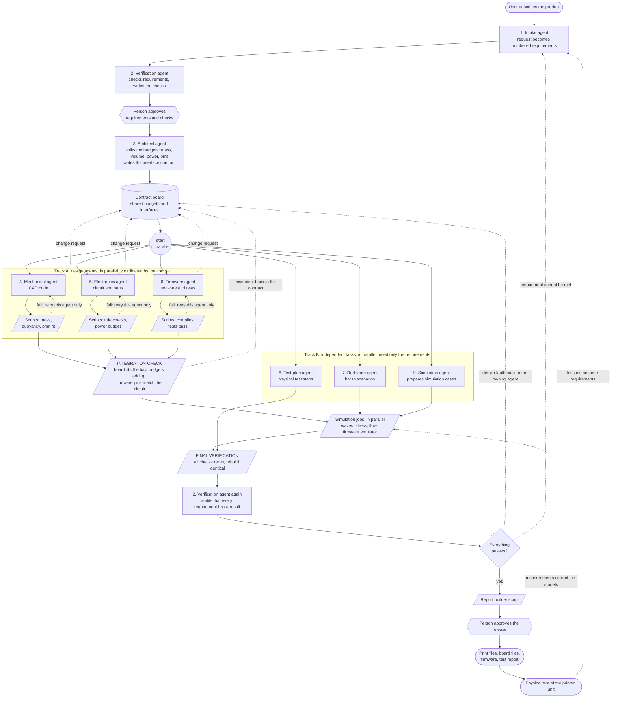
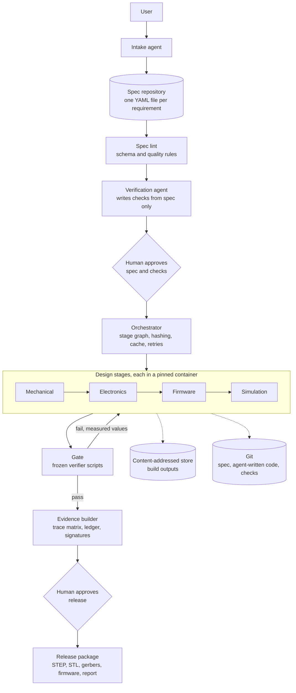
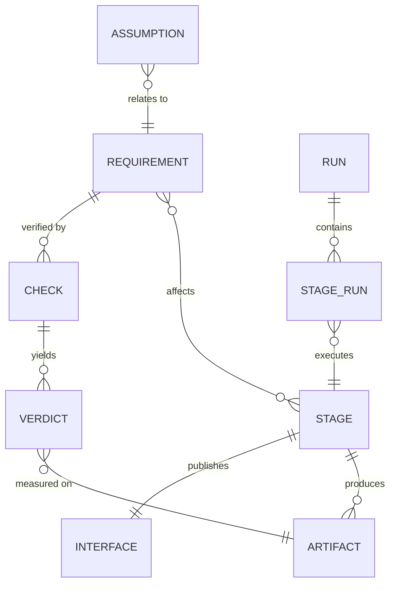
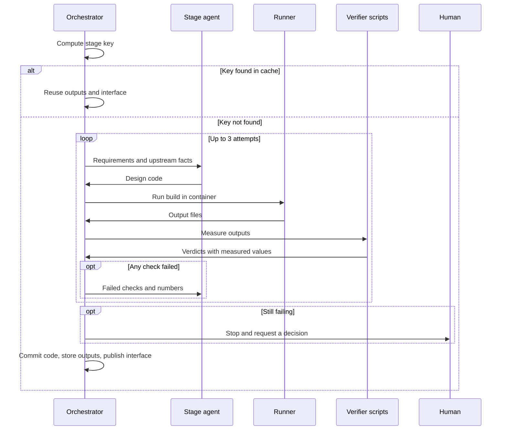
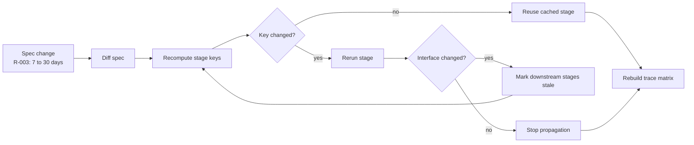
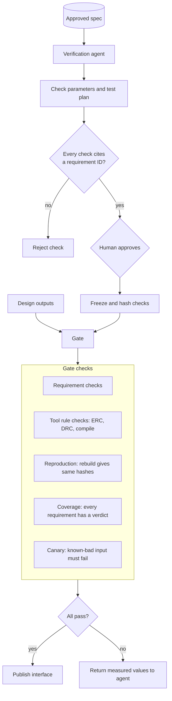
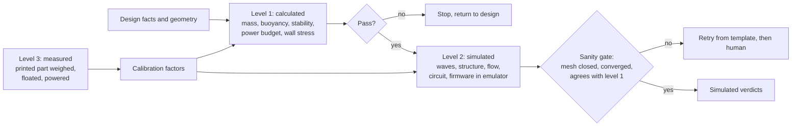
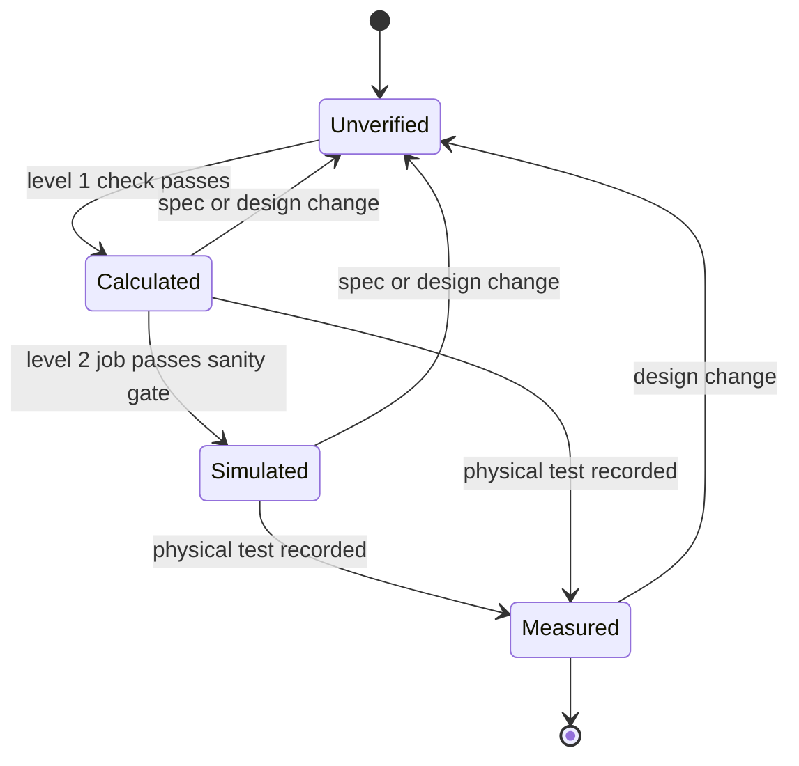
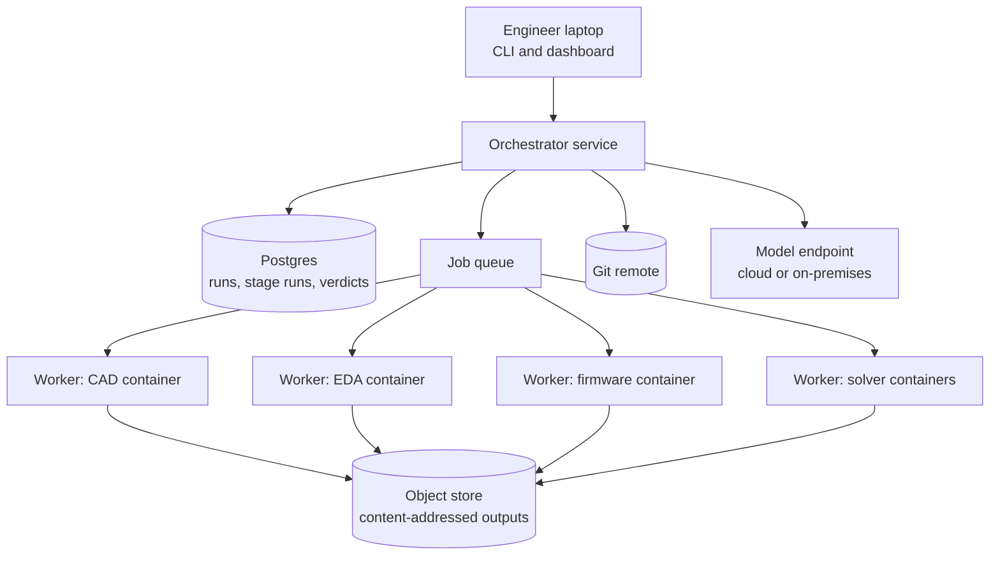

# Engenia: Technical Implementation Plan

A requirements-driven pipeline that turns a written product request into verified CAD, electronics, firmware and simulation results, and rebuilds only what a requirement change affects.

Diagrams are written in Mermaid. They render on GitHub, GitLab, and in VS Code with a Mermaid extension.

---

## How it works at a glance

Nine agents each do one job. Design agents run in parallel and coordinate through a shared contract. Independent tasks run on their own track. Scripts and people sit between them.



**How to read it**

- Rectangles are agents. They write things.
- Slanted boxes are scripts. They measure things and decide pass or fail.
- Hexagons are people. They approve.
- The cylinder is the contract board, the shared data the design agents coordinate through.
- Dotted arrows are feedback loops.

| # | Agent | One-line job | Track |
|---|---|---|---|
| 1 | Intake | Request in, requirements out | Start |
| 2 | Verification | Requirements in, checks out; audits at the end. Never sees the design | Start and end |
| 3 | Architect | Splits budgets and writes the interface contract | Start |
| 4 | Mechanical | Contract in, CAD code out | A, parallel |
| 5 | Electronics | Contract in, circuit out | A, parallel |
| 6 | Firmware | Contract in, software out | A, parallel |
| 7 | Red team | Requirements in, worst-case scenarios out | B, independent |
| 8 | Test plan | Requirements in, physical test steps out | B, independent |
| 9 | Simulation | Requirements in, simulation cases out | B, independent |

### How parallel agents coordinate

Agents do not chat with each other. Free conversation between agents is a known cause of failure. They coordinate through the contract board instead.

1. **The architect agent fixes the contract first.** It gives each design agent a budget and the interfaces between them. Example: electronics gets 60 g, a 70 x 40 x 22 mm bay and 180 mWh per day. Firmware gets a named pin map.
2. **Each design agent works only inside its budget.** Because the interfaces are agreed up front, mechanical, electronics and firmware can run at the same time.
3. **An agent that cannot fit files a change request.** Example: "electronics needs a 26 mm bay height". It keeps working on the rest of its task.
4. **The orchestrator resolves change requests.** A script checks whether the totals still fit. If yes, the contract is updated and only the agents touching that item rerun. If no, the architect agent proposes a new split, with a limit of three rounds, then a person decides.
5. **The integration check proves the parts fit together.** It runs after the parallel work and catches anything the contract missed.

### What runs when

| Group | Tasks | Depends on |
|---|---|---|
| Parallel, coordinated | Mechanical, electronics, firmware | The contract |
| Parallel, independent | Red-team scenarios, test plan, simulation case preparation | Requirements only |
| Parallel jobs | Wave, stress, flow and firmware simulations | The integrated design |
| Serial by nature | Intake, approval, contract, integration check, final verification, release | Each other |

### What happens when one agent fails

| Situation | Response |
|---|---|
| One design agent fails its checks | Only that agent retries. The others keep running and their finished work is kept |
| An agent uses up its three attempts | That branch pauses for a person. Other branches finish and are cached |
| An agent needs more budget | Change request to the contract board. Only affected agents rerun |
| Integration check finds a mismatch | Back to the contract, then only the mismatched agents rerun |
| An independent task fails | It retries alone. Design work is not affected |
| The requirements contradict each other | Full stop. This is the only case that halts everything, and it returns to intake |

**Verification happens four times**

1. **Before the process.** The verification agent checks the requirements are clear and writes the checks. A person approves both.
2. **During the process.** Scripts measure each design agent's output as soon as it finishes.
3. **At integration.** Scripts check the separately built parts fit together.
4. **At the end.** All checks are rerun on the complete design, the build is reproduced, and the verification agent audits that every requirement has a result.

**Four feedback loops**

| Loop | Trigger | Goes back to |
|---|---|---|
| Inner | A stage check fails | The same agent, with the measured numbers |
| Contract | A budget does not fit, or integration finds a mismatch | The contract board, then only the affected agents |
| Outer | Final verification fails | The owning agent through the contract, or the requirements if they cannot be met |
| Real world | Physical test results | The simulation models as corrections, and the requirements as lessons |

---

## 1. Goals and non-goals

**Goals**

- One spec file set is the single source of truth for a project.
- The same inputs always produce the same outputs.
- Pass or fail is decided by scripts, never by an AI model.
- A requirement change rebuilds only the affected stages.
- Every requirement traces to a design element, a check, a measured value and an evidence level.
- New product types are added as domain packs without changing the core.

**Non-goals**

- Building arbitrary products with no domain pack.
- Removing human approval. People approve the spec, the checks and the final design.
- Replacing physical testing. Simulation is evidence, measurement is proof.

---

## 2. Design principles

| # | Principle | Reason |
|---|---|---|
| 1 | Fixed workflow, not free-roaming agents | Predefined code paths are predictable and debuggable |
| 2 | Design as code | Text diffs, version control, repeatable builds |
| 3 | Deterministic gates after every stage | Errors compound across steps: 95% per step gives about 36% over 20 steps |
| 4 | Independent verification | Checks written from the spec alone cannot inherit the designer's misreading |
| 5 | Data files between stages, no agent chat | Removes inter-agent misalignment as a failure class |
| 6 | Sealed, hashed builds | A cache is only safe when every input is declared |
| 7 | Evidence levels on every claim | Separates calculated, simulated and measured results |

---

## 3. System architecture



### Layers

| Layer | Responsibility | Technology |
|---|---|---|
| Spec | Requirements as files, schema, lint | YAML, JSON Schema or Pydantic, git |
| Orchestration | Stage graph, hashing, cache, retries, human gates | Python; Postgres run table; Temporal later |
| Execution | Run stage commands in sealed containers | Docker or Podman, images pinned by digest |
| Agents | Write design code and simulation parameters | Direct model API calls with a small tool set |
| Verification | Checks, gate, fault injection | Python scripts, pytest |
| Simulation | Virtual prototype | Capytaine, CalculiX, OpenFOAM, ngspice, Renode |
| Evidence | Trace matrix, assumption ledger, signatures | Generated Markdown and JSON, sigstore or GPG |
| Storage | Sources and outputs | Git for text, S3 or MinIO for build outputs |

---

## 4. Repository layout

```
engenia/
  core/
    spec/            schema.py, lint.py, loader.py
    graph/           stages.py, hashing.py, cache.py
    orchestrator/    run.py, retry.py, gates.py
    runner/          container.py, local.py, cloud.py
    evidence/        matrix.py, ledger.py, sign.py
  agents/
    intake/  mechanical/  electronics/  firmware/
    simulation/  testplan/  verification/  redteam/
  verifiers/         one script per check, frozen after approval
  packs/
    buoy/            templates, pack checks, parts library, sim cases
  containers/        Dockerfiles, one per tool family
  evals/             benchmark specs, fault suite, nightly runner
  projects/
    <name>/
      spec/          R-001.yaml, R-002.yaml ...
      checks/        generated, approved, hashed
      src/           agent-written design code, committed
      build/         per stage: outputs, interface.json, verdict.json
```

---

## 5. Data model



### Requirement file

```yaml
id: R-003
statement: The unit shall operate for at least 30 days on one charge.
value: 30
unit: days
verify:
  method: analysis          # inspection | analysis | simulation | test
  check: power_budget
  limit: {min: 30}
affects: [electronics, mechanical]
classification: open
status: approved
```

### Interface file, published by a stage

```json
{
  "stage": "mechanical",
  "key": "sha256:9f2c...",
  "facts": {
    "internal_volume_cm3": 412.0,
    "battery_bay_mm": [70, 40, 22],
    "dry_mass_g": 318.4
  }
}
```

### Verdict file, written by a verifier

```json
{
  "check": "buoyancy_margin",
  "requirement": "R-005",
  "measured": 0.27,
  "limit": {"min": 0.20},
  "result": "pass",
  "evidence_level": "calculated",
  "artifact": "sha256:41ab..."
}
```

---

## 6. Stage contract

Every stage follows the same contract. This is what makes the core reusable.

| Element | Rule |
|---|---|
| Inputs | Relevant requirements, upstream interface files, pack templates |
| Agent output | Source code only, committed to a branch with a change note |
| Build | One command, run in a container with no network |
| Outputs | Declared file list, stored by content hash |
| Interface | Facts later stages need, in `interface.json` |
| Verdicts | One `verdict.json` entry per check |
| Reproduction | Rebuilding from committed source must give identical hashes |



### Stage key

```
key = sha256(
    relevant requirement files
  + upstream interface files
  + agent-written source, once committed
  + build command
  + container image digest
  + pack version
)
```

Before the agent has written code, the key covers everything except the source and decides whether generation is needed. After commit, the full key decides whether a rebuild is needed. Rebuilding from committed code never calls a model.

---

## 7. Change propagation



A stage that reruns but publishes the same interface does not trigger its downstream stages. This keeps rebuilds minimal and correct.

---

## 8. Agents

| Agent | Reads | Writes | Must not |
|---|---|---|---|
| Intake | User text, existing spec | Requirement files, spec diffs | Start a build |
| Verification | Spec only | Check parameters, test plan, coverage report | See design code, issue verdicts |
| Mechanical | Its requirements, pack templates | build123d source | Edit checks |
| Electronics | Its requirements, mechanical facts, parts library | Circuit source, facts file with datasheet page references | Use parts outside the approved list |
| Firmware | Its requirements, electronics facts | Source and unit tests | Change pin mapping facts |
| Simulation | Design facts, scenario files | Parameters for template cases | Write solver setups from scratch |
| Test plan | Spec, verdicts | Physical test procedures | Mark anything as measured |
| Red team | Spec, design facts | New scenario files | Issue verdicts |

### Harness rules

- Direct model API calls with a loop. No heavy framework until the patterns are stable.
- Tools per agent: `write_file`, `run_build`, `read_verdicts`. Nothing else.
- Verification agent uses a different model family from the design agents.
- Prompts, model name and settings are versioned and included in the run record.
- Hard limits: attempts per stage, tokens per stage, wall time per stage.

---

## 9. Verification



### Requirement quality lint

Run before anything is built. Each requirement must:

- Contain one obligation only.
- Have a number, a unit and a limit, or a named inspection.
- Use no vague terms such as "robust", "fast", "sufficient".
- Name a verification method and a check.

Unclear items go to a person. The model does not rewrite them alone.

### Fault injection suite

A set of deliberately broken designs: wall too thin, battery undersized, part too large for the print bed, an unconnected pin, firmware that misses a detection. The gate must reject every one. The suite runs on each change to the verifiers. The detection rate is reported.

---

## 10. Simulation and the virtual prototype



| Job | Checks | Tool | Runs |
|---|---|---|---|
| Hydrostatics | Buoyancy, waterline, stability | Python on CAD mass properties | Every build |
| Power | Budget, endurance | Python on parts facts | Every build |
| Wave response | Motion and tilt in waves | Capytaine | Cloud job |
| Structure | Stress from pressure and impact | CalculiX | Cloud job |
| Flow | Drag, current loads | OpenFOAM | Cloud job |
| Circuit | Voltages, current draw | ngspice | Every build |
| Firmware | Real code on a virtual chip, replayed sensor data | Renode | Cloud job |

Rules:

- Each job starts from a known-good template case in the domain pack.
- Scenarios are files: `calm_harbour.yaml`, `baltic_winter.yaml`, `storm.yaml`.
- The model is called a virtual prototype until one physical measurement has calibrated it. After that it is a digital twin of that unit.

### Evidence levels



---

## 11. Execution and infrastructure



- **Containers.** One image per tool family, referenced by digest. No network inside a build.
- **Idempotency.** Each stage run has a stable ID. A retry with the same ID never duplicates work.
- **Durability.** Run state is persisted after every stage. Start with the Postgres table. Adopt Temporal when runs last hours or span many workers.
- **Observability.** Per stage: attempts, duration, tokens, cost, cache hit, verdicts. Full prompts and tool calls are stored for replay.
- **Sovereign mode.** The model endpoint is a config value. The pipeline runs with a local open model and no outbound traffic.
- **Security.** Requirements carry a classification tag. Outputs are hashed and signed. Parts come only from an approved list with a second source.

---

## 12. Domain packs

A pack holds everything specific to one product type.

| Pack content | Example for the buoy pack |
|---|---|
| Part templates | Hull shell, lid with seal groove, battery bay, sensor mount |
| Pack checks | Buoyancy margin, seal compression, print orientation |
| Parts library | Approved microcontrollers, radios, batteries, with datasheet facts |
| Simulation templates | Capytaine float case, CalculiX pressure case |
| Scenario files | Harbour, open sea, winter |
| Printer profiles | Bed size, material, minimum wall, sealing steps |

A new project of a known type needs only a spec. A new product type needs one new pack.

---

## 13. Evaluation and reliability targets

Reliability is measured on a fixed benchmark, not asserted.

| Metric | Definition | Target |
|---|---|---|
| End-to-end pass rate | Benchmark specs that reach a full green gate without human help | Track, then raise |
| Reproducibility | Rebuilds from committed code with identical hashes | 100% |
| Fault detection | Planted defects rejected by the gate | 100% |
| Requirement coverage | Requirements with at least one verdict | 100% |
| Cache correctness | Stages rerun when an input changed, and only then | 100% |
| Attempts per stage | Mean agent attempts before pass | Falling trend |
| Simulation sanity failures | Solver runs rejected by the sanity gate | Reported per solver |

The benchmark is 10 to 20 specs across packs, run nightly. Any change to prompts, models, verifiers or containers must not lower these numbers.

---

## 14. Build phases

```mermaid
gantt
    title Build phases
    dateFormat X
    axisFormat Phase %s
    section Core
    Spec schema and lint            :a1, 0, 1
    Stage graph, keys, cache        :a2, 0, 1
    section Design
    Mechanical stage                :b1, 1, 2
    Electronics stage               :b2, 2, 3
    Firmware stage                  :b3, 3, 4
    section Verification
    Verification agent and gate     :c1, 1, 2
    Fault injection suite           :c2, 2, 3
    section Simulation
    Level 1 calculations            :d1, 1, 2
    Level 2 solvers, one at a time  :d2, 3, 5
    Calibration loop                :d3, 5, 6
    section Platform
    Evidence builder                :e1, 2, 3
    Evaluation benchmark            :e2, 4, 5
    Durable orchestration, signing  :e3, 5, 6
```



| Phase | Deliverable | Exit test |
|---|---|---|
| 0 | Spec schema, lint, stage graph with placeholder stages | Editing one requirement reruns exactly the right stages |
| 1 | Mechanical stage, verification agent, level 1 checks | A hull is generated, measured and reproduced bit for bit |
| 2 | Electronics stage, evidence builder, fault suite | Hull change resizes the battery bay and the circuit follows |
| 3 | Firmware stage, first solver | Firmware passes on the emulator; one simulated verdict |
| 4 | Remaining solvers, benchmark | Nightly benchmark reports all metrics |
| 5 | Calibration, durability, signing, on-premises model | One physical measurement updates the model; a killed run resumes |

---

## 15. Risks

| Risk | Mitigation |
|---|---|
| Agent produces invalid geometry | Closed loop with measured feedback, simple parametric templates, attempt limit |
| Checks drift toward the design | Verification agent never sees design code; checks frozen and hashed |
| Verifier invents requirements | Every check must cite a requirement ID; coverage and citation enforced by script |
| Silent solver errors | Sanity gate and cross-check against level 1 |
| Non-repeatable results | Committed agent code, pinned containers, reproduction check |
| Stale cache | Full declared-input hashing; cache correctness in the benchmark |
| Scope creep in packs | Pack interface is fixed; one pack proven before the next starts |
| Over-trust in simulation | Evidence levels shown on every result; measured level needs a recorded test |

---

## 16. Prior work to build on

| Project | Use |
|---|---|
| earthtojake/text-to-cad | build123d skill with STEP output and validation snapshots, for the mechanical stage |
| kfihihc/pcb-pipeline | Gate design with reproduction and canary checks, datasheet facts file |
| copperheadhq/copperhead | Brief-to-board flow on KiCad files |
| VibeBB/acd-agent | Board, enclosure and firmware from requirements with deterministic gates |
| eLSeR17/pcb-ai-agent | Fixed firmware templates, compile check, fully local operation |
| csml-rpi/Foam-Agent | Automated OpenFOAM cases |
| Doorstop, StrictDoc | Requirements as text files in git |

These are patterns and components. None of them covers the full chain or has published end-to-end reliability figures for it.

---

## 17. References

- Anthropic, "Building effective agents": https://anthropic.com/engineering/building-effective-agents
- Cemri et al., "Why Do Multi-Agent LLM Systems Fail?": https://arxiv.org/abs/2503.13657
- Barkley et al., "CADSmith": https://arxiv.org/abs/2603.26512
- Yue et al., "Foam-Agent": https://arxiv.org/abs/2509.18178
- Pombal et al., "Self-Preference Bias in Rubric-Based Evaluation": https://arxiv.org/abs/2604.06996
- "Towards spec-driven test automation": https://towardsdatascience.com/towards-spec-driven-test-automation-part-1/
- pcb-pipeline: https://github.com/kfihihc/pcb-pipeline
- text-to-cad: https://github.com/earthtojake/text-to-cad
- Copperhead: https://github.com/copperheadhq/copperhead
- acd-agent: https://github.com/VibeBB/acd-agent
- Foam-Agent: https://github.com/csml-rpi/Foam-Agent
